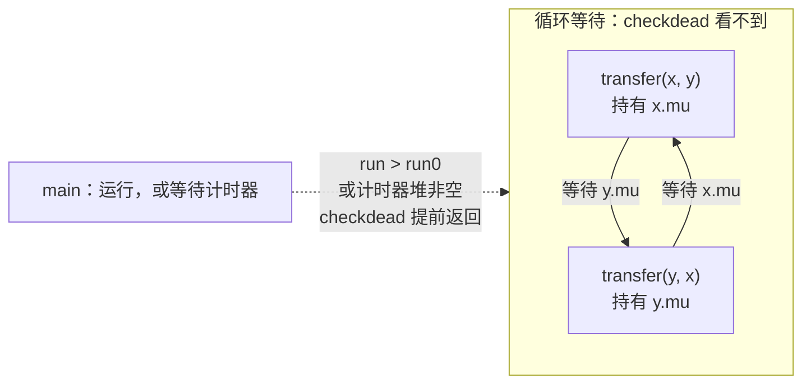

# 16.1 运行时死锁检查

`fatal error: all goroutines are asleep - deadlock!` 是 Go 程序员最早遇到的运行时错误之一。
它来自运行时内置的死锁检查，判据只有一条：没有任何线程还在运行，也没有任何事件能让某个 goroutine
重新运行。判据如此简单，是因为它只对整个程序下结论。要断言一部分 goroutine 陷入了死锁，
必须先确认这一部分之外没有谁能唤醒它们，而这需要更多的信息。

本节先剖析运行时的全局检查 `checkdead`，说明它为何可靠而不完备，以及它在结构上无法发现的局部死锁；
随后介绍三种针对局部死锁的手段：`testing/synctest` 用气泡（bubble）在测试中划出一个封闭的世界，Go 1.26 的
goroutine 泄漏剖面借垃圾回收器的可达性分析推断这种封闭性，运行时自身则以静态锁排序在死锁发生之前发现违反加
锁顺序的代码。

## 16.1.1 判据：没有运行中的线程

死锁检查由 `runtime/proc.go` 中的 `checkdead` 完成 [[Go Authors, 2026a](#ref-go-authors-2026a)]。
函数开头的注释概括了判据：检查基于正在运行的 M 的数目，数目为零即为死锁。

```go
// Check for deadlock situation.
// The check is based on number of running M's, if 0 -> deadlock.
// sched.lock must be held.
func checkdead() {
	assertLockHeld(&sched.lock)

	// For -buildmode=c-shared or -buildmode=c-archive it's OK if
	// there are no running goroutines. The calling program is
	// assumed to be running.
	// One exception is Wasm, which is single-threaded. If we are
	// in Go and all goroutines are blocked, it deadlocks.
	if (islibrary || isarchive) && GOARCH != "wasm" {
		return
	}
	// ……
	run := mcount() - sched.nmidle - sched.nmidlelocked - sched.nmsys
	if run > run0 {
		return
	}
	// ……
```

运行中的 M 由一次减法得出：M 的总数，减去空闲的 M（`nmidle`）、因锁定线程而空闲的 M（`nmidlelocked`）以及
不参与判定的系统 M（`nmsys`，即 sysmon 与模板线程）。差值大于 `run0`，说明还有线程在执行，它可能让某个
goroutine 重新就绪，检查随即返回。`run0` 通常为零；不使用 cgo 的程序若持有额外的 M（Windows 上
`syscall.NewCallback` 创建的回调需要它），则取 1。作为 c-shared 或 c-archive 库构建时，宿主程序仍在运行，
没有 goroutine 运行属于正常；wasm 是单线程的，不在此列。省略的部分还有一项豁免：程序正因 panic 而终止时，
`freezetheworld` 会使其余线程全部阻塞，此时不应报告死锁。

差值为零时，所有用户 goroutine 都应处于阻塞状态，`checkdead` 遍历全部 goroutine 加以确认：

```go
	grunning := 0
	forEachG(func(gp *g) {
		if isSystemGoroutine(gp, false) {
			return
		}
		s := readgstatus(gp)
		switch s &^ _Gscan {
		case _Gwaiting,
			_Gpreempted:
			grunning++
		case _Grunnable,
			_Grunning,
			_Gsyscall:
			print("runtime: checkdead: find g ", gp.goid, " in status ", s, "\n")
			unlock(&sched.lock)
			throw("checkdead: runnable g")
		}
	})
	if grunning == 0 { // possible if main goroutine calls runtime·Goexit()
		unlock(&sched.lock) // unlock so that GODEBUG=scheddetail=1 doesn't hang
		fatal("no goroutines (main called runtime.Goexit) - deadlock!")
	}
	// ……
	// There are no goroutines running, so we can look at the P's.
	for _, pp := range allp {
		if len(pp.timers.heap) > 0 {
			return
		}
	}

	unlock(&sched.lock) // unlock so that GODEBUG=scheddetail=1 doesn't hang
	fatal("all goroutines are asleep - deadlock!")
}
```

入口函数位于 `runtime` 包的系统 goroutine（`runtime.main` 除外）不计入；处于 `_Gwaiting` 或 `_Gpreempted`
的 goroutine 计为阻塞；若发现可运行、运行中或处于系统调用中的 goroutine，说明计数与状态相互矛盾，
这是运行时自身的缺陷，以 `throw` 终止。一个阻塞的用户 goroutine 也没有时，通常是主 goroutine 调用了
`runtime.Goexit`，报告的是另一条消息。

最后一道检查针对计时器。所有 goroutine 都阻塞，并不意味着它们永远阻塞：只要某个 P 的计时器堆中还有计时器，
它到期时就会唤醒某个 goroutine，例如处于 `time.Sleep` 中的那个。只有所有计时器堆都为空，`checkdead` 才报告
死锁。Go Playground 使用伪时间，省略的部分会在这里把时钟直接拨到下一个计时器的到期时刻，而不报告死锁。

`checkdead` 不做定时轮询。它在 M 转入空闲、被锁定的 M 转入空闲、M 退出以及 sysmon
与模板线程启动时被调用（[9.8](../../part3concurrency/ch09sched/sysmon.md)），因此最后一个线程停下的时刻，
就是检查发生的时刻。下面的程序是一个典型的全局死锁：主 goroutine 在 `wg.Wait()` 中等待发送方结束，
发送方却在等待一个尚未开始的接收。

```go {run=true}
package main

import (
	"fmt"
	"sync"
)

func main() {
	results := make(chan int) // 无缓冲通道
	var wg sync.WaitGroup
	for i := range 3 {
		wg.Add(1)
		go func() {
			defer wg.Done()
			results <- i * i // 尚无接收方，发送阻塞
		}()
	}
	wg.Wait() // 等发送方结束，而发送方在等接收方
	close(results)
	for r := range results {
		fmt.Println(r)
	}
}
```

输出的第一行即为死锁报告，其后是各 goroutine 的栈：主 goroutine 停在 `sync.WaitGroup.Wait`，三个发送方停在
`chan send`。

这条判据几乎与 Go 的运行时同龄。2008 年 8 月，Russ Cox 首次为运行时加入多线程支持，调度器在等待的 M
数等于 M 的总数时打印这条消息，然后照常进入睡眠 [[Cox, 2008](#ref-cox-2008)]。Go 1.1
的调度器重写把它整理为 `checkdead`，判据同样是 M 的总数减去空闲的 M、锁定的 M 与 sysmon
[[Vyukov, 2013](#ref-vyukov-2013)]，此后的修改只是补充豁免与计数项。

## 16.1.2 可靠而不完备

Coffman、Elphick 与 Shoshani 在 1971 年的综述中给出了死锁的四个必要条件：互斥、持有并等待、
不可抢占与循环等待；检测死锁的经典方法是维护一张等待图（wait-for graph），在其中寻找环
[[Coffman et al., 1971](#ref-coffman-et-al-1971)]。等待图的每条边回答同一个问题：谁在等谁。
对带有所有者的锁，这个问题有确定的答案。JVM 的 `jstack` 在转储线程栈的同时进行死锁检测，报告「线程 A
等待的监视器由线程 B 持有」这样的环 [[Oracle, n.d.a](#ref-oracle-nda)]；
`ThreadMXBean.findDeadlockedThreads` 查找的同样是「环中每个线程持有一把锁，又在请求另一个线程已持有的锁」
的情形，其文档还注明，它不查找包含虚拟线程的环 [[Oracle, 2023](#ref-oracle-2023)]。InnoDB
在事务的锁等待上检测死锁，发现后回滚一个或几个事务以打破环，并尽量选择较小的事务
[[Oracle, n.d.b](#ref-oracle-ndb)]。

Go 的同步原语提供不了这样的边。`sync.Mutex` 的文档写明，已加锁的 Mutex 不与特定的 goroutine 关联，
允许一个 goroutine 加锁，再安排另一个 goroutine 解锁 [[Go Authors, 2026c](#ref-go-authors-2026c)]；
阻塞在通道接收上的 goroutine，等待的是将来任意一个发送方，而不是某个确定的 goroutine。没有所有者，
就画不出「谁在等谁」的边。`checkdead` 因此不问每个 goroutine 在等什么，只问整个程序是否还可能前进。

这样的判据有确定的逻辑性质。记 $D$ 为「程序陷入了全局死锁」，$R$ 为「`checkdead` 报告死锁」，则

$$
R \Rightarrow D, \qquad D \not\Rightarrow R.
$$

前者是**可靠性**（soundness），即报告必为真：线程全部停下、计时器堆全部为空时，没有任何执行流能让阻塞的
goroutine 就绪，前述几项豁免则排除了宿主程序仍在运行、程序正在终止等不应下结论的情形。后者是
**不完备性**（incompleteness），即真实存在的死锁未必被报告：只要程序中还有一个线程在运行，`run > run0`
便成立，检查在看到任何 goroutine 之前就已返回。

## 16.1.3 局部死锁

不完备性最典型的后果是局部死锁：一部分 goroutine 相互等待，另一部分照常运行。下面的程序中，两次方向相反的
转账各自先锁住转出账户，再请求转入账户的锁，形成 AB-BA 式的循环等待；主 goroutine 则继续工作，最后用
`TryLock` 检查两把锁的状态。

```go {run=true}
package main

import (
	"fmt"
	"sync"
	"time"
)

type account struct {
	mu      sync.Mutex
	balance int
}

func transfer(from, to *account, amount int) {
	from.mu.Lock()
	defer from.mu.Unlock()
	time.Sleep(time.Millisecond) // 拉开时间窗口，让反向转账先拿到另一把锁
	to.mu.Lock()
	defer to.mu.Unlock()
	from.balance -= amount
	to.balance += amount
}

func main() {
	x, y := &account{balance: 100}, &account{balance: 100}
	go transfer(x, y, 10)
	go transfer(y, x, 20)

	for i := range 3 { // 主 goroutine 照常工作
		time.Sleep(10 * time.Millisecond)
		fmt.Println("tick", i)
	}
	fmt.Println("x 可加锁:", x.mu.TryLock(), "y 可加锁:", y.mu.TryLock())
}
```

程序正常退出，没有任何死锁报告；最后一行表明两把锁始终被持有，两个转账 goroutine 永远不会返回。主
goroutine 要么在运行，要么在 `time.Sleep` 中等待计时器，前者使运行中的 M 不为零，后者使计时器堆不为空，
两种情况下 `checkdead` 都提前返回。同样的缺陷出现在长期运行的服务中，症状便是部分请求挂起、
它们持有的资源不再释放，而进程本身一切正常。



另一类不被报告的情形是等待外部事件。网络轮询器中存在等待者时，`findRunnable` 在找不到工作后不会让最后一个
M 转入空闲，而是让它阻塞在 `netpoll` 中，直到有事件就绪或计时器到期
[[Go Authors, 2026a](#ref-go-authors-2026a)]（[9.9](../../part3concurrency/ch09sched/poller.md)）。
接收信号的 goroutine 也是如此：`os/signal` 的接收循环在 `signal_recv` 中经 `notetsleepg` 等待，后者先调用
`entersyscallblock`，所在的 M 因而处于系统调用之中 [[Go Authors, 2026h](#ref-go-authors-2026h)]。
对一个只等待 `SIGINT` 的程序，这是正确的行为：信号来自进程之外，运行时无从断定它不会到来。由此可见，
「不会再前进」只能相对于一个封闭的世界而言；进程对外部开放，运行时便只能在确知没有外部事件可等时下结论。

## 16.1.4 划定封闭世界：synctest 的气泡

要对一部分 goroutine 断言死锁，就需要一个更小的封闭世界。Go 1.24 以实验形式（`GOEXPERIMENT=synctest`）
引入 `testing/synctest` [[Go Authors, 2025a](#ref-go-authors-2025a)]，Go 1.25 将其转为正式功能，入口改为
`synctest.Test` [[Go Authors, 2025b](#ref-go-authors-2025b)]。`Test` 在一个隔离的气泡中运行测试函数，
气泡内启动的 goroutine 都属于这个气泡；在气泡内创建的通道、`time.Timer` 与 `time.Ticker` 与之关联，
从气泡外操作它们会引发 panic [[Go Authors, 2026d](#ref-go-authors-2026d)]。

隔离使气泡能够定义**持久阻塞**（durably blocked）：一个 goroutine 处于阻塞，并且只能由同一气泡内的
goroutine 解除阻塞。在气泡内创建的通道上收发、各分支都是气泡内通道的 `select`、`sync.Cond.Wait`、
在气泡内调用过 `Add` 的 `sync.WaitGroup.Wait` 以及 `time.Sleep` 属于持久阻塞；对 `sync.Mutex` 加锁、网络
I/O 与系统调用则不是，因为解除它们的事件可能来自气泡之外 [[Go Authors, 2026d](#ref-go-authors-2026d)]。
气泡内所有 goroutine 都持久阻塞时，若有 goroutine 在 `synctest.Wait` 中等待，`Wait` 返回；否则，若根
goroutine 尚未退出，且存在某个能唤醒至少一个 goroutine 的时刻，气泡的伪时钟直接拨到该时刻；两者都不成立，
即为死锁，`Test` 引发 panic。这是 `checkdead` 的判据在一个子集上的翻版，
隔离保证了这个子集之外没有谁能唤醒其中的 goroutine。panic 的消息区分两种情形：根 goroutine 仍在阻塞时为
`deadlock: all goroutines in bubble are blocked`，根 goroutine 已经退出、仍有 goroutine 阻塞时为
`deadlock: main bubble goroutine has exited but blocked goroutines remain`
[[Go Authors, 2026d](#ref-go-authors-2026d)]。

第二种情形可以直接用来发现泄漏。下面的 `first` 并发查询多个后端，只取最先返回的结果；结果通道没有缓冲，
落选的后端将永远阻塞在发送上。

```go
package st

import (
	"testing"
	"testing/synctest"
	"time"
)

func first(backends ...func() int) int {
	c := make(chan int)
	for _, b := range backends {
		go func() { c <- b() }()
	}
	return <-c
}

func TestFirst(t *testing.T) {
	synctest.Test(t, func(t *testing.T) {
		fast := func() int { return 1 }
		slow := func() int { time.Sleep(time.Second); return 2 }
		if got := first(fast, slow); got != 1 {
			t.Fatalf("first = %d, want 1", got)
		}
	})
}
```

以 Go 1.26.10 运行，输出有删节：

```shell
$ go test
--- FAIL: TestFirst (0.00s)
panic: deadlock: main bubble goroutine has exited but blocked goroutines remain [recovered, repanicked]
……
goroutine 8 [sleep (durable), synctest bubble 1]:
time.Sleep(0x3b9aca00)
……
st.first.func1()
	first_test.go:12 +0x28
created by st.first in goroutine 6
……
```

`fast` 返回后根 goroutine 随即退出，气泡的时钟随之停止，处于 `time.Sleep` 中的 `slow` 再也等不到到期，
测试当场失败，并指出了泄漏的 goroutine 由 `first` 创建。在真实时间中，这个 goroutine 一秒后醒来，
随即阻塞在发送上，成为又一个局部死锁。

## 16.1.5 借助可达性：goroutine 泄漏剖面

synctest 的封闭世界是在测试中人为划定的。对生产环境中运行的程序，Go 1.26 以实验形式加入了 `goroutineleak`
剖面（构建时设置 `GOEXPERIMENT=goroutineleakprofile`），Go 1.27 把它转为正式功能
[[Go Authors, 2026e](#ref-go-authors-2026e); [Go Authors, 2026f](#ref-go-authors-2026f)]。
它以垃圾回收器的可达性代替等待图：若 goroutine G 阻塞在同步原语 P 上，而 P 对任何可运行的 goroutine、
以及这些 goroutine 可能唤醒的 goroutine 都不可达，那么 P 不可能再被操作，G 永远不会醒来
[[Go Authors, 2026e](#ref-go-authors-2026e)]。这一判据无须知道谁持有锁、谁会发送，只依赖一个朴素的事实：
能够解除 G 阻塞的 goroutine，必定能够访问 P。检测在一次特殊的垃圾回收中进行，初始的根只包括可能运行的
goroutine，阻塞 goroutine 的栈随其等待的原语被标记而逐步加入，直至不动点
[[Saioc and Chabbi, 2025](#ref-saioc-and-chabbi-2025)]；运行时的实现见
[9.3](../../part3concurrency/ch09sched/mpg.md)，理论基础见 Saioc 等人的论文
[[Saioc et al., 2025](#ref-saioc-et-al-2025)]，实现随 Go 1.26 合入 [[Saioc, 2025](#ref-saioc-2025)]。

把 16.1.3 的转账程序稍作改动，同时制造两组 AB-BA：一组在包级变量 `x`、`y` 之间，另一组在两个堆上分配、随后
不再被 `main` 引用的账户之间。

```go
package main

import (
	"os"
	"runtime/pprof"
	"sync"
	"time"
)

type account struct {
	mu      sync.Mutex
	balance [4]int64
}

var x, y account // 包级变量：不在堆上

func transfer(from, to *account) {
	from.mu.Lock()
	time.Sleep(time.Millisecond)
	to.mu.Lock()
	to.mu.Unlock()
	from.mu.Unlock()
}

func main() {
	go transfer(&x, &y) // 包级变量之间的 AB-BA
	go transfer(&y, &x)
	a, b := new(account), new(account) // 堆上的账户
	go transfer(a, b)
	go transfer(b, a)
	a, b = nil, nil // main 此后不再引用它们
	time.Sleep(50 * time.Millisecond)
	pprof.Lookup("goroutineleak").WriteTo(os.Stdout, 1)
}
```

以 Go 1.26.10 运行，输出删去了地址与路径前缀：

```shell
$ GOEXPERIMENT=goroutineleakprofile go run .
goroutineleak profile: total 2
2 @ ……
#  internal/sync.runtime_SemacquireMutex+0x27  runtime/sema.go:95
#  internal/sync.(*Mutex).lockSlow+0x16f       internal/sync/mutex.go:149
#  internal/sync.(*Mutex).Lock+0xcf            internal/sync/mutex.go:70
#  sync.(*Mutex).Lock+0x84                     sync/mutex.go:46
#  main.transfer+0x7c                          main.go:20
```

不设置这个实验时，`pprof.Lookup("goroutineleak")` 返回 `nil`。剖面只报告了两个 goroutine，栈指向
`transfer` 中的第二次加锁，对应堆上的那一组。包级变量不在堆上，判断原语是否已被标记的
`isMarkedOrNotInHeap` 对它们总是返回真，等待它们的 goroutine 因而始终被视为可能运行
[[Go Authors, 2026b](#ref-go-authors-2026b)]。这正是发布说明指出的局限：若原语可经全局变量或可运行
goroutine 的局部变量到达，相应的泄漏便无法识别 [[Go Authors, 2026e](#ref-go-authors-2026e)]。`account`
中的 `balance` 数组也并非装饰：不含指针且小于 16 字节的对象由微对象分配器与其他对象合用一个块
（[12.6](../../part4memory/ch12alloc/tinyalloc.md)），而每一轮标记都会把各 P
当前使用的微对象块直接标灰（`gcMarkTinyAllocs`），其中的锁因此总是可达。

反过来，剖面报告的每个 goroutine 都确实无法再被唤醒，设计文档称这一方法在理论上是可靠的，没有误报
[[Saioc and Chabbi, 2025](#ref-saioc-and-chabbi-2025)]。它与 `checkdead` 同样可靠而不完备，
区别在于把封闭的世界从整个进程缩小为「从可能运行的 goroutine 出发不可达的那部分内存」。

## 16.1.6 预防：运行时的静态锁排序

以上手段都要等死锁发生之后才能发现它。对运行时自身的锁，Go 还有一种预防性的检查。Go 1.15
加入的静态锁排序（以 `GOEXPERIMENT=staticlockranking` 启用）为运行时中的每把锁指定一个等级，等级图记录在
`mklockrank.go` 中，由它生成 `lockrank.go`；图中的 `sched < allg, allp;` 表示同时持有时必须先获取
`sched`，持有 `allg` 时便不能再获取 `sched` [[Go Authors, 2026g](#ref-go-authors-2026g)]。启用检查后，
每次加锁时 `checkRanks` 比较新锁与当前持有的最后一把锁：新锁的等级不得更低；
新锁若不是叶子锁（未指定等级的锁都按叶子锁处理），后者还必须出现在新锁等级的偏序表中，
即被明确允许先于新锁持有。违反任何一条，都以 `lock ordering problem` 终止
[[Go Authors, 2026g](#ref-go-authors-2026g)]。

提交说明指出了这种检查的特点：违反顺序既可能意味着死锁已经发生，也可能只是潜在死锁的一侧刚刚出现；
只要顺序得到遵守，加锁顺序导致的死锁就不会发生 [[Scales, 2020](#ref-scales-2020)]。按 Coffman
等人的四个条件来看，它消除的是循环等待，因此不必等两个方向真的交错就能发现问题。开发这项检查的过程中，
就发现了新计时器代码中的一处死锁和另外两处潜在死锁 [[Scales, 2020](#ref-scales-2020)]。
等级图同时成了运行时加锁顺序的文档。

这项检查只覆盖运行时内部的锁，用户代码没有对应的工具。用户代码中的预防仍依赖约定：
对同一组锁始终按一致的顺序加锁（[11.2](../../part3concurrency/ch11sync/mutex.md)），
为可能永久阻塞的操作设置超时或取消（[11.8](../../part3concurrency/ch11sync/context.md)）。死锁已经发生时，
goroutine 剖面列出每个 goroutine 的栈与阻塞原因，是定位问题的起点
[[Go Authors, n.d.](#ref-go-authors-nd)]（[16.5](./perf.md)）。

## 16.1.7 小结

| 手段 | 范围 | 判据 | 可用性 |
|:-----|:-----|:-----|:-------|
| `checkdead` | 整个进程 | 没有运行中的 M，计时器堆全部为空 | 始终开启 |
| `synctest` 气泡 | 气泡内的 goroutine | 全部持久阻塞，且时钟无法推进 | 测试中；Go 1.25 正式 |
| `goroutineleak` 剖面 | 任意一组 goroutine | 所等待的原语对可能运行的 goroutine 不可达 | 按需触发；Go 1.26 实验，Go 1.27 正式 |
| 静态锁排序 | 运行时内部的锁 | 加锁顺序违反等级图 | 运行时开发；`GOEXPERIMENT=staticlockranking` |

四种手段的区别，在于它们如何确认「没有谁能唤醒这些 goroutine」：`checkdead` 要求整个进程停下，synctest
以隔离划出气泡，泄漏剖面依据内存的可达性加以推断，静态锁排序则不等死锁发生。前三者都可靠而不完备，
看到死锁报告意味着问题确实存在，看不到报告却不能说明程序没有死锁。

## 延伸阅读

- <a id="ref-coffman-et-al-1971"></a>[Coffman et al., 1971] E. G. Coffman, M. Elphick, A. Shoshani.
  *System Deadlocks.* ACM Computing Surveys, 3(2):67–78, 1971.
  https://dl.acm.org/doi/10.1145/356586.356588
  死锁的四个必要条件与等待图检测的经典框架。
- <a id="ref-cox-2008"></a>[Cox, 2008] Russ Cox. first cut at multithreading. works on Linux. Go commit
  d28acc42ec, 2008. https://github.com/golang/go/commit/d28acc42ec0f8dff9471e4663cfe55aa5da86656
  调度器在全部 M 都等待时打印 `all goroutines are asleep - deadlock!`。
- <a id="ref-go-authors-nd"></a>[Go Authors, n.d.] The Go Authors. *Diagnostics.*
  https://go.dev/doc/diagnostics
  goroutine 剖面等诊断手段。
- <a id="ref-go-authors-2025a"></a>[Go Authors, 2025a] The Go Authors. *Go 1.24 Release Notes.* 2025.
  https://go.dev/doc/go1.24
  实验性的 `testing/synctest`（`GOEXPERIMENT=synctest`）。
- <a id="ref-go-authors-2025b"></a>[Go Authors, 2025b] The Go Authors. *Go 1.25 Release Notes.* 2025.
  https://go.dev/doc/go1.25
  `testing/synctest` 转为正式功能。
- <a id="ref-go-authors-2026a"></a>[Go Authors, 2026a] The Go Authors. src/runtime/proc.go：`checkdead`、
  `findRunnable`. Go 1.26 源码.
  https://github.com/golang/go/blob/release-branch.go1.26/src/runtime/proc.go
- <a id="ref-go-authors-2026b"></a>[Go Authors, 2026b] The Go Authors.
  src/runtime/mgc.go：`isMaybeRunnable`、`findGoroutineLeaks`. Go 1.26 源码.
  https://github.com/golang/go/blob/release-branch.go1.26/src/runtime/mgc.go
- <a id="ref-go-authors-2026c"></a>[Go Authors, 2026c] The Go Authors. src/sync/mutex.go. Go 1.26 源码.
  https://github.com/golang/go/blob/release-branch.go1.26/src/sync/mutex.go
- <a id="ref-go-authors-2026d"></a>[Go Authors, 2026d] The Go Authors. src/testing/synctest/synctest.go 与
  src/runtime/synctest.go. Go 1.26 源码.
  https://github.com/golang/go/blob/release-branch.go1.26/src/testing/synctest/synctest.go
  持久阻塞的定义与气泡死锁的两种 panic。
- <a id="ref-go-authors-2026e"></a>[Go Authors, 2026e] The Go Authors. *Go 1.26 Release Notes.* 2026.
  https://go.dev/doc/go1.26
  实验性的 `goroutineleak` 剖面。
- <a id="ref-go-authors-2026f"></a>[Go Authors, 2026f] The Go Authors. *Go 1.27 Release Notes.* 2026.
  https://go.dev/doc/go1.27
  `goroutineleak` 剖面转为正式功能。
- <a id="ref-go-authors-2026g"></a>[Go Authors, 2026g] The Go Authors. src/runtime/mklockrank.go 与
  src/runtime/lockrank_on.go. Go 1.26 源码.
  https://github.com/golang/go/blob/release-branch.go1.26/src/runtime/mklockrank.go
- <a id="ref-go-authors-2026h"></a>[Go Authors, 2026h] The Go Authors. src/runtime/sigqueue.go：
  `signal_recv`. Go 1.26 源码.
  https://github.com/golang/go/blob/release-branch.go1.26/src/runtime/sigqueue.go
- <a id="ref-oracle-nda"></a>[Oracle, n.d.a] Oracle. *Java Platform, Standard Edition Troubleshooting
  Guide.* https://docs.oracle.com/javase/8/docs/technotes/guides/troubleshoot/
  `jstack` 线程转储中的死锁检测，锁等待图式检测的对照。
- <a id="ref-oracle-ndb"></a>[Oracle, n.d.b] Oracle. *MySQL Reference Manual: Deadlock Detection.*
  https://dev.mysql.com/doc/refman/8.0/en/innodb-deadlock-detection.html
  InnoDB 的锁等待检测与回滚牺牲者事务。
- <a id="ref-oracle-2023"></a>[Oracle, 2023] Oracle. *Java SE 21 API: Interface ThreadMXBean.* 2023.
  https://docs.oracle.com/en/java/javase/21/docs/api/java.management/java/lang/management/ThreadMXBean.html
  `findDeadlockedThreads` 查找监视器与可拥有同步器上的死锁环，不含虚拟线程。
- <a id="ref-saioc-2025"></a>[Saioc, 2025] Vlad Saioc. runtime,net/http/pprof: goroutine leak detection by
  using the garbage collector. Go commit 8c68a1c1ab, 2025. https://go.dev/cl/688335
  随 Go 1.26 发布（`GOEXPERIMENT=goroutineleakprofile`）。
- <a id="ref-saioc-and-chabbi-2025"></a>[Saioc and Chabbi, 2025] Georgian-Vlad Saioc and Milind Chabbi.
  Proposal: Goroutine leak detection via garbage collection. Go design document, 2025-08-14.
  https://go.dev/design/74609-goroutine-leak-detection-gc
- <a id="ref-saioc-et-al-2025"></a>[Saioc et al., 2025] Georgian-Vlad Saioc, I-Ting Angelina Lee, Anders
  Møller, and Milind Chabbi. Dynamic Partial Deadlock Detection and Recovery via Garbage Collection. In
  *Proceedings of the 30th ACM International Conference on Architectural Support for Programming Languages
  and Operating Systems (ASPLOS '25), Volume 2*, 244–259, 2025. https://doi.org/10.1145/3676641.3715990
- <a id="ref-scales-2020"></a>[Scales, 2020] Dan Scales. runtime: static lock ranking for the runtime
  (enabled by GOEXPERIMENT). Go commit 0a820007e7, 2020. https://go.dev/cl/207619
  随 Go 1.15 发布。
- <a id="ref-vyukov-2013"></a>[Vyukov, 2013] Dmitriy Vyukov. runtime: improved scheduler. Go commit
  779c45a507, 2013. https://golang.org/cl/7314062
  随 Go 1.1 发布。
- 本书 [9.3 MPG 模型与并发调度单元](../../part3concurrency/ch09sched/mpg.md)、
  [9.8 系统监控](../../part3concurrency/ch09sched/sysmon.md)、
  [9.9 网络轮询器](../../part3concurrency/ch09sched/poller.md)、
  [11.2 互斥锁](../../part3concurrency/ch11sync/mutex.md)、
  [11.8 上下文](../../part3concurrency/ch11sync/context.md)（用超时预防永久阻塞）、
  [16.3 性能追踪](./trace.md)、[16.5 基准测试与性能剖析](./perf.md)（用 goroutine 剖面定位局部死锁）。
