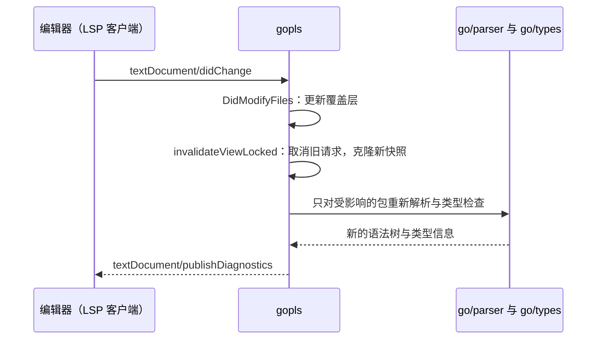

# 16.7 语言服务协议

编辑器中的自动补全、跳转到定义、实时诊断与重命名，在 Go 中由 **`gopls`**（Go language server，读作「go
please」）提供，它与编辑器之间的通信遵循**语言服务协议**（Language Server Protocol，LSP）。本节依次讨论
LSP 要解决的问题与协议的设计，gopls 产生的背景，它如何在常驻进程中维护对工程的一致理解，以及 v0.12
如何借用分离编译的思想控制内存，最后与其他语言的服务器作对照。

## 16.7.1 LSP：从 M × N 到 M + N

要让 M 个编辑器都支持 N 种语言的语义功能，最直接的做法是为每一对「编辑器与语言」单独编写集成，共需 M × N
套实现，语言语义的每次变化都要在 M 个编辑器中分别跟进。2016 年 6 月 27 日，Visual Studio Code
团队公布了语言服务协议，同时宣布与 Red Hat、Codenvy 合作推动它成为开放的标准
[[VS Code Team, 2016](#ref-vs-code-team-2016); [Wikipedia, n.d.](#ref-wikipedia-nd)]。
协议把语义分析放进一个独立的进程，即语言服务器；编辑器作为客户端，通过标准输入输出或套接字与它通信。
每种语言只需实现一个服务器，每个编辑器只需实现一个客户端，M × N 由此变为 M + N。

协议建立在 JSON-RPC 之上，消息分为三类：客户端发出请求并等待响应，以及不需要回复的单向通知
[[Microsoft, n.d.](#ref-microsoft-nd)]。协议有意只使用编辑器本来就理解的数据类型：文档以 URI 标识，
位置以从零开始的行号与列偏移表示，不涉及任何语言的语法树或符号表。例如，光标停在 `main.go` 第 4 行第 13
列的标识符上时，「跳转到定义」的请求与响应如下：

```json
{ "jsonrpc": "2.0", "id": 1, "method": "textDocument/definition",
  "params": {
    "textDocument": { "uri": "file:///app/main.go" },
    "position":     { "line": 3, "character": 12 } } }

{ "jsonrpc": "2.0", "id": 1,
  "result": {
    "uri":   "file:///app/user/user.go",
    "range": { "start": { "line": 12, "character": 5 },
               "end":   { "line": 12, "character": 9 } } } }
```

列偏移的单位是一处有代表性的细节。3.17 版之前，列偏移一律按 UTF-16 编码单元计算；3.17 版起，
双方可以协商其他编码，但 UTF-16 仍是唯一必须支持的一种 [[Microsoft, n.d.](#ref-microsoft-nd)]。Go
的字符串是 UTF-8，`go/token` 记录的是字节偏移，gopls 因此要在两种坐标之间换算，`protocol.Mapper`
负责这项工作 [[Go Authors, 2026a](#ref-go-authors-2026a)]。

诊断的方向与查询相反：服务器分析完成后，以 `textDocument/publishDiagnostics` 通知主动推送错误与警告。
编辑器则以 `textDocument/didOpen`、`textDocument/didChange` 等通知告知服务器文件的打开与修改，
服务器据此维护文件的当前内容，包括尚未保存的修改。连接建立时，双方在 `initialize`
请求中交换各自支持的能力（capabilities）。能力协商使协议可以逐步扩充：
一端支持某项新功能而另一端尚不支持时，双方按协商结果各自降级。协议因此得以从最初的少数几个方法，
扩充为今天 3.18 版中涵盖语义高亮、内联提示、调用层级等数十类交互的规范，而客户端与服务器不必同时升级。

## 16.7.2 gopls 的由来

gopls 出现之前，Go 的编辑器支持由一批各自独立的命令行工具拼成：补全用 gocode，跳转用 godef，查询用 guru，
重命名用 gorename。gopls 的设计文档记录了当时的局面：VS Code 的 Go 扩展为支持已有的功能安装了
24 个命令行工具；统计所有编辑器中需要迁移到模块模式的工具，共有 63 个；这些工具每次调用都要重新处理代码，
几乎没有一个能在 100 ms 内返回结果 [[Go Authors, 2019](#ref-go-authors-2019)]。Go 1.11 引入模块之后，
这些按 GOPATH 布局查找代码的工具都需要迁移，Rebecca Stambler 在 GopherCon 2019 的主题演讲「Go, please
stop breaking my editor!」中讲述了这段经历与 gopls 的应对 [[Stambler, 2019](#ref-stambler-2019)]。

gopls 始于 2018 年 [[Findley and Donovan, 2023](#ref-findley-and-donovan-2023)]。
设计文档以人机交互的研究为依据定下延迟目标：对用户连续操作的直接反馈需要在 100 ms 以内才不被察觉，超过
200 ms 就会令人烦躁，因此用户打字时发生的一切，目标都是 100 ms 以内。文档同时指出了最大的障碍：`go/token`、`go/ast`
与 `go/types` 这些基础库是为类似编译器的应用设计的，更关心吞吐量而不是内存，
数据结构的设计是先增长、在程序退出时整体丢弃；它们在源码有错误时也不打算继续工作，更没有增量修改的能力
[[Go Authors, 2019](#ref-go-authors-2019)]。编辑中的代码几乎总是有错误的，而且每次按键只改动一处。gopls
要做的，就是在这些面向一次性编译的库之上，建立一个常驻的、容错的、增量的系统。设计文档后来补写的前言说明，
它的前两项目标已经实现：gopls 完整实现了 LSP，并成为 VS Code Go 扩展与许多其他编辑器的默认后端。

## 16.7.3 建立在 go/parser 与 go/types 之上

gopls 并没有另写一套语义分析。它通过 `go/packages` 调用 `go list` 取得包的元数据，即每个包由哪些文件组成、
依赖哪些包、采用哪些构建设置 [[Go Authors, 2024](#ref-go-authors-2024)]；再用 `go/parser`
解析源码（[15.1](../ch15compile/parse.md)），用 `go/types` 做类型检查
（[8.3](../../part2lang/ch08generics/checker.md)）。类型检查器在检查的同时记录每个标识符定义或引用了哪个对
象，这就是跳转、查找引用与重命名所需的全部原料 [[Go Authors, 2026b](#ref-go-authors-2026b)]：

```go
fset := token.NewFileSet()
f, _ := parser.ParseFile(fset, "main.go", src, parser.AllErrors) // 源码 → 语法树
info := &types.Info{
	Defs: map[*ast.Ident]types.Object{}, // 标识符定义了哪个对象
	Uses: map[*ast.Ident]types.Object{}, // 标识符引用了哪个对象
}
conf := types.Config{Importer: importer.Default()}
pkg, _ := conf.Check("app", fset, []*ast.File{f}, info) // 语法树 → 类型信息
```

`Defs` 与 `Uses` 合在一起，给出了从标识符到对象、再从对象到全部引用位置的映射。gopls 的大部分功能，
都是把类型检查器本来就要计算的信息，按编辑器的提问重新组织。

`go/types` 与编译器的类型检查器 `cmd/compile/internal/types2` 是同一份实现的两个版本。Go 1.26 中，`go/types`
的 74 个非测试源文件里有 46 个由 types2 生成，文件开头标注「Code generated by "go test
-run=Generate -write=all"」；这一生成过程由 Robert Findley 在 Go 1.21 中改为以测试的形式运行，测试会检查
`go/types` 是否与 types2 保持同步 [[Findley, 2023](#ref-findley-2023)]。因此，
编辑器中看到的类型错误与编译器报告的错误出自同一套规则。

## 16.7.4 快照：常驻进程中的一致视图

编译器是一次性的：读入全部源码，计算一遍，输出结果后退出。语言服务器正好相反，它常驻内存，
面对一个不断被修改的工程，同时还有多个请求在并发地读取它的状态。gopls 把状态分成几层：`Session`
是与一个客户端的会话；`View` 是以特定构建设置观察的一棵工作区目录树；`Snapshot`
是某次编辑之后工作区全部文件的状态；`Cache` 保存可在会话之间共享的记忆化计算结果
[[Go Authors, 2024](#ref-go-authors-2024)]。其中 `Snapshot` 是核心
[[Go Authors, 2026a](#ref-go-authors-2026a)]：

```go
type Snapshot struct {
	// sequenceID is the monotonically increasing ID of this snapshot within its View.
	// ……
	sequenceID uint64
	// ……
	store *memoize.Store // cache of handles shared by all snapshots
	// ……
	// refcount holds the number of outstanding references to the current
	// Snapshot. When refcount is decremented to 0, the Snapshot maps are
	// destroyed and the done function is called.
	// ……
	refcount int
	// ……
	// meta holds loaded metadata.
	// ……
	meta *metadata.Graph

	// files maps file URIs to their corresponding FileHandles.
	// It may invalidated when a file's content changes.
	files *fileMap

	// packages maps a packageKey to a *packageHandle.
	// It may be invalidated when a file's content changes.
	// ……
	packages *persistent.Map[PackageID, *packageHandle]
	// ……
}
```

快照一经建立就不再修改。文件发生变化时，`Session.DidModifyFiles` 先更新未保存内容的覆盖层，再由
`invalidateViewLocked` 以旧快照为基础克隆出新快照：

```go
	// Cancel all still-running previous requests, since they would be
	// operating on stale data.
	prevSnapshot.cancel()
	// ……
	var needsDiagnosis bool
	s.snapshotWG.Add(1)
	v.snapshot, needsDiagnosis = prevSnapshot.clone(ctx, v.baseCtx, changed, s.snapshotWG.Done)

	// Remove the initial reference created when prevSnapshot was created.
	prevSnapshot.decref()
```

仍在旧快照上运行的请求先被取消，它们的结果已经过时。新快照是立即克隆出来的，克隆的代价却很低：
快照中的映射是 `persistent.Map`，一种随机化的持久树堆（treap），可以在常数时间内克隆；
修改只需复制少量节点，其余节点由新旧两个映射共享，并以引用计数管理
[[Go Authors, 2026a](#ref-go-authors-2026a)]。克隆时只删去受这次修改影响的条目；包的解析、
类型检查与分析结果则在有请求需要时才重新计算，并经 `memoize.Store` 记忆化，未受影响的包直接沿用旧结果。
不可变保证了每个请求看到的都是某一时刻完整一致的状态，不会读到改了一半的中间结果；
结构共享保证了每次按键只需付出与改动规模相称的代价。没有请求再持有的旧快照，在引用计数降为零时释放。
一次编辑到诊断更新的过程如下：



## 16.7.5 分离编译：v0.12 的重新设计

快照解决了一致性，内存却随工程规模增长。v0.12 之前，gopls 在内存中保存工作区全部包及其全部依赖的、
带类型信息的语法树，如同一次编译整个程序；而带类型信息的语法树通常是源码文本的 30 倍大。2023 年
5 月发布的 v0.12 重新设计了这一部分，Robert Findley 与 Alan Donovan 在当年的 Go 博客文章中介绍了它的思路
[[Findley and Donovan, 2023](#ref-findley-and-donovan-2023)]：

- **分离编译**。编译器编译包 P 时，并不需要 P 所依赖的包的语法树，只需要它们导出 API 的摘要，即导出数据。v0.12
  采用同样的做法，并复用编译器的摘要格式：类型检查一个包时，依赖包以摘要的形式读入。gopls
  的内存占用因此只与打开的包及其直接依赖成正比，而与整个工程的规模无关。文章报告的测量中，内存平均减少约
  75%，而且工程越大，减少的比例越高。
- **剪枝**。一个包修改之后，若它的导出摘要没有变化，依赖它的包就不必重新检查，工作量与改动的范围成正比。
  文章指出这并非新的想法，Vesta 系统与 `go build` 都采用过；v0.12 更进一步，以 `typerefs`
  包实现了一种基于语法分析的启发式剪枝，速度更快。
- **持久缓存**。摘要与交叉引用、方法集等索引被序列化到磁盘上的文件缓存中，gopls 重启之后可以迅速恢复，
  同时运行的多个 gopls 进程也可以共享这些结果 [[Go Authors, 2024](#ref-go-authors-2024)]。

rust-analyzer 的作者之一 Alex Kladov 在 2020 年把响应迅速的 IDE 后端归纳为三种架构：以 map-reduce
方式预先建立索引（IntelliJ、Sorbet）；利用头文件之类的接口摘要（Merlin、clangd）；以及基于查询、
可以提前截断的增量计算（rust-analyzer）[[Kladov, 2020](#ref-kladov-2020)]。笔者认为，v0.12 之后的 gopls
接近第二种：Go 的导出数据扮演了头文件的角色。这条路在 Go 中走得通，得益于语言本身的两项设计：
包是编译的单位，语言规范又禁止包直接或间接地导入自身 [[Go Authors, 2026c](#ref-go-authors-2026c)]，
导入关系因此不会成环。每个包都可以在其依赖之后独立检查，摘要也有明确的边界。

## 16.7.6 与其他语言服务器的对照

所有语言服务器都要回答同一个问题：从哪里得到一份准确、增量、可查询的源码理解。clangd 的设计文档写道，
它基于 clang 编译器，核心是在一个循环中反复运行 clang 的解析器；为了回答跨文件的查询，
它另外维护一份符号索引 [[Clang Team, n.d.](#ref-clang-team-nd)]。clangd 与编译器共用前端，
编辑器中的诊断与编译结果一致，这一点与 gopls 相同。rust-analyzer 则拥有自己的「编译器部分」，以 salsa
框架实现增量与按需的计算。它的架构文档解释了不沿用传统编译器结构的一个原因：在传统编译器中，
把语法树当作语义信息的存储很方便，在 IDE 中却行不通
[[rust-analyzer Authors, n.d.](#ref-rust-analyzer-authors-nd)]。

Go 的情况介于二者之间。`go/parser` 与 `go/types` 是受兼容性承诺保护的标准库，
任何工具都可以稳定地依赖它们；`go/types` 又与编译器的 types2 同源。gopls、`go vet`
与各种静态分析工具因此站在同一套前端之上，对一段代码含义的理解天然一致。设计文档指出的不足，即不能容错、
不能增量，则由 gopls 在库之上补足：快照与持久数据结构提供一致的增量状态，
分离编译与剪枝控制了内存与重复计算。

本章讨论的工具覆盖了 Go 程序从正确性（[16.1](./deadlock.md)、[16.2](./race.md)、[16.4](./testing.md)）、
性能（[16.3](./trace.md)、[16.5](./perf.md)）、运行状态（[16.6](./metric.md)）到开发体验（本节）
的各个方面。它们多数随工具链一同发布，并建立在同一组标准库之上，这是 Go 工具生态的一个显著特点。

## 延伸阅读

- <a id="ref-clang-team-nd"></a>[Clang Team, n.d.] The Clang Team. *clangd Design.*
  https://clangd.llvm.org/design/
  「基于 clang 编译器，核心是在循环中运行 clang 的解析器」，与 gopls 同样复用编译器前端。
- <a id="ref-findley-2023"></a>[Findley, 2023] Robert Findley. go/types: add a test that generated files
  match types2. Go commit 59964663e5, 2023. https://go.dev/cl/462758
  随 Go 1.21 发布。
- <a id="ref-findley-and-donovan-2023"></a>[Findley and Donovan, 2023] Robert Findley, Alan Donovan.
  *Scaling gopls for the growing Go ecosystem.* The Go Blog, 2023. https://go.dev/blog/gopls-scalability
  v0.12 的分离编译、剪枝与持久缓存。
- <a id="ref-go-authors-2019"></a>[Go Authors, 2019] The Go Authors. *gopls design documentation.*
  https://github.com/golang/tools/blob/master/gopls/doc/design/design.md
  汇总自 2018 至 2019 年的设计资料：目标、延迟要求与基础库的不足。
- <a id="ref-go-authors-2024"></a>[Go Authors, 2024] The Go Authors. *Gopls architecture.*
  https://github.com/golang/tools/blob/master/gopls/doc/design/implementation.md
  gopls 的分层结构与 cache 层中的 Session、View、Snapshot。
- <a id="ref-go-authors-2026a"></a>[Go Authors, 2026a] The Go Authors. *gopls 文档与源码.*
  https://pkg.go.dev/golang.org/x/tools/gopls ；https://github.com/golang/tools/tree/master/gopls
  `internal/cache` 的 Session、View、Snapshot，`internal/util/persistent` 与 `internal/protocol`；
  本节依据 gopls/v0.24.0。
- <a id="ref-go-authors-2026b"></a>[Go Authors, 2026b] The Go Authors.
  *go/types、go/parser、 go/ast（可复用的前端库）.* https://pkg.go.dev/go/types
  ；https://pkg.go.dev/go/parser
- <a id="ref-go-authors-2026c"></a>[Go Authors, 2026c] The Go Authors. *The Go Programming Language
  Specification*（Import declarations）. https://go.dev/ref/spec#Import_declarations
- <a id="ref-kladov-2020"></a>[Kladov, 2020] Alex Kladov. *Three Architectures for a Responsive IDE.*
  rust-analyzer blog, 2020.
  https://rust-analyzer.github.io/blog/2020/07/20/three-architectures-for-responsive-ide.html
- <a id="ref-microsoft-nd"></a>[Microsoft, n.d.] Microsoft. *Language Server Protocol Specification
  (3.18).* https://microsoft.github.io/language-server-protocol/
- <a id="ref-rust-analyzer-authors-nd"></a>[rust-analyzer Authors, n.d.] *rust-analyzer Architecture.*
  https://rust-analyzer.github.io/book/contributing/architecture.html
- <a id="ref-stambler-2019"></a>[Stambler, 2019] Rebecca Stambler. *Go, please stop breaking my editor!*
  GopherCon 2019 keynote. https://www.youtube.com/watch?v=EFJfdWzBHwE
- <a id="ref-vs-code-team-2016"></a>[VS Code Team, 2016] VS Code Team. *A Common Protocol for Languages.*
  Visual Studio Code blog, 2016. https://code.visualstudio.com/blogs/2016/06/27/common-language-protocol
- <a id="ref-wikipedia-nd"></a>[Wikipedia, n.d.] Wikipedia. *Language Server Protocol*（Microsoft 与 Red
  Hat、Codenvy 于 2016 年 6 月 27 日公布）. https://en.wikipedia.org/wiki/Language_Server_Protocol
- 本书 [15.1 词法与文法](../ch15compile/parse.md)、[8.3
  类型检查技术](../../part2lang/ch08generics/checker.md)、[17
  模块](../ch17modules)、[3.1 命令源码分析](../../part1overview/ch03life/cmd.md).
