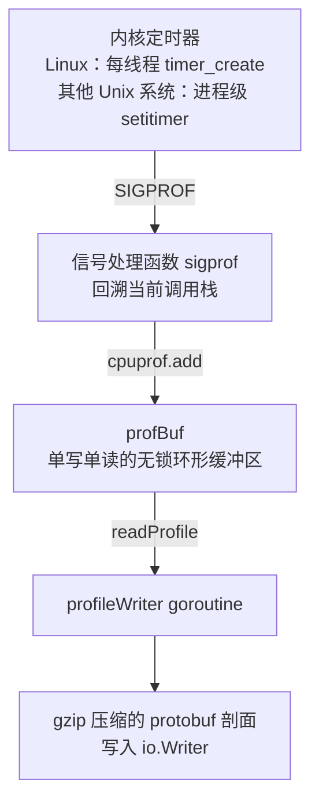

# 16.5 基准测试与性能剖析

优化之前先要测量。程序的时间花在哪里，常常与直觉不符；一次改动是否真的带来了改进，
也不能凭一两次运行的读数下结论。Go 的工具链为此提供了三类工具：**基准测试**（benchmark）
测量一段代码执行一次需要多少时间、分配多少内存；`benchstat` 用统计检验判断两组基准结果的差异是否超出了噪
声；**剖析**（profiling）以采样的方式，把 CPU 时间、内存分配与阻塞时间归因到具体的调用栈，
所得的结果称为**剖面**（profile）。

本节依次讨论 `testing` 包如何决定迭代次数并计时，Go 1.24 引入的 `B.Loop` 解决了什么问题，`benchstat`
采用的统计方法与它对样本数的要求，以及运行时如何采集 CPU、阻塞与锁竞争剖面。执行追踪见
[16.3](./trace.md)，运行时指标见 [16.6](./metric.md)，堆剖面的抽样原理见
[12.8.5](../../part4memory/ch12alloc/mstats.md)。

## 16.5.1 迭代次数与计时

基准函数形如 `func BenchmarkXxx(b *testing.B)`，由 `go test -bench` 运行。纳秒量级的操作无法单独计时：
时钟的分辨率、读取时钟本身的开销，都与被测操作处于同一量级。`testing` 包因此让被测代码重复执行 `b.N` 次，
以总时间除以 `b.N` 得到每次操作的耗时（ns/op）。`b.N` 由框架决定：先以 `b.N` = 1 运行一次，
再反复估计下一轮的次数，直到一轮的计时达到 `-benchtime`（默认 1 秒）。估计由 `predictN` 完成
[[Go Authors, 2026b](#ref-go-authors-2026b)]：

```go
func predictN(goalns int64, prevIters int64, prevns int64, last int64) int {
	if prevns == 0 {
		// Round up to dodge divide by zero. See https://go.dev/issue/70709.
		prevns = 1
	}

	// Order of operations matters.
	// For very fast benchmarks, prevIters ~= prevns.
	// If you divide first, you get 0 or 1,
	// which can hide an order of magnitude in execution time.
	// So multiply first, then divide.
	n := goalns * prevIters / prevns
	// Run more iterations than we think we'll need (1.2x).
	n += n / 5
	// Don't grow too fast in case we had timing errors previously.
	n = min(n, 100*last)
	// Be sure to run at least one more than last time.
	n = max(n, last+1)
	// Don't run more than 1e9 times. (This also keeps n in int range on 32 bit platforms.)
	n = min(n, maxBenchPredictIters)
	return int(n)
}
```

估计的依据是上一轮的速度：按上一轮的每次耗时线性外推到目标时间，再多加 20% 的余量。
上一轮的计时可能有误差，因此每轮至多增长到上一轮的 100 倍；同时至少比上一轮多一次，总数不超过 10 亿次。
先乘后除的注释交代了一个整数运算的细节：对极快的操作，迭代次数与纳秒数相近，先做除法得到的 0 或 1
会掩盖一个数量级的差异。

每一轮由 `runN` 执行。它先调用 `runtime.GC()`，清除上一轮留下的垃圾，使各轮的起始条件尽量一致，
然后重置计时器，调用整个基准函数。因此 `b.N` 每变化一次，基准函数就从头执行一次，
循环之外的准备与清理代码也随之重复。下面的程序在 `main` 中用 `testing.Benchmark` 运行基准，
记录基准函数每次被调用时的 `b.N`：

```go {run=true}
package main

import (
	"fmt"
	"strings"
	"testing"
)

var sink string

func work() string { return strings.Repeat("x", 64) }

func main() {
	var calls []int
	r := testing.Benchmark(func(b *testing.B) {
		calls = append(calls, b.N)
		for range b.N {
			sink = work()
		}
	})
	fmt.Println("b.N 写法：基准函数被调用", len(calls), "次，b.N 依次为", calls)
	fmt.Println("  最终", r.N, "次迭代，", r.NsPerOp(), "ns/op")

	calls = nil
	r = testing.Benchmark(func(b *testing.B) {
		calls = append(calls, b.N)
		for b.Loop() {
			sink = work()
		}
	})
	fmt.Println("b.Loop 写法：基准函数被调用", len(calls), "次，进入时 b.N 为", calls)
	fmt.Println("  最终", r.N, "次迭代，", r.NsPerOp(), "ns/op")
}
```

以 Go 1.26.10 在 arm64 上运行一次的输出如下，迭代次数与耗时随机器而变：

```
b.N 写法：基准函数被调用 5 次，b.N 依次为 [1 100 10000 1000000 23930182]
  最终 23930182 次迭代， 63 ns/op
b.Loop 写法：基准函数被调用 1 次，进入时 b.N 为 [1]
  最终 21721591 次迭代， 59 ns/op
```

第二至第四轮的次数都恰好是上一轮的 100 倍：这几轮的耗时远短于 1 秒，线性外推给出的次数都超过了增长上限。
第五轮的次数由外推得出，这一轮的计时超过了 1 秒，测量随之结束。输出的后半部分留到下一小节讨论。

计时的范围由 `StartTimer`、`StopTimer` 与 `ResetTimer` 控制，准备工作可以借此排除在计时之外。
这几个方法有一个容易被忽视的代价：为了统计内存分配，`StartTimer` 与 `StopTimer` 都要调用
`runtime.ReadMemStats` [[Go Authors, 2026b](#ref-go-authors-2026b)]，
而后者每次都要停止一切（[12.8.4](../../part4memory/ch12alloc/mstats.md)）。若在循环体内为每次迭代调用一对
`StopTimer` 与 `StartTimer`，计时虽然只覆盖被测代码，墙钟时间却被停止一切所主导；`predictN`
依据的是计时而不是墙钟时间，仍会按计时继续放大迭代次数，基准的实际运行时间于是远超 `-benchtime`。Go issue
#27217 报告的「使用 `StopTimer` 的微小基准永不结束」即源于此 [[peterGo, 2018](#ref-petergo-2018)]，
它与更早的 #20875 [[Bleecher Snyder, 2017](#ref-bleecher-snyder-2017)]至今都没有关闭。

## 16.5.2 `B.Loop`

`b.N` 写法有两个长期存在的问题。其一如上所述：基准函数要被调用多次，昂贵的准备工作随之重复，需要手动调用
`ResetTimer` 排除。其二是编译器可能删除被测代码：循环体调用的函数一旦被内联，结果又无人使用，
死代码消除便可能删去整个调用，测得的只是一个空循环。2023 年，Austin Clements 提出 `testing.B.Loop`（Go
issue #61515），Go 1.24 采纳了这一提议 [[Clements, 2023b](#ref-clements-2023b);
[Go Authors, 2025](#ref-go-authors-2025)]。它的文档说明了这两个问题各自如何解决
[[Go Authors, 2026b](#ref-go-authors-2026b)]：

```go
// Loop resets the benchmark timer the first time it is called in a benchmark,
// so any setup performed prior to starting the benchmark loop does not count
// toward the benchmark measurement. Likewise, when it returns false, it stops
// the timer so cleanup code is not measured.
//
// Within the body of a "for b.Loop() { ... }" loop, arguments to and
// results from function calls and assigned variables within the loop are kept
// alive, preventing the compiler from fully optimizing away the loop body.
// Currently, this is implemented as a compiler transformation that wraps such
// variables with a runtime.KeepAlive intrinsic call. This applies only to
// statements syntactically between the curly braces of the loop, and the loop
// condition must be written exactly as "b.Loop()".
```

计时问题的解决办法是把迭代次数的估计搬进循环内部。`B.Loop` 第一次被调用时把目标次数设为 1 并重置计时器；
每当迭代达到目标，它就用同一个 `predictN` 估计新的目标，直到计时达到 `-benchtime`。
整个过程发生在基准函数的一次调用之内，`launch` 发现迭代已经完成，便不再重新调用基准函数。
上面程序输出的后半部分印证了这一点：基准函数只被调用一次，进入时的 `b.N` 是首轮调用设置的 1。Go 1.25 起，
循环内部的 `b.N` 为 0，循环结束后才写入总迭代次数，以免使用者混淆两种写法，也便于发现误用
[[Clements, 2025](#ref-clements-2025)]。为了不给每次迭代增加可观的开销，`Loop`
的快速路径只有一次比较和一次自增，可以被内联；计时器停止时，`StopTimer` 把迭代计数的最高位置 1，
迫使下一次调用进入慢路径并报错 [[Go Authors, 2026b](#ref-go-authors-2026b)]：

```go
func (b *B) Loop() bool {
	// ……
	if b.loop.i < b.loop.n {
		b.loop.i++
		return true
	}
	return b.loopSlowPath()
}
```

死代码问题的解决办法是一项编译器变换，它只识别逐字写成 `for b.Loop() { ... }` 的循环。Go 1.24 与 1.25
的做法是在这样的循环体内禁止内联。这确实保住了被测代码，却带来了另一种失真。Go issue #73137 举了一个例子：
函数在内部 `make` 一个切片并返回给调用者，实际程序中它被内联，逃逸分析便可以把切片留在调用者的栈上
（[15.5](../ch15compile/escape.md)）；在 `B.Loop` 的循环体内它不能内联，切片只能分配在堆上，
基准里于是出现了实际程序中并不存在的堆分配。Go 1.26 改为保留内联，只把循环体内的函数实参、
返回值与被赋值的变量用 `runtime.KeepAlive` 包裹，使它们的计算不能被删除 [[Shao, 2025](#ref-shao-2025)]。
发布说明因此预期，所有基准都可以从 `b.N` 写法改为 `B.Loop` 写法而不产生副作用
[[Go Authors, 2026a](#ref-go-authors-2026a)]。

防止被测代码被优化掉，是所有微基准框架共同的问题。Java 的 JMH 要求使用者把结果交给 `Blackhole.consume`
[[Shipilëv, n.d.](#ref-shipilev-nd)]，由使用者显式标出哪些值不能被删除。`B.Loop` 把这项工作交给编译器，
代价是写法受到限制：循环条件必须逐字写成 `b.Loop()`，变换也只作用于循环体在语法上包含的语句。

## 16.5.3 分配的统计与自定义指标

加上 `-benchmem`，或在基准函数中调用 `b.ReportAllocs()`，结果中会多出两列：每次操作分配的字节数（B/op）与
对象数（allocs/op）。它们来自 `StartTimer` 与 `StopTimer` 两次读取的 `MemStats.TotalAlloc` 与
`MemStats.Mallocs` 之差 [[Go Authors, 2026b](#ref-go-authors-2026b)]。这两个计数是整个进程的累计值，
计时期间其他 goroutine 的分配同样会被计入。

allocs/op 往往比 ns/op 更稳定，也更容易解释。每次堆分配都会增加垃圾回收器的工作
（[第 13 章](../../part4memory/ch13gc/readme.md)），allocs/op 从 0 变为 1，通常意味着某个值逃逸到了堆上，
这时可以对照 `go build -gcflags=-m` 的逃逸分析输出，找出是哪一行导致了分配
（[15.5](../ch15compile/escape.md)）。

框架内置的指标不够用时，`b.ReportMetric(n, unit)` 可以报告自定义的指标，例如每次操作处理的元素数、
缓存命中率。单位不能含空白字符；若与框架内置的单位同名（如 allocs/op），则覆盖内置的值，把 ns/op 设为 0
则不再报告耗时 [[Go Authors, 2026b](#ref-go-authors-2026b)]。

## 16.5.4 判断差异是否显著

### 基准数据格式与噪声

`go test -bench` 的输出本身就是一种数据格式。2016 年，Russ Cox 与 Austin Clements
在设计文档中把它确定为记录 Go 基准数据的标准格式。他们在文档中写道，
没能找到任何记录原始基准数据的标准格式，连 SPEC CPU2006 公布的也只是分析之后的结果。按照这一格式，形如
`key: value` 的配置行（如 `goos`、`goarch`、`pkg`）描述运行环境，每个结果行由基准名称、
迭代次数与若干「数值 单位」对组成 [[Cox and Clements, 2016](#ref-cox-and-clements-2016)]；`testing`
包还会在名称末尾加上运行时的 `GOMAXPROCS`，如 `-18`，为 1 时省略
[[Go Authors, 2026b](#ref-go-authors-2026b)]。有了约定的格式，产生数据的程序与分析数据的程序就可以各自演
进。

同一个基准在同一台机器上重复运行，读数也会波动。CPU 的动态调频、温度墙、后台进程与共享同一物理核的超线程，
都会使读数在百分之几乃至更大的范围内变化。Clements 编写的 `perflock`
以一把系统范围的锁使共享机器上的基准串行运行，在独占模式下还默认在运行期间把 CPU
频率固定在最低与最高频率之间 90% 的位置；频率固定之后，动态调频就不再影响读数
[[Clements, n.d.](#ref-clements-nd)]。即便如此，噪声也不能完全消除，只比较前后两次的读数并不可靠。

### `benchstat` 的统计方法

`benchstat` 最初由 Russ Cox 编写，2017 年并入 `golang.org/x/perf` [[Cox, 2017b](#ref-cox-2017b)]。
2023 年，Clements 重写了它的统计方法 [[Clements, 2023a](#ref-clements-2023a)]。
旧版先按四分位距剔除离群值，再报告剩余样本的均值与范围；而任何剔除离群值的做法都要先假设数据的分布，
这里假设的是正态分布，基准数据通常并不满足。新版不再剔除任何样本，因此也必须改用对离群值不敏感的统计量：
每组报告中位数及其 95% 置信区间。两组之间的比较仍使用 **Mann–Whitney U 检验**，但改在完整的样本上进行，
检验的功效因此提高。

Mann 与 Whitney 在 1947 年发表了这一检验 [[Mann and Whitney, 1947](#ref-mann-and-whitney-1947)]，它与
Wilcoxon 在 1945 年提出的秩和检验等价 [[Wilcoxon, 1945](#ref-wilcoxon-1945)]。
它的想法是只看两组样本混合排序后的名次，而不看数值本身：若两组样本来自同一分布（原假设），
每一种名次排列都同样可能；p 值就是在原假设下，出现与观测结果至少同样极端的排列的概率。
它不对分布的形状作任何假设，因此适合有离群值、甚至呈多峰分布的基准数据。`benchstat` 默认的显著性水平 α 为
0.05，p 值小于 α 时报告变化的百分比，否则以 `~` 表示未检测到显著差异
[[Go Authors, 2026g](#ref-go-authors-2026g)]。

名次检验的分辨力受样本数限制。每组 n 个样本时，最极端的排列是一组的样本全部排在另一组之前，
在原假设下它的概率为 $2/\binom{2n}{n}$：n = 3 时为 0.1，n = 4 时约为 0.029。也就是说，每组少于
4 个样本时，无论两组相差多大，p 值都不可能低于 0.05。中位数的置信区间同理：
以样本的最小值与最大值为区间端点，区间包含总体中位数的概率为 $1-2\cdot 2^{-n}$，n = 5 时为 0.9375，n = 6
时才超过 0.95。`benchstat` 把这两个下限写成了表，样本不足时直接给出警告
[[Go Authors, 2026g](#ref-go-authors-2026g)]。

### 一次完整的比较

下面比较字符串拼接的两种实现。旧版用 `+=` 逐个拼接，每次拼接都分配一个新字符串；新版先算出总长度，
再用 `strings.Builder` 一次写入：

```go
// 旧版
func join(parts []string) string {
	var s string
	for _, p := range parts {
		s += p
	}
	return s
}

// 新版
func join(parts []string) string {
	n := 0
	for _, p := range parts {
		n += len(p)
	}
	var b strings.Builder
	b.Grow(n)
	for _, p := range parts {
		b.WriteString(p)
	}
	return b.String()
}
```

`BenchmarkJoin` 以 `for b.Loop()` 反复拼接 32 个单词；`BenchmarkCount` 测量与这次改动无关的
`strings.Count`，作为对照。`benchstat` 的文档建议交替运行前后两个版本，使噪声均匀地分布在两组样本中，
而不是先连续运行旧版 10 次、再连续运行新版 10 次 [[Go Authors, 2026g](#ref-go-authors-2026g)]。用
`go test -c` 预先编译出两个测试程序，交替执行即可。以 Go 1.26.10 与 `golang.org/x/perf` 的 be2c69f
版本为准：

```shell
$ go test -c -o old.test     # 旧版 join
$ go test -c -o new.test     # 新版 join
$ for i in $(seq 10); do
>   ./old.test -test.run='^$' -test.bench=. -test.benchmem >> old.txt
>   ./new.test -test.run='^$' -test.bench=. -test.benchmem >> new.txt
> done
$ benchstat old.txt new.txt
goos: darwin
goarch: arm64
pkg: join
cpu: Apple M5 Pro
         │    old.txt     │               new.txt                │
         │     sec/op     │    sec/op     vs base                │
Join-18    1817.0n ±  35%   187.4n ± 30%  -89.69% (p=0.000 n=10)
Count-18    16.91n ± 121%   14.80n ± 36%        ~ (p=0.631 n=10)
geomean     175.3n          52.66n        -69.95%

         │    old.txt    │               new.txt                │
         │     B/op      │    B/op     vs base                  │
Join-18    2720.0 ± 0%     160.0 ± 0%  -94.12% (p=0.000 n=10)
Count-18    0.000 ± 0%     0.000 ± 0%        ~ (p=1.000 n=10) ¹
geomean                ²               -75.75%                ²
¹ all samples are equal
² summaries must be >0 to compute geomean

         │    old.txt    │               new.txt                │
         │   allocs/op   │ allocs/op   vs base                  │
Join-18    31.000 ± 0%     1.000 ± 0%  -96.77% (p=0.000 n=10)
Count-18    0.000 ± 0%     0.000 ± 0%        ~ (p=1.000 n=10) ¹
geomean                ²               -82.04%                ²
¹ all samples are equal
² summaries must be >0 to compute geomean
```

这次运行时，机器上同时有大量其他进程，耗时的置信区间因此格外宽，这也正好说明了统计检验的作用。`Join`
的两组样本完全没有重叠，即便噪声如此之大，p 值也接近 0；`Count` 的中位数相差约 12%，p 值却是 0.631，
`benchstat` 据此判定这一差异无法与噪声区分。`± 35%` 是中位数 95% 置信区间相对中位数的幅度，
而不是样本的离散程度。每张表末行的几何平均汇总了全部基准的变化：若 n 个基准中有一个变为原来的 2 倍，
几何平均变为原来的 $\sqrt[n]{2}$ 倍。几何平均要求每个值都大于 0，`Count` 不分配内存，
后两张表的几何平均因此带有警告。分配的统计则没有噪声：旧版拼接 32 个单词要分配
31 次（第一次拼接的左操作数是空串，运行时直接返回右操作数，不分配），新版只在 `Grow` 时分配一次。

每组只运行 3 次时，`benchstat` 会给出上一小节推出的两个下限：

```shell
$ benchstat a3.txt b3.txt
         │    a3.txt    │             b3.txt              │
         │    sec/op    │    sec/op     vs base           │
Count-18   17.17n ± ∞ ¹   14.75n ± ∞ ¹  ~ (p=0.400 n=3) ²
¹ need >= 6 samples for confidence interval at level 0.95
² need >= 4 samples to detect a difference at alpha level 0.05
```

`benchstat` 的文档还提醒了两个统计上的陷阱 [[Go Authors, 2026g](#ref-go-authors-2026g)]。其一，
样本数应当事先确定（至少 10 次，最好 20 次），不应在结果不显著时反复重跑，直到出现显著为止：α = 0.05
意味着即使毫无差异，也有 5% 的机会报告差异，反复重跑终究会碰上一次。其二，同理，一次比较大量基准时，
即使代码没有任何改变，也应预期其中约 5% 显示出显著变化。

## 16.5.5 运行时如何采集剖面

基准测试告诉我们一段代码有多快，剖析则回答一个运行中的程序把时间与内存花在了哪些调用栈上。
`runtime/pprof` 预定义了以下几种剖面 [[Go Authors, 2026c](#ref-go-authors-2026c)]：

```go
//	goroutine      - stack traces of all current goroutines
//	goroutineleak  - stack traces of all leaked goroutines
//	allocs         - a sampling of all past memory allocations
//	heap           - a sampling of memory allocations of live objects
//	threadcreate   - stack traces that led to the creation of new OS threads
//	block          - stack traces that led to blocking on synchronization primitives
//	mutex          - stack traces of holders of contended mutexes
```

CPU 剖面不在其中。它在剖析期间持续向 `io.Writer` 输出数据，因此有单独的接口 `StartCPUProfile` 与
`StopCPUProfile`。`goroutineleak` 虽然出现在文档中，在 Go 1.26 里却只有以
`GOEXPERIMENT=goroutineleakprofile` 构建时才会注册 [[Go Authors, 2026a](#ref-go-authors-2026a);
[Go Authors, 2026f](#ref-go-authors-2026f)]。它借助垃圾回收器找出永远无法被唤醒的 goroutine，Go 1.27
起正式可用 [[Go Authors, 2026h](#ref-go-authors-2026h)]，检测的原理见 [16.1](./deadlock.md)。`heap` 与
`allocs` 按平均每分配 512 KiB 记录一次的方式抽样，原理见 [12.8.5](../../part4memory/ch12alloc/mstats.md)。
下面讨论 CPU、阻塞与锁竞争三种剖面的采集方式。

### CPU 剖面

CPU 剖面依靠定时信号采样：每隔固定的 CPU 时间，内核向进程发送一次 `SIGPROF`，
信号处理函数记下当前的调用栈。某个函数在样本中出现的比例，近似于它占用 CPU 时间的比例。采样频率固定为 100
Hz，`StartCPUProfile` 的注释给出了理由 [[Go Authors, 2026c](#ref-go-authors-2026c)]：

```go
	// The runtime routines allow a variable profiling rate,
	// but in practice operating systems cannot trigger signals
	// at more than about 500 Hz, and our processing of the
	// signal is not cheap (mostly getting the stack trace).
	// 100 Hz is a reasonable choice: it is frequent enough to
	// produce useful data, rare enough not to bog down the
	// system, and a nice round number to make it easy to
	// convert sample counts to seconds. Instead of requiring
	// each client to specify the frequency, we hard code it.
	const hz = 100
```

从信号到剖面文件，数据经过下面几步：



信号处理函数不能分配内存，也不能获取可能已被持有的锁，因此 `sigprof` 只把调用栈写入 `profBuf`。`profBuf`
是一个只允许一个写者和一个读者的无锁环形缓冲区，写者可以是没有用户 goroutine 的信号处理函数；
每条记录除了调用栈，还带有一个指针，指向当前 goroutine 的剖析标签（由 `pprof.Do` 设置）。Cox 在
2017 年为支持标签重新实现了这个缓冲区，随 Go 1.9 发布 [[Cox, 2017a](#ref-cox-2017a)]。读者
`profileWriter` 是一个普通的 goroutine，它不断从缓冲区取出记录，汇总成 protobuf 格式的剖面。这一格式由
Michael Matloob 在 Go 1.8 中引入，取代此前的旧 pprof 格式：protobuf 格式更易扩展，也是 pprof
工具首选的格式，剖析标签只能写在这种格式中 [[Matloob, 2016](#ref-matloob-2016)]。

定时器的选择经历过一次修正。`setitimer` 按整个进程消耗的 CPU 时间计时，而 Linux 定期（通常每 4 ms）
才结算一次进程的 CPU 时间；若两次结算之间应当发出不止一次信号（默认的 100 Hz 下每 10 ms 一次），
内核往往只能送达其中一次。其结果是，程序中并行运行的 goroutine 超过约 2.5 个时，CPU 剖面就会系统地少计。
Rhys Hiltner 在 Go issue #35057 中报告了这一问题，并在 Go 1.18 中改为用 `timer_create`
为运行时管理的每个线程各建一个定时器，各自按本线程的 CPU 时间计时，信号直接送往该线程
[[Hiltner, 2021](#ref-hiltner-2021)]。cgo 创建的线程不归运行时管理，仍需进程级的 `setitimer` 覆盖，
`validSIGPROF` 据信号的来源去重：有 M 且有本线程定时器的线程只接受来自 `timer_create` 的信号，没有 M
的线程只接受来自 `setitimer` 的信号 [[Go Authors, 2026c](#ref-go-authors-2026c)]。
每线程计时又带来一种新的偏差：短寿的线程，或只偶尔运行片刻的线程（例如空闲系统上的垃圾回收工作线程），
可能在第一次信号到来之前就已停止运行。为此，每个定时器的首次触发时间在零到一个完整采样周期之间均匀随机选
取。

### 阻塞剖面与锁竞争剖面

这两种剖面都默认关闭。它们需要在同步原语的慢路径上计时，开销高于 CPU 与堆的抽样，是否值得由使用者决定：
`runtime.SetBlockProfileRate` 打开阻塞剖面，`runtime.SetMutexProfileFraction` 打开锁竞争剖面。阻塞剖面由
Dmitriy Vyukov 在 Go 1.1 中加入 [[Vyukov, 2012](#ref-vyukov-2012)]，锁竞争剖面由 Peter Weinberger 在 Go
1.8 中加入 [[Weinberger, 2016](#ref-weinberger-2016)]。

两者记录的调用栈不同。阻塞剖面记录的是**等待者**的调用栈：goroutine 在 channel、`select`、`sync.Cond`
或互斥锁上阻塞多久，就把这段时间记在它阻塞处的调用栈上。锁竞争剖面记录的是**持有者**的调用栈：
等待者被唤醒时，`semrelease1` 把等待的时间记在执行解锁的 goroutine 名下
[[Go Authors, 2026d](#ref-go-authors-2026d)]：

```go
	if s != nil { // May be slow or even yield, so unlock first
		acquiretime := s.acquiretime
		if acquiretime != 0 {
			// Charge contention that this (delayed) unlock caused.
			// If there are N more goroutines waiting beyond the
			// one that's waking up, charge their delay as well, so that
			// contention holding up many goroutines shows up as
			// more costly than contention holding up a single goroutine.
			// It would take O(N) time to calculate how long each goroutine
			// has been waiting, so instead we charge avg(head-wait, tail-wait)*N.
			// head-wait is the longest wait and tail-wait is the shortest.
			// ……
			dt0 := t0 - acquiretime
			dt := dt0
			if s.waiters != 0 {
				dtail := t0 - tailtime
				dt += (dtail + dt0) / 2 * int64(s.waiters)
			}
			mutexevent(dt, 3+skipframes)
		}
```

被唤醒者之后若还有 N 个 goroutine 在排队，解锁者被记上的就不只是被唤醒者的等待时间，
还要加上以队首与队尾等待时间的平均值乘以 N 估计的其余等待时间，使阻塞了许多 goroutine 的临界区显得更昂贵。
这样，阻塞剖面回答「哪里在等」，锁竞争剖面回答「是谁的临界区造成了等待」。

按排队的 goroutine 数累计，是 Go 1.22 才补上的。锁竞争剖面本意是仿照 Mike Burrows 为 Google 的 C++
库（即今天的 Abseil）设计的锁竞争剖析器，后者按每个线程分别计算阻塞时间：100 个线程在同一把锁上同时阻塞
10 ms，计为 1000 ms 的竞争。Go 最初的实现遗漏了这一点，只计 10 ms。2023 年，Russ Cox 改为按阻塞的
goroutine 数累计，同时仍把时间记在造成积压的那次解锁上，而不记在随后受拥塞牵连的解锁上
[[Cox, 2023](#ref-cox-2023)]。运行时内部的锁也从 Go 1.22 起计入锁竞争剖面，但起初只记在一个占位的帧
`runtime._LostContendedRuntimeLock` 上 [[Go Authors, 2024](#ref-go-authors-2024)]；Go 1.25 起才与
`sync.Mutex` 一致，记在造成等待的临界区末尾，即解锁者的调用栈上 [[Hiltner, 2025](#ref-hiltner-2025)]。

下面的程序让 `holder` 持锁 50 ms，`waiter` 在此期间等锁，然后分别读出两种剖面中属于 `main` 包的调用栈：

```go {run=true}
package main

import (
	"fmt"
	"runtime"
	"strings"
	"sync"
	"time"
)

var mu sync.Mutex

func holder(locked chan<- struct{}) {
	mu.Lock()
	close(locked)
	time.Sleep(50 * time.Millisecond) // 持锁期间让 waiter 等待
	mu.Unlock()
}

func waiter() {
	mu.Lock()
	mu.Unlock()
}

// frames 返回调用栈中属于 main 包的函数名。
func frames(stk []uintptr) []string {
	var names []string
	fs := runtime.CallersFrames(stk)
	for {
		f, more := fs.Next()
		if strings.HasPrefix(f.Function, "main.") {
			names = append(names, f.Function)
		}
		if !more {
			return names
		}
	}
}

func main() {
	runtime.SetBlockProfileRate(1)     // 记录每一次阻塞
	runtime.SetMutexProfileFraction(1) // 记录每一次锁竞争

	locked := make(chan struct{})
	var wg sync.WaitGroup
	wg.Go(func() { holder(locked) })
	<-locked
	wg.Go(waiter)
	wg.Wait()

	for _, p := range []struct {
		name  string
		fetch func([]runtime.BlockProfileRecord) (int, bool)
	}{{"block", runtime.BlockProfile}, {"mutex", runtime.MutexProfile}} {
		recs := make([]runtime.BlockProfileRecord, 64)
		n, _ := p.fetch(recs)
		for _, r := range recs[:n] {
			if names := frames(r.Stack()); len(names) > 0 && names[0] != "main.main" {
				fmt.Printf("%s 剖面：%v\n", p.name, names)
			}
		}
	}
}
```

程序跳过了栈顶为 `main.main` 的记录，即 `main` 自己在 channel 与 `WaitGroup` 上的阻塞。输出如下：

```
block 剖面：[main.waiter]
mutex 剖面：[main.holder main.main.func1]
```

同一次等待在两种剖面中分别归于等锁的 `waiter` 与持锁的 `holder`。

两种剖面的抽样方式也不同，但都对抽样作了加权，使剖面中的总时间是实际总时间的无偏估计
[[Go Authors, 2026d](#ref-go-authors-2026d)]：

```go
	if which == blockProfile && cycles < rate {
		// Remove sampling bias, see discussion on http://golang.org/cl/299991.
		bp.count += float64(rate) / float64(cycles)
		bp.cycles += rate
	} else if which == mutexProfile {
		bp.count += float64(rate)
		bp.cycles += rate * cycles
	} else {
		bp.count++
		bp.cycles += cycles
	}
```

阻塞剖面以时间为单位抽样：阻塞时间不短于 `rate` 的事件全部记录，较短的事件以「阻塞时间 / `rate`」
的概率记录，记录时按概率的倒数放大。Go 1.17 之前，短事件被抽中后只按原样计一次，剖面因此偏向少而长的阻塞、
低估多而短的阻塞，Felix Geisendörfer 据 Vyukov 的建议修正了这一偏差
[[Geisendörfer, 2021](#ref-geisendorfer-2021)]。锁竞争剖面则以事件为单位，每 `rate` 次竞争平均记录一次，
记录时放大 `rate` 倍。堆剖面按抽样概率还原分配量（[12.8.5](../../part4memory/ch12alloc/mstats.md)），
用的也是这种以概率倒数加权的做法。

### goroutine 剖面与调用栈深度

goroutine 剖面需要所有 goroutine 在同一时刻的调用栈，早期的实现在停止一切的状态下遍历全部 goroutine，
暂停时间与 goroutine 的数量成正比。Go 1.19 改为在停止一切期间只做固定量的工作，其中包括设置一道屏障：
程序恢复运行后，某个 goroutine 若在被记录之前得到调度，调度器先替它记下停止时刻的调用栈，再让它运行；
其余的 goroutine 由剖析方在程序运行的同时逐个记录，最后再停止一次以撤除屏障。暂停时间因此不再随 goroutine
数量增长，代价是剖析本身消耗更多的 CPU 时间，调用也需要更长的墙钟时间
[[Hiltner, 2022](#ref-hiltner-2022)]。另外，除 CPU 剖面外的各种剖面原本只记录调用栈最深的 32 帧，
生产环境中常被截断，Go 1.23 将上限提高到与执行追踪相同的 128 帧
[[Geisendörfer, 2024](#ref-geisendorfer-2024)]。

## 16.5.6 从剖面到结论

剖面的标准格式是 gzip 压缩的 protobuf，由 `go tool pprof` 读取。`runtime/pprof` 把剖面写入文件，
`net/http/pprof` 则在 `/debug/pprof/` 下以 HTTP 提供同样的数据，可以从运行中的服务直接取得
[[Cox, 2011](#ref-cox-2011); [Go Authors, 2026e](#ref-go-authors-2026e)]：

```go
import _ "net/http/pprof" // 在 DefaultServeMux 上注册 /debug/pprof/

func main() {
	go func() { log.Println(http.ListenAndServe("localhost:6060", nil)) }()
	// ……
}
```

`/debug/pprof/profile?seconds=30` 采集 30 秒的 CPU 剖面；对 `heap`、`block`、`mutex` 等累计型剖面，
`seconds` 参数则返回这段时间内的增量。Go 1.22 起这些路径只接受 GET 请求
[[Go Authors, 2026e](#ref-go-authors-2026e)]。这些端点暴露了程序的内部状态，
通常只应监听本地地址或经过鉴权。

```shell
$ go tool pprof -http=localhost:8080 'http://localhost:6060/debug/pprof/profile?seconds=30'
```

`go tool pprof -http` 打开一个网页界面，Go 1.26 起默认显示**火焰图**（flame
graph）[[Go Authors, 2026a](#ref-go-authors-2026a)]。火焰图由 Brendan Gregg 提出
[[Gregg, 2016](#ref-gregg-2016); [Gregg, n.d.](#ref-gregg-nd)]：每个矩形是调用栈中的一帧，
按调用关系逐层堆叠，宽度正比于包含这一帧的样本数，横向的排列顺序没有时间含义。Gregg
的原始画法把根放在底部，调用栈向上生长，顶部边缘的帧是采样时正在 CPU 上执行的函数；pprof
网页界面中的火焰图则把根放在顶部，被调用者向下生长，方向正好相反
[[Go Authors, 2026c](#ref-go-authors-2026c)]。无论哪种方向，高度只反映调用栈的深度，
寻找热点时应当看叶端一侧又宽又平的「平台」，即自身占用了大量样本的函数。火焰图并不依赖特定的剖析器，
DTrace、Linux `perf` 采到的调用栈同样可以这样呈现。

剖面还可以离开开发者的机器，成为基础设施的一部分。Google 的 Google-Wide Profiling 在数据中心的机器上持续、
低频地采集剖面并集中存储，使性能分析可以覆盖整个机群的长期数据 [[Ren et al., 2010](#ref-ren-et-al-2010)]。
采样的低开销是持续剖析得以成立的前提。剖面也可以交给编译器：Go 1.21 起，主包目录中的 `default.pgo`
会被默认用于性能制导优化（profile-guided optimization，PGO），编译器据此对热点做更积极的内联与去虚化。Go
1.21 的发布说明报告的典型收益为 2% 至 7% [[Go Authors, 2023](#ref-go-authors-2023)]；Go 1.22 让 PGO
能够去虚化更多的调用，发布说明报告的收益提高到 2% 至 14% [[Go Authors, 2024](#ref-go-authors-2024)]。
具体机制见 [15.3](../ch15compile/optimize.md)。

剖析回答的是「时间总体上花在哪里」。当问题是偶发的长尾延迟时，剖面中的统计聚合会掩盖个别请求的经历，
这时需要执行追踪按时间顺序记录调度、垃圾回收与系统调用事件（[16.3](./trace.md)）。

## 16.5.7 小结

基准测试、统计检验与剖析分别回答「多快」「是否真的变了」「花在哪里」。`testing`
包以指数增长再外推的方式确定迭代次数，`B.Loop` 把这一过程搬进循环内部，并以编译器变换防止被测代码被删除，
Go 1.26 又让这一变换不再妨碍内联。`benchstat` 以中位数、置信区间与 Mann–Whitney U
检验处理不服从正态分布的基准数据，名次检验的性质决定了每组至少需要 4 个样本，中位数的置信区间至少需要
6 个。运行时以 100 Hz 的定时信号采集 CPU 剖面，Linux 上改用每线程的定时器以避免多核时少计；
阻塞剖面与锁竞争剖面分别把同一次等待记在等待者与持有者名下，并都按抽样概率加权以保持无偏。

## 延伸阅读

- <a id="ref-bleecher-snyder-2017"></a>[Bleecher Snyder, 2017] Josh Bleecher Snyder. Go issue #20875.
  *testing: consider calling ReadMemStats less during benchmarking.* 2017. https://go.dev/issue/20875
- <a id="ref-clements-2023a"></a>[Clements, 2023a] Austin Clements. cmd/benchstat: new version of
  benchstat. golang.org/x/perf commit 02c55175bb, 2023. https://go.dev/cl/309969
  改用中位数、中位数的置信区间与对全部样本的 U 检验，不再剔除离群值。
- <a id="ref-clements-2023b"></a>[Clements, 2023b] Austin Clements. Go issue #61515. *testing: add
  testing.B.Loop for iteration.* 2023. https://go.dev/issue/61515
- <a id="ref-clements-2025"></a>[Clements, 2025] Austin Clements. testing: separate b.Loop counter from
  b.N. Go commit 9003154206, 2025. https://go.dev/cl/659655
  随 Go 1.25 发布。
- <a id="ref-clements-nd"></a>[Clements, n.d.] Austin Clements. *perflock.*
  https://github.com/aclements/perflock
  以系统范围的锁串行运行基准，并在运行期间调整 CPU 频率。
- <a id="ref-cox-2011"></a>[Cox, 2011] Russ Cox. *Profiling Go Programs.* The Go Blog, 2011（Shenghou Ma
  于 2013 年更新）. https://go.dev/blog/pprof
  以一个基准程序为例，演示 CPU 剖面与堆剖面的采集和分析。
- <a id="ref-cox-2017a"></a>[Cox, 2017a] Russ Cox. runtime: new profile buffer implementation supporting
  label pointers. Go commit b788fd80e6, 2017. https://go.dev/cl/36713
  随 Go 1.9 发布。
- <a id="ref-cox-2017b"></a>[Cox, 2017b] Russ Cox. cmd/benchstat: import from rsc.io/benchstat.
  golang.org/x/perf commit 1da04cc6cd, 2017. https://go.dev/cl/35503
- <a id="ref-cox-2023"></a>[Cox, 2023] Russ Cox. runtime: change mutex profile to count every blocked
  goroutine. Go commit 1c00354013, 2023. https://go.dev/cl/506415
  随 Go 1.22 发布，修复 Go issue #61015。提交说明交代了锁竞争剖面与 Abseil 锁剖析器的渊源。
- <a id="ref-cox-and-clements-2016"></a>[Cox and Clements, 2016] Russ Cox, Austin Clements. *Proposal: Go
  Benchmark Data Format.* Go design document, 2016.
  https://go.googlesource.com/proposal/+/master/design/14313-benchmark-format.md
  把 `go test -bench` 的输出确定为记录基准数据的标准格式。
- <a id="ref-geisendorfer-2021"></a>[Geisendörfer, 2021] Felix Geisendörfer. runtime/pprof: fix block
  profile bias. Go commit 0ae9c3b98b, 2021. https://go.dev/cl/299991
  随 Go 1.17 发布，修复 Go issue #44192。
- <a id="ref-geisendorfer-2024"></a>[Geisendörfer, 2024] Felix Geisendörfer. runtime: increase profiling
  stack depth to 128. Go commit 1b9dc3e178, 2024. https://go.dev/cl/572396
  随 Go 1.23 发布。
- <a id="ref-go-authors-2023"></a>[Go Authors, 2023] The Go Authors. *Go 1.21 Release Notes.* 2023.
  https://go.dev/doc/go1.21
  PGO 正式可用，`-pgo` 默认为 `auto`。
- <a id="ref-go-authors-2024"></a>[Go Authors, 2024] The Go Authors. *Go 1.22 Release Notes.* 2024.
  https://go.dev/doc/go1.22
  锁竞争剖面按阻塞的 goroutine 数累计，并开始计入运行时内部的锁；PGO 的收益提高到 2% 至 14%。
- <a id="ref-go-authors-2025"></a>[Go Authors, 2025] The Go Authors. *Go 1.24 Release Notes.* 2025.
  https://go.dev/doc/go1.24
  引入 `testing.B.Loop`。
- <a id="ref-go-authors-2026a"></a>[Go Authors, 2026a] The Go Authors. *Go 1.26 Release Notes.* 2026.
  https://go.dev/doc/go1.26
  `B.Loop` 不再妨碍内联；实验性的 goroutine 泄漏剖面；pprof 网页界面默认显示火焰图。
- <a id="ref-go-authors-2026b"></a>[Go Authors, 2026b] The Go Authors.
  src/testing/benchmark.go（`predictN`、`launch`、`runN`、`Loop`、`StartTimer`、`StopTimer`）. Go 1.26
  源码. https://github.com/golang/go/blob/release-branch.go1.26/src/testing/benchmark.go
- <a id="ref-go-authors-2026c"></a>[Go Authors, 2026c] The Go Authors.
  src/runtime/pprof/pprof.go（预定义剖面、`StartCPUProfile`、`profileWriter`）、src/runtime/cpuprof.go、
  src/runtime/profbuf.go、src/runtime/os_linux.go（`validSIGPROF`）、
  src/cmd/vendor/github.com/google/pprof/internal/driver/html/stacks.js（火焰图的绘制方向）. Go 1.26 源码.
  https://github.com/golang/go/tree/release-branch.go1.26/src/runtime
- <a id="ref-go-authors-2026d"></a>[Go Authors, 2026d] The Go Authors.
  src/runtime/mprof.go（`blocksampled`、`mutexevent`、`saveBlockEventStack`）、
  src/runtime/sema.go（`semrelease1`）. Go 1.26 源码.
  https://github.com/golang/go/tree/release-branch.go1.26/src/runtime
- <a id="ref-go-authors-2026e"></a>[Go Authors, 2026e] The Go Authors.
  *Package runtime/pprof、 net/http/pprof.* https://pkg.go.dev/runtime/pprof
  ；https://pkg.go.dev/net/http/pprof
  各种剖面的含义，以及 HTTP 端点的参数。
- <a id="ref-go-authors-2026f"></a>[Go Authors, 2026f] The Go Authors. *testing.B.Loop（Go 1.24 引入）.*
  https://pkg.go.dev/testing#B.Loop ；`goroutineleak` 剖面见 `src/runtime/pprof/pprof.go`（Go 1.26
  中需以 `GOEXPERIMENT=goroutineleakprofile` 构建，Go 1.27 起正式可用）。
- <a id="ref-go-authors-2026g"></a>[Go Authors, 2026g] The Go Authors. *benchstat.*
  https://pkg.go.dev/golang.org/x/perf/cmd/benchstat ；实现见 `golang.org/x/perf/benchmath`（Mann-Whitney
  U 检验）。
  本节依据 be2c69f 版本：中位数与 95% 置信区间、默认 α = 0.05、样本数下限与使用建议。
- <a id="ref-go-authors-2026h"></a>[Go Authors, 2026h] The Go Authors. *Go 1.27 Release Notes.* 2026.
  https://go.dev/doc/go1.27
  goroutine 泄漏剖面正式可用，`goroutineleakprofile` 实验设置随之删除。
- <a id="ref-gregg-2016"></a>[Gregg, 2016] Brendan Gregg. "The Flame Graph." *Communications of the ACM*,
  59(6): 48–57, 2016. https://doi.org/10.1145/2909476
  火焰图的提出者对这种表示法的系统介绍。
- <a id="ref-gregg-nd"></a>[Gregg, n.d.] Brendan Gregg. *Flame Graphs.*
  https://www.brendangregg.com/flamegraphs.html ；
  *Systems Performance.* 2nd ed. Pearson, 2020.
- <a id="ref-hiltner-2021"></a>[Hiltner, 2021] Rhys Hiltner. runtime: profile with per-thread timers on
  Linux. Go commit 8cfd8c3db8, 2021. https://go.dev/cl/324129
  随 Go 1.18 发布，对应 Go issue #35057。
- <a id="ref-hiltner-2022"></a>[Hiltner, 2022] Rhys Hiltner. runtime: decrease STW pause for goroutine
  profile. Go commit 52bd1c4d6c, 2022. https://go.dev/cl/387415
  随 Go 1.19 发布。
- <a id="ref-hiltner-2025"></a>[Hiltner, 2025] Rhys Hiltner. runtime: blame unlocker for mutex delay. Go
  commit 4d0f955a5e, 2025. https://go.dev/cl/667615
  随 Go 1.25 发布，修复 Go issue #66999。
- <a id="ref-mann-and-whitney-1947"></a>[Mann and Whitney, 1947] H. B. Mann, D. R. Whitney. "On a Test of
  Whether one of Two Random Variables is Stochastically Larger than the Other." *The Annals of
  Mathematical Statistics*, 18(1): 50–60, 1947. https://doi.org/10.1214/aoms/1177730491
  `benchstat` 所用的 U 检验的原始论文。
- <a id="ref-matloob-2016"></a>[Matloob, 2016] Michael Matloob. runtime/pprof: output CPU profiles in
  pprof protobuf format. Go commit 76f12cdaa2, 2016. https://go.dev/cl/33071
  随 Go 1.8 发布，修复 Go issue #16093（*runtime/pprof: generate profiles in gzipped proto format*）。
- <a id="ref-petergo-2018"></a>[peterGo, 2018] peterGo. Go issue #27217. *testing: tiny benchmark with
  StopTimer runs forever.* 2018. https://go.dev/issue/27217
- <a id="ref-ren-et-al-2010"></a>[Ren et al., 2010] Gang Ren, Eric Tune, Tipp Moseley, Yixin Shi, Silvius
  Rus, Robert Hundt. "Google-Wide Profiling: A Continuous Profiling Infrastructure for Data Centers."
  *IEEE Micro*, 30(4): 65–79, 2010. https://doi.org/10.1109/MM.2010.68
  持续剖析的奠基工作。
- <a id="ref-shao-2025"></a>[Shao, 2025] Junyang Shao. cmd/compile: change testing.B.Loop keep alive
  semantic. Go commit 22f24f90b5, 2025. https://go.dev/cl/716660
  随 Go 1.26 发布，修复 Go issue #73137。
- <a id="ref-shipilev-nd"></a>[Shipilëv, n.d.] Aleksey Shipilëv. *JMH（Java Microbenchmark Harness）.*
  https://openjdk.org/projects/code-tools/jmh/
  `Blackhole` 对抗死代码消除，与 `B.Loop` 解决的是同一个问题。
- <a id="ref-vyukov-2012"></a>[Vyukov, 2012] Dmitriy Vyukov. pprof: add goroutine blocking profiling. Go
  commit 4cc7bf326a, 2012. https://go.dev/cl/6443115
  随 Go 1.1 发布。
- <a id="ref-weinberger-2016"></a>[Weinberger, 2016] Peter Weinberger. runtime: Profile goroutines holding
  contended mutexes. Go commit ca922b6d36, 2016. https://go.dev/cl/29650
  随 Go 1.8 发布。
- <a id="ref-wilcoxon-1945"></a>[Wilcoxon, 1945] Frank Wilcoxon. "Individual Comparisons by Ranking
  Methods." *Biometrics Bulletin*, 1(6): 80–83, 1945. https://doi.org/10.2307/3001968
- 本书 [15.3 优化器（PGO）](../ch15compile/optimize.md)、[16.3 性能追踪](./trace.md)、
  [16.1 死锁检测](./deadlock.md)、[13 垃圾回收](../../part4memory/ch13gc)、
  [15.5 逃逸分析](../ch15compile/escape.md).
