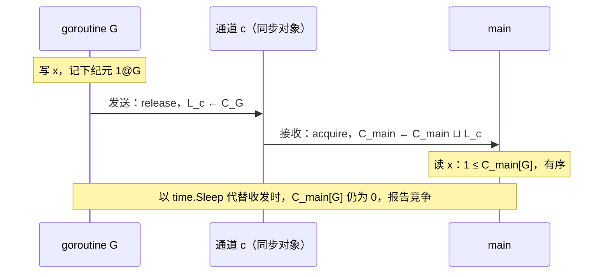

# 16.2 竞争检查

两个 goroutine 访问同一内存位置，其中至少一个是写，而先行发生关系不能为二者定序，
就构成一次数据竞争（[11.9.5](../../part3concurrency/ch11sync/mem.md)）。Go 的内存模型以 DRF-SC 为基础：
免数据竞争的程序表现得如同顺序一致 [[Go Authors, 2022a](#ref-go-authors-2022a)]，
程序员的义务因此归结为消除数据竞争（[11.9.2](../../part3concurrency/ch11sync/mem.md)）。
这一义务无法靠阅读代码可靠地履行，竞争往往只在特定的负载、硬件与调度下才显现。竞态检测器（race detector）
把它变成一项可以检查的性质：以 `-race` 构建的程序在运行中构造先行发生关系，
一旦发现两次冲突的访问没有被它定序，就报告一次竞争。

本节先用两个例子说明检测器报告什么，再依次讨论它的理论基础（向量时钟）、编译器与运行时各自承担的工作、ThreadSanitizer
运行时的数据结构及其代价，最后讨论它的能力边界。

## 16.2.1 报告的是缺失的定序

`go test`、`go run`、`go build` 与 `go install` 都接受 `-race` 标志。下面的程序中，两个 goroutine 各自对
`counter` 做一次自增，`WaitGroup` 只保证 `main` 在二者结束之后读取，并不为两次自增定序：

```go
package main

import (
	"fmt"
	"sync"
)

func main() {
	var counter int
	var wg sync.WaitGroup
	for range 2 {
		wg.Add(1)
		go func() {
			defer wg.Done()
			counter++ // 读-改-写，没有同步
		}()
	}
	wg.Wait()
	fmt.Println(counter)
}
```

以 Go 1.26.10 构建，并以 `GOMAXPROCS=1` 运行，输出删去了路径前缀：

```shell
$ go build -race -o counter .
$ GOMAXPROCS=1 ./counter
==================
WARNING: DATA RACE
Read at 0x00c000012158 by goroutine 7:
  main.main.func1()
      main.go:15 +0x68

Previous write at 0x00c000012158 by goroutine 8:
  main.main.func1()
      main.go:15 +0x78

Goroutine 7 (running) created at:
  main.main()
      main.go:13 +0x6c

Goroutine 8 (finished) created at:
  main.main()
      main.go:13 +0x6c
==================
2
Found 1 data race(s)
$ echo $?
66
```

报告给出了两次冲突访问的栈，以及相关 goroutine 的创建位置 [[Go Authors, n.d.](#ref-go-authors-nd)]。
值得注意的是运行条件：只有一个 P，goroutine 8 在 goroutine 7 开始之前就已结束，两次自增在时间上并未交错，
程序也打印了正确的结果 2。检测器仍然报告竞争，因为它检查的不是访问是否真的在时间上重叠，
而是两次访问之间是否存在先行发生关系；在 `GOMAXPROCS` 为 1、2、8 时，五次运行都得到同样的报告。
程序照常运行到结束，最后以退出码 66 退出；以 `GORACE=halt_on_error=1` 运行，则在第一次报告后终止
[[Go Authors, n.d.](#ref-go-authors-nd)]。

第二个例子说明，时间上的先后不等于同步。写入方 goroutine 早在 100 毫秒之前就已结束，主 goroutine
才读取变量：

```go
package main

import (
	"fmt"
	"time"
)

func main() {
	var ready bool
	go func() { ready = true }()
	time.Sleep(100 * time.Millisecond) // 时间上的先后，不是同步
	fmt.Println(ready)
}
```

```shell
$ go build -race -o sleep . && ./sleep
==================
WARNING: DATA RACE
Read at 0x00c00001215f by main goroutine:
  main.main()
      main.go:12 +0xb0

Previous write at 0x00c00001215f by goroutine 7:
  main.main.func1()
      main.go:10 +0x2c

Goroutine 7 (finished) created at:
  main.main()
      main.go:10 +0x98
==================
true
Found 1 data race(s)
```

`time.Sleep` 不在内存模型规定的任何同步操作之列，它不建立先行发生关系。在多数机器上这个程序会打印 `true`，
但内存模型并不保证这一点。把 `Sleep` 换成一次通道收发，或者用 `sync.WaitGroup` 等待写入方结束，
报告便消失。

## 16.2.2 向量时钟

先行发生关系由程序次序与同步次序生成（[11.9.5](../../part3concurrency/ch11sync/mem.md)）。
检测器在运行中用**向量时钟**（vector clock）维护这一关系。每个 goroutine $t$ 持有一个向量 $C_t$，分量
$C_t[u]$ 表示 $t$ 已经知道的 goroutine $u$ 的逻辑时间；每个同步对象 $m$（一把锁、一个通道缓冲槽）
也持有一个向量 $L_m$。同步操作按以下规则更新它们：

$$
\begin{aligned}
\text{release}(t, m):&\quad L_m \leftarrow C_t,\quad C_t[t] \leftarrow C_t[t] + 1,\\
\text{acquire}(t, m):&\quad C_t \leftarrow C_t \sqcup L_m,
\end{aligned}
$$

其中 $\sqcup$ 是逐分量取最大值。$t$ 在本地时间 $c = C_t[t]$ 时进行的一次访问，记为纪元（epoch）$c@t$。此后
goroutine $u$ 访问同一位置时，前一次访问先行发生于这一次，当且仅当 $c \le C_u[t]$，即 $u$ 经由某条
release-acquire 链已经知道 $t$ 的时间 $c$。两次访问不满足这一条件、又至少有一个是写，便是竞争。



为每个内存位置保存一个完整的向量时钟，代价与 goroutine 数成正比。Flanagan 与 Freund 的 FastTrack 指出，
绝大多数访问只需记录最近一次访问的纪元，比较也就从 $O(n)$ 降为 $O(1)$，
只在读操作被多个线程并发共享时才需要完整的向量
[[Flanagan and Freund, 2009](#ref-flanagan-and-freund-2009)]。下文会看到，ThreadSanitizer
的影子内存记录的正是这样的纪元。

## 16.2.3 编译器与运行时的分工

构造先行发生关系需要两类事件：内存访问，以及同步。前者由编译器插桩产生，后者由运行时与标准库报告。

以 `-race` 编译时，`cmd/compile` 在生成 SSA 的阶段为每次内存读写插入对运行时的调用
[[Go Authors, 2026a](#ref-go-authors-2026a)]：

```go
func (s *state) instrument2(t *types.Type, addr, addr2 *ssa.Value, kind instrumentKind) {
	if !s.instrumentMemory {
		return
	}

	w := t.Size()
	if w == 0 {
		return // can't race on zero-sized things
	}

	if ssa.IsSanitizerSafeAddr(addr) {
		return
	}
	// ……
	} else if base.Flag.Race && t.NumComponents(types.CountBlankFields) > 1 {
		// for composite objects we have to write every address
		// because a write might happen to any subobject.
		// composites with only one element don't have subobjects, though.
		switch kind {
		case instrumentRead:
			fn = ir.Syms.Racereadrange
		case instrumentWrite:
			fn = ir.Syms.Racewriterange
		default:
			panic("unreachable")
		}
		needWidth = true
	} else if base.Flag.Race {
		// for non-composite objects we can write just the start
		// address, as any write must write the first byte.
		switch kind {
		case instrumentRead:
			fn = ir.Syms.Raceread
		case instrumentWrite:
			fn = ir.Syms.Racewrite
		default:
			panic("unreachable")
		}
	// ……
```

大小为零的对象不可能竞争；`IsSanitizerSafeAddr` 排除了栈上的地址、只读数据以及初始化后只读的 itab、
字符串数据与闭包字段；复合对象的写可能落在任何子对象上，因而按范围报告，标量只需报告起始地址。此外，
编译器还在每个函数的入口与出口插入 `racefuncenter` 与 `racefuncexit`，
它们维护的影子调用栈使报告能够给出完整的栈。并非所有包都被插桩：`runtime` 及其内部依赖完全不插桩；`sync`、`sync/atomic`
等包既不插桩内存访问，也不插桩函数出入口，源码注释的理由是，这些包中的内存访问要么无关紧要，
要么会导致误报 [[Go Authors, 2026b](#ref-go-authors-2026b)]。

这些包转而直接报告同步语义。`sync.Mutex` 加锁成功后执行 acquire，解锁时先执行 release
[[Go Authors, 2026d](#ref-go-authors-2026d)]：

```go
func (m *Mutex) Lock() {
	// Fast path: grab unlocked mutex.
	if atomic.CompareAndSwapInt32(&m.state, 0, mutexLocked) {
		if race.Enabled {
			race.Acquire(unsafe.Pointer(m))
		}
		return
	}
	// ……
}
```

```go
func (m *Mutex) Unlock() {
	if race.Enabled {
		_ = m.state
		race.Release(unsafe.Pointer(m))
	}
	// ……
```

`sync/atomic` 的原子操作在 `-race` 构建中由汇编桩转发给 ThreadSanitizer 的原子操作接口，例如 `AddInt32`
转为 `__tsan_go_atomic32_fetch_add`，检测器因此按原子操作的语义处理它们
[[Go Authors, 2026d](#ref-go-authors-2026d)]。通道的收发在 `runtime/chan.go` 中报告：
带缓冲的通道以每个缓冲槽为一个同步对象，收发时对相应的槽执行 release-acquire，由此实现内存模型中「容量为
C 的通道上第 k 次接收先于第 k+C 次发送完成」的规则；元素大小为零的通道不分配缓冲区，
所有收发只能共用一个同步对象 [[Go Authors, 2026d](#ref-go-authors-2026d)]。这条规则曾经没有被逐字实现。2020
年，Daniel S Fava 发现 `chansend` 与 `chanrecv` 中 acquire 与 release 的次序颠倒，
检测器会因此漏报一些竞争；修复调整了调用次序，并依赖 ThreadSanitizer 新增的一个接口，随 Go 1.16 发布
[[Fava, 2020](#ref-fava-2020)]。

对检测器看不到的同步，`runtime` 包导出了 `RaceAcquire`、`RaceRelease` 与 `RaceReleaseMerge`。
源码注释说明了它们的用途，并给出了与 C11 内存模型的对应 [[Go Authors, 2026c](#ref-go-authors-2026c)]：

```go
// RaceAcquire/RaceRelease/RaceReleaseMerge establish happens-before relations
// between goroutines. These inform the race detector about actual synchronization
// that it can't see for some reason (e.g. synchronization within RaceDisable/RaceEnable
// sections of code).
// RaceAcquire establishes a happens-before relation with the preceding
// RaceReleaseMerge on addr up to and including the last RaceRelease on addr.
// In terms of the C memory model (C11 §5.1.2.4, §7.17.3),
// RaceAcquire is equivalent to atomic_load(memory_order_acquire).
```

## 16.2.4 ThreadSanitizer 运行时

检测器的运行时来自 LLVM `compiler-rt` 中的 ThreadSanitizer（TSan），Go 以预编译的 `.syso`
目标文件的形式把它链入程序，`src/runtime/race` 目录下的 README 记录了每个文件所基于的 LLVM 提交
[[Go Authors, 2026e](#ref-go-authors-2026e)]。ThreadSanitizer 由 Serebryany 与 Iskhodzhanov 于
2009 年提出 [[Serebryany and Iskhodzhanov, 2009](#ref-serebryany-and-iskhodzhanov-2009)]，
第二版的算法说明称，最初的版本运行缓慢，已被废弃 [[Google, n.d.](#ref-google-nd)]。Vyukov 在
2012 年把它接入 Go 的编译器与运行时 [[Vyukov, 2012](#ref-vyukov-2012)]，Go 1.1 随即发布了竞态检测器
[[Go Authors, 2013](#ref-go-authors-2013)]。

Go 1.19 之前的检测器使用第二版，其算法说明描述了检测的基本结构 [[Google, n.d.](#ref-google-nd)]：
每个对齐的 8 字节应用内存，按直接的地址映射对应 N 个影子字，每个影子字记录一次访问的线程编号、标量时钟、
读写类型与访问的字节范围；每次访问时，运行时把新访问与已有的影子字逐一比较，若二者访问的字节相交、
来自不同线程且不存在先行发生关系，就报告竞争，然后把新访问写入一个空位，或替换一个先行发生于它的旧记录，
没有位置时随机逐出一个。为了在报告中给出先前那次访问的栈，每个线程还把访问事件记入一个循环缓冲区。

2022 年，Vyukov 把 Go 的运行时更新到 ThreadSanitizer 第三版，提交说明列出了新运行时的特点：
影子内存缩小一半，为应用内存的两倍；竞争检测完全向量化（x86 上）；向量时钟固定为 512 字节；
不再限制同时存活的线程与 goroutine 的数目 [[Vyukov, 2022](#ref-vyukov-2022)]。Go 1.19 的发布说明称，
与第二版相比，新版通常快 1.5 至 2 倍，内存占用减半；windows/amd64 与 openbsd/amd64 当时仍留在第二版
[[Go Authors, 2022b](#ref-go-authors-2022b)]。这些数字可以从 Go 1.26 在多数平台上所链接版本的定义中读出：
每 8 字节应用内存对应 4 个 32 位影子值，影子内存是应用内存的 $4 \times 4 / 8 = 2$ 倍；影子值记录
8 位的线程槽位编号与 14 位的纪元；向量时钟有 256 个槽位，每个分量 16 位，共 512 字节，
同时用于线程与同步对象 [[LLVM Project, 2023](#ref-llvm-project-2023)]。槽位在线程之间复用，存活的
goroutine 数因此不再受槽位数限制。影子值中的「槽位与纪元」正是前述的纪元表示，检查一次旧访问是否先行发生，
只需把它的纪元与当前线程向量时钟中对应的分量比较。

在用户看来，代价可以概括为文档给出的经验数字：对典型程序，内存占用增加 5 至 10 倍，执行时间增加 2 至
20 倍。此外，检测器为每条 `defer` 与 `recover` 语句额外分配 8 字节，直到 goroutine 退出才回收，
长期运行并周期性地执行 `defer` 与 `recover` 的 goroutine 会使内存无界增长，而这些分配不出现在
`runtime.ReadMemStats` 或 `runtime/pprof` 的输出中 [[Go Authors, n.d.](#ref-go-authors-nd)]。构建上，`-race`
在 macOS 之外要求启用 cgo；Go 1.20 起，macOS 上的检测器改写为不依赖 cgo，无须安装 Xcode
[[Go Authors, 2023](#ref-go-authors-2023); [Go Authors, 2026f](#ref-go-authors-2026f)]。

## 16.2.5 能力边界

检测器只能报告实际执行到的访问。文档写明，它只能发现运行时发生的竞争，无法发现未被执行的代码路径中的竞争；
测试覆盖不完整时，在接近真实的负载下运行以 `-race` 构建的程序，可以发现更多竞争
[[Go Authors, n.d.](#ref-go-authors-nd)]。即便路径被执行到，也可能漏报：每
8 字节内存只保存最近的少数几次访问，更早的记录会被逐出；先前访问的栈保存在有限的历史缓冲区中，`GORACE` 的
`history_size` 选项可以扩大它，以避免报告中出现「failed to restore the
stack」[[Go Authors, n.d.](#ref-go-authors-nd)]。插桩只覆盖由 `cmd/compile` 编译的 Go 代码，汇编与经由
cgo 调用的 C 代码中的访问不在其列。

另一方面，检测器的报告是可信的。FastTrack 的论文把这类检测器称为精确的：
它们为观察到的执行计算出精确的先行发生关系，因而从不产生误报，代价是不完备
[[Flanagan and Freund, 2009](#ref-flanagan-and-freund-2009)]。Vyukov 与 Gerrand
在发布检测器的博文中也写道，它不会产生误报，因此应当认真对待它的每一个警告
[[Vyukov and Gerrand, 2013](#ref-vyukov-and-gerrand-2013)]。这一性质的前提是检测器看得到全部同步：
同步若发生在它看不到的地方，就需要用 `RaceAcquire` 等接口告知它，前文的注释说的正是这种情形。
博文还讲述了一个「良性竞争」的例子：`ioutil.Discard` 的 `ReadFrom` 让所有使用者共享同一块缓冲区，
开发者认为写入的数据反正会被丢弃，竞争无关紧要，检测器报告后也只是在 `-race` 构建中换用了无竞争的实现；
几个月后，一个边读取边计算哈希的程序把这块缓冲区当作读出与写入哈希之间的中转，多个 goroutine
同时计算时数据被相互覆盖，得到错误的哈希值。

开销决定了检测器的使用方式。博文估计，以 `-race` 构建的程序可能消耗十倍的 CPU 与内存，常开并不现实；
它建议在负载测试与集成测试中启用检测器，或者在一组线上服务器中只部署一个以 `-race` 构建的实例
[[Vyukov and Gerrand, 2013](#ref-vyukov-and-gerrand-2013)]。

## 16.2.6 小结

竞态检测器是内存模型的可执行形式。内存模型以先行发生关系定义什么是数据竞争
（[11.9](../../part3concurrency/ch11sync/mem.md)），检测器则在运行中构造这一关系：编译器为内存访问插桩，
运行时与标准库报告同步，ThreadSanitizer 以影子内存与向量时钟判断两次访问是否有序。
它报告的是缺失的定序而非碰巧发生的交错，因此一次运行就能发现在时间上并未重叠的竞争；
它只看得到被执行的路径，因此检测的效果取决于测试覆盖与负载。

## 延伸阅读

- <a id="ref-fava-2020"></a>[Fava, 2020] Daniel S Fava. runtime: swap the order of raceacquire() and
  racerelease(). Go commit 35455fff0e, 2020. https://go.dev/cl/220419
  随 Go 1.16 发布。
- <a id="ref-flanagan-and-freund-2009"></a>[Flanagan and Freund, 2009] Cormac Flanagan and Stephen N.
  Freund. FastTrack: Efficient and Precise Dynamic Race Detection. In *Proceedings of the 30th ACM SIGPLAN
  Conference on Programming Language Design and Implementation (PLDI '09)*, 121–133, 2009.
  https://doi.org/10.1145/1542476.1542490
  向量时钟到纪元的优化。
- <a id="ref-go-authors-nd"></a>[Go Authors, n.d.] The Go Authors. *Data Race Detector.*
  https://go.dev/doc/articles/race_detector
  报告格式、`GORACE` 选项、运行时开销与已知限制。
- <a id="ref-go-authors-2013"></a>[Go Authors, 2013] The Go Authors. *Go 1.1 Release Notes.* 2013.
  https://go.dev/doc/go1.1
  竞态检测器随 Go 1.1 发布。
- <a id="ref-go-authors-2022a"></a>[Go Authors, 2022a] The Go Authors. *The Go Memory Model.* Version of
  June 6, 2022. https://go.dev/ref/mem
- <a id="ref-go-authors-2022b"></a>[Go Authors, 2022b] The Go Authors. *Go 1.19 Release Notes.* 2022.
  https://go.dev/doc/go1.19
  检测器升级到 ThreadSanitizer 第三版。
- <a id="ref-go-authors-2023"></a>[Go Authors, 2023] The Go Authors. *Go 1.20 Release Notes.* 2023.
  https://go.dev/doc/go1.20
  macOS 上的检测器不再依赖 cgo。
- <a id="ref-go-authors-2026a"></a>[Go Authors, 2026a] The Go Authors.
  src/cmd/compile/internal/ssagen/ssa.go：`instrument2`. Go 1.26 源码.
  https://github.com/golang/go/blob/release-branch.go1.26/src/cmd/compile/internal/ssagen/ssa.go
- <a id="ref-go-authors-2026b"></a>[Go Authors, 2026b] The Go Authors.
  src/cmd/internal/objabi/pkgspecial.go. Go 1.26 源码.
  https://github.com/golang/go/blob/release-branch.go1.26/src/cmd/internal/objabi/pkgspecial.go
  不插桩的包及其理由。
- <a id="ref-go-authors-2026c"></a>[Go Authors, 2026c] The Go Authors. src/runtime/race.go. Go 1.26 源码.
  https://github.com/golang/go/blob/release-branch.go1.26/src/runtime/race.go
- <a id="ref-go-authors-2026d"></a>[Go Authors, 2026d] The Go Authors. src/internal/sync/mutex.go、src/runtime/race_amd64.s
  与 src/runtime/chan.go：`racenotify`. Go 1.26 源码.
  https://github.com/golang/go/blob/release-branch.go1.26/src/runtime/chan.go
- <a id="ref-go-authors-2026e"></a>[Go Authors, 2026e] The Go Authors. src/runtime/race/README. Go 1.26
  源码. https://github.com/golang/go/blob/release-branch.go1.26/src/runtime/race/README
  各平台 `.syso` 所基于的 LLVM 提交。
- <a id="ref-go-authors-2026f"></a>[Go Authors, 2026f] The Go Authors. src/cmd/go/internal/work/init.go.
  Go 1.26 源码. https://github.com/golang/go/blob/release-branch.go1.26/src/cmd/go/internal/work/init.go
- <a id="ref-google-nd"></a>[Google, n.d.] Google. *ThreadSanitizerAlgorithm.* google/sanitizers wiki.
  https://github.com/google/sanitizers/wiki/ThreadSanitizerAlgorithm
  第二版算法的说明。
- <a id="ref-llvm-project-2023"></a>[LLVM Project, 2023] LLVM Project.
  compiler-rt/lib/tsan/rtl/tsan_defs.h、tsan_shadow.h 与 tsan_vector_clock.h. LLVM commit 51bfeff0e4,
  2023.
  https://github.com/llvm/llvm-project/blob/51bfeff0e4b0757ff773da6882f4d538996c9b04/compiler-rt/lib/tsan/rtl/tsan_defs.h
  Go 1.26 在多数平台上链接的 ThreadSanitizer 版本。
- <a id="ref-serebryany-and-iskhodzhanov-2009"></a>[Serebryany and Iskhodzhanov, 2009] Konstantin
  Serebryany and Timur Iskhodzhanov. ThreadSanitizer: data race detection in practice. In *Proceedings of
  the Workshop on Binary Instrumentation and Applications (WBIA '09)*, 62–71, 2009.
  https://doi.org/10.1145/1791194.1791203
  ThreadSanitizer 的起源；Go 链入的是 LLVM `compiler-rt` 中的运行时，Go 1.19 起为第三版，见
  `runtime/race/README`。
- <a id="ref-vyukov-2012"></a>[Vyukov, 2012] Dmitriy Vyukov. race: gc changes. Go commit 041fc8bf96, 2012.
  https://golang.org/cl/6497074
  随 Go 1.1 发布。
- <a id="ref-vyukov-2022"></a>[Vyukov, 2022] Dmitry Vyukov. runtime/race: update runtime (v3). Go commit
  d6a1ffd624, 2022. https://go.dev/cl/333529
  随 Go 1.19 发布。
- <a id="ref-vyukov-and-gerrand-2013"></a>[Vyukov and Gerrand, 2013] Dmitry Vyukov and Andrew Gerrand.
  *Introducing the Go Race Detector.* The Go Blog, 2013-06-26. https://go.dev/blog/race-detector
- 本书 [11.9 内存一致模型](../../part3concurrency/ch11sync/mem.md)、[11
  同步原语与模式](../../part3concurrency/ch11sync)。
