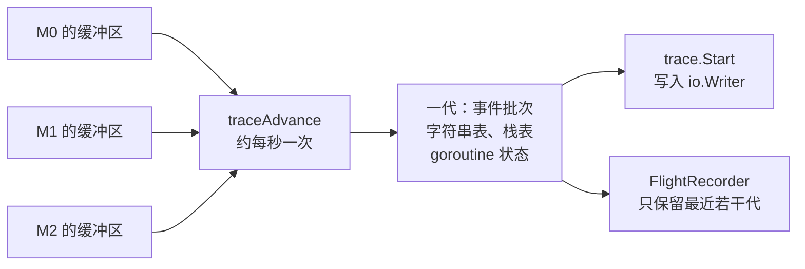

# 16.3 性能追踪

性能剖析（[16.5](./perf.md)）以采样回答「时间花在哪些函数上」：每隔固定的间隔记录一次正在执行的调用栈，
再把样本聚合成调用树。这种方法看不见等待。一个阻塞在通道上的 goroutine 不占用任何 CPU，
采样时不在任何线程上，也就不会出现在 CPU 剖面中。Knyszek 在介绍执行追踪的博文中举的正是这样的例子：大量
goroutine 阻塞在同一个通道上形成的并发瓶颈，在 CPU 剖面中很难看出，因为没有可供采样的执行
[[Knyszek, 2024](#ref-knyszek-2024)]。一次请求耗时 50 毫秒，其中 45 毫秒处理它的 goroutine 根本没有运行，
要解释这 45 毫秒，需要另一种工具。

执行追踪器（execution tracer）不做抽样，而是逐条记录运行时事件：goroutine 的创建、阻塞、唤醒与结束，P
的启动与停止，系统调用的进出，垃圾回收的各个阶段，以及堆大小的变化；多数事件还带有时间戳与调用栈
[[Go Authors, 2026a](#ref-go-authors-2026a)]。把这些事件按时间排开，等待便与执行一样清晰可见。
本节先用一个例子说明追踪记录了什么，再讨论追踪器如何以低开销写出事件、如何在不信任时钟的前提下为事件定序、
如何把追踪切分为自包含的「代」，以及建立在分代之上的飞行记录仪。

## 16.3.1 一条事件的时间线

下面的程序在一个任务（task）中启动一个 goroutine，后者在区域（region）`work` 中休眠 10 毫秒，`main`
则阻塞在通道接收上等待它结束：

```go
package main

import (
	"context"
	"log"
	"os"
	"runtime/trace"
	"time"
)

func main() {
	f, err := os.Create("trace.out")
	if err != nil {
		log.Fatal(err)
	}
	defer f.Close()
	if err := trace.Start(f); err != nil {
		log.Fatal(err)
	}
	defer trace.Stop()

	ctx, task := trace.NewTask(context.Background(), "request")
	defer task.End()

	done := make(chan struct{})
	go func() {
		trace.WithRegion(ctx, "work", func() {
			time.Sleep(10 * time.Millisecond)
		})
		close(done)
	}()
	<-done // main 在此阻塞，等待 work 完成
	trace.Log(ctx, "result", "ok")
}
```

以 Go 1.26.10 运行，再用 `go tool trace` 的调试模式 `-d=parsed` 打印解析后的事件。完整输出有四百余行，
下面只保留与 goroutine 1（即 `main`）和 goroutine 10 相关的事件，删去了线程编号 `M=`、大部分栈与路径前缀：

```shell
$ go run .
$ go tool trace -d=parsed trace.out
P=0 G=1 TaskBegin Time=2837339101203840 ID=1 Parent=18446744073709551615 Type="request"
P=0 G=1 StateTransition Time=2837339101207552 GoID=10 NotExist->Runnable Reason=""
P=0 G=1 StateTransition Time=2837339101208704 GoID=1 Running->Waiting Reason="chan receive"
TransitionStack=
	runtime.chanrecv1 @ 0x104ff6d63
		runtime/chan.go:509
	main.main @ 0x105091fcb
		main.go:32
P=0 G=-1 StateTransition Time=2837339101210112 GoID=10 Runnable->Running Reason=""
P=0 G=10 RegionBegin Time=2837339101211072 Task=1 Type="work"
P=0 G=10 StateTransition Time=2837339101211456 GoID=10 Running->Waiting Reason="sleep"
P=17 G=-1 StateTransition Time=2837339111460480 GoID=10 Waiting->Runnable Reason=""
P=17 G=-1 StateTransition Time=2837339111466880 GoID=10 Runnable->Running Reason=""
P=17 G=10 RegionEnd Time=2837339111468864 Task=1 Type="work"
P=17 G=10 StateTransition Time=2837339111469568 GoID=1 Waiting->Runnable Reason=""
Stack=
	main.main.func1 @ 0x105092093
		main.go:30
P=17 G=10 StateTransition Time=2837339111469632 GoID=10 Running->NotExist Reason=""
P=17 G=-1 StateTransition Time=2837339111471168 GoID=1 Runnable->Running Reason=""
P=17 G=1 Log Time=2837339111473152 Task=1 Category="result" Message="ok"
P=17 G=1 TaskEnd Time=2837339111473408 ID=1 Parent=18446744073709551615 Type="request"
```

从这段输出可以还原 `main` 的 10 毫秒是怎样度过的。goroutine 1 在 `main.go:32` 的通道接收处由 `Running`
转为 `Waiting`，原因是 `chan receive`；goroutine 10 随即开始运行，进入区域 `work`，又因 `sleep` 进入等待。
约 10.25 毫秒后，goroutine 10 被置为可运行并重新执行，结束区域，然后把 goroutine 1 置为可运行。
最后这个事件由 goroutine 10 发出，所附的栈指向 `main.go:30` 的 `close(done)`，追踪因此记下了谁唤醒了谁。
goroutine 1 从可运行到真正开始运行又经过了 1.6 微秒，这是它的调度延迟。`Time` 以纳秒为单位，
上面每一个值都是 64 的倍数，原因见下一小节。

这些信息在 CPU 剖面中无从得到：整个过程中两个 goroutine 实际执行的时间以微秒计，剖面里几乎什么也没有；
追踪则给出了每一段等待的起止、原因与唤醒者。`go tool trace trace.out`
会把同样的数据渲染成网页上的时间线（16.3.7）。

## 16.3.2 每线程缓冲与紧凑编码

追踪开启时，几乎每一次调度都要写出事件，写事件的路径必须足够便宜。Go 1.26 的追踪器为每个 M
配备自己的缓冲区，M 只向自己的缓冲区写入，无须与其他线程同步；每个 M 另有一个写标志，
表明它的缓冲区正在使用 [[Go Authors, 2026a](#ref-go-authors-2026a)]。事件的编码同样简单：
一个字节的事件类型，后跟零个或多个 LEB128 编码的无符号变长整数，每个追踪版本的事件参数由
`internal/trace/tracev2` 中的一张表规定。下面是其中关于 goroutine 的部分
[[Go Authors, 2026c](#ref-go-authors-2026c)]：

```go
	// Goroutines.
	EvGoCreate            // goroutine creation [timestamp, new goroutine ID, new stack ID, stack ID]
	EvGoCreateSyscall     // goroutine appears in syscall (cgo callback) [timestamp, new goroutine ID]
	EvGoStart             // goroutine starts running [timestamp, goroutine ID, goroutine seq]
	EvGoDestroy           // goroutine ends [timestamp]
	EvGoDestroySyscall    // goroutine ends in syscall (cgo callback) [timestamp]
	EvGoStop              // goroutine yields its time, but is runnable [timestamp, reason, stack ID]
	EvGoBlock             // goroutine blocks [timestamp, reason, stack ID]
	EvGoUnblock           // goroutine is unblocked [timestamp, goroutine ID, goroutine seq, stack ID]
	EvGoSyscallBegin      // syscall enter [timestamp, P seq, stack ID]
	EvGoSyscallEnd        // syscall exit [timestamp]
	EvGoSyscallEndBlocked // syscall exit and it blocked at some point [timestamp]
	EvGoStatus            // goroutine status at the start of a generation [timestamp, goroutine ID, M ID, status]
```

以 `GoBlock` 为例。它的时间戳实际记录为与同一缓冲区中前一事件的时间差；阻塞原因与栈都不内联在事件中，
而是字符串表与栈表中的编号。时间差与编号的数值都很小，变长编码后各占一两个字节，
一个阻塞事件因此只占几个字节。上一小节的追踪文件总共只有 4857 字节，开头 16 字节是版本头 `go 1.26 trace`
及补齐的零字节。

时间戳取自操作系统的单调时钟 `nanotime`，再除以 64；Windows 上系统时钟的精度不足，改用 CPU 的时钟计数
`cputicks`，除数也随之调整。源码注释给出了 64 纳秒这一分辨率的依据：追踪器发出事件的频率大约不会高于每
200 纳秒一次，因为这大致是走一遍调度器所需的时间；时间戳除以 64 之后，时间差的绝对值更小，
编码所需的字节也更少 [[Go Authors, 2026b](#ref-go-authors-2026b)]。

## 16.3.3 不依赖时钟的定序

每个 M 各写各的缓冲区，事件在追踪数据中的顺序就不再是它们实际发生的顺序。最直接的办法是按时间戳排序，
但这要求各个核心读到的时钟彼此一致，许多现代 CPU 并不提供这样的保证 [[Knyszek, 2023](#ref-knyszek-2023)]。
Go 1.5 的追踪器最初正是按 `cputicks` 时间戳为事件定序，在时钟不同步的机器与虚拟机上得到了次序错乱的追踪；
Go 1.5 发布之前，Cox 把次序改为由全局序号显式记录，时间戳只用于显示 [[Cox, 2015](#ref-cox-2015)]。
全局序号要求每个事件都同步地递增同一个计数器，在多核机器上代价很高。Go 1.7 改用每个 goroutine 各自的序号
[[Vyukov, 2016](#ref-vyukov-2016)]：goroutine 运行期间不会离开它所在的线程，它自己发出的事件天然有序，
只有由别处「代为」发出的事件，例如唤醒另一个 goroutine 的 `GoUnblock`，才需要携带序号，以便与该 goroutine
的 `GoStart` 定序 [[Knyszek, 2023](#ref-knyszek-2023)]。Go 1.7 的发布说明称，追踪的典型开销由此从至少
400% 降到约 25% [[Go Authors, 2016](#ref-go-authors-2016)]。

现行的追踪器沿用了这一思路。每个 G 与 P 各有一个序号计数器，序号写入相关事件，编码出一个偏序，
计数器在每一代开始时归零；M 不需要序号，因为同一线程写出的事件乃至整个缓冲区，
在数据流中的顺序就是它们的发出顺序 [[Go Authors, 2026a](#ref-go-authors-2026a)]。上面的事件表中，
`GoStart` 与 `GoUnblock` 都带有 `goroutine seq` 参数。解析器的算法写在 `internal/trace` 的注释中
[[Go Authors, 2026d](#ref-go-authors-2026d)]：

```go
	// Trace v2 parsing algorithm.
	//
	// (1) Read in all the batches for the next generation from the stream.
	//   (a) Use the size field in the header to quickly find all batches.
	// (2) Parse out the strings, stacks, CPU samples, and timestamp conversion data.
	// (3) Group each event batch by M, sorted by timestamp. (batchCursor contains the groups.)
	// (4) Organize batchCursors in a min-heap, ordered by the timestamp of the next event for each M.
	// (5) Try to advance the next event for the M at the top of the min-heap.
	//   (a) On success, select that M.
	//   (b) On failure, sort the min-heap and try to advance other Ms. Select the first M that advances.
	//   (c) If there's nothing left to advance, goto (1).
```

时间戳在这里只是提示：解析器先尝试时间戳最小的那个线程，若该线程的下一个事件按序号还不能发生，例如一个
`GoStart` 的序号表明唤醒它的 `GoUnblock` 尚未出现，就改试其他线程。决定次序的是序号，时钟即便不可靠，
得到的也是一个与偏序相容的全序。这与 [16.2](./race.md) 的竞态检测器有相通之处：
二者都在重建程序执行中的偏序，只是检测器要判断任意两次访问之间是否有序，
解析器只需要找到一个与偏序相容的排列。

## 16.3.4 分代：从 Go 1.5 到 Go 1.22

执行追踪器由 Vyukov 于 2014 年设计 [[Vyukov, 2014](#ref-vyukov-2014)]，随 Go 1.5 发布，同时提供了
`go test -trace` 与 `go tool trace` [[Go Authors, 2015](#ref-go-authors-2015)]。此后的几个版本不断扩充它：
Go 1.11 加入了用户标注 [[Go Authors, 2018](#ref-go-authors-2018)]，Go 1.19 起，同时开启 CPU 剖析时，
追踪中会包含 CPU 剖析的样本 [[Go Authors, 2022](#ref-go-authors-2022)]。但它的基本结构此后八年多没有改变，
Knyszek 在 2024 年的博文中把由此带来的问题归纳为四点：开销高；追踪不能伸缩，可能大到无法分析；
往往不清楚何时开始追踪才能捕捉到某个异常；缺少公开的解析包，只有少数人能以编程方式分析追踪
[[Knyszek, 2024](#ref-knyszek-2024)]。

第一个问题的主要成本来自栈回溯：许多事件都附带调用栈。Geisendörfer 与 Ripley
让追踪器直接沿帧指针链展开调用栈，而不必运行通用的栈展开器
[[Geisendörfer, 2023](#ref-geisendorfer-2023)]。Go 1.21 的发布说明称，在 amd64 与 arm64 上收集追踪的 CPU
成本最多降低为原来的十分之一 [[Go Authors, 2023a](#ref-go-authors-2023a)]；按 Knyszek 的博文，追踪的 CPU
开销从许多应用中的 10% 至 20% 降到了 1% 至 2% [[Knyszek, 2024](#ref-knyszek-2024)]。

第二个问题在于旧格式本身。为了降低运行时开销，事件写入相当于线程本地的缓冲区，在数据中并不按真实次序出现，
还原次序的负担落在解析工具上，而旧格式的追踪必须整体解析才能得到有用的结果，既无法流式处理，
对大追踪的解析与校验也需要大量内存 [[Knyszek, 2023](#ref-knyszek-2023)]，几百 MiB 的追踪可能需要数 GiB
内存来分析 [[Knyszek, 2024](#ref-knyszek-2024)]。Knyszek 的重新设计以「分代」解决这一问题
[[Knyszek, 2023](#ref-knyszek-2023)]：运行时周期性地推进一代，默认周期约为一秒（可由
`GODEBUG=traceadvanceperiod` 调整）。推进时，`traceAdvance` 确认每个 M 都已看到新的代号，
再刷出上一代残留的缓冲区；每个 M 因此为缓冲区保留两个槽位，一个属于上一代，一个属于当前代。
每一代都是自包含的：它有自己的字符串表与栈表，并且至少为每个存活的 goroutine 写出一次状态事件，
交代它在这一代开始时的状态 [[Go Authors, 2026a](#ref-go-authors-2026a)]。16.3.1 的完整输出开头有若干
`Undetermined->Running` 之类的转换，就是解析器在第一代中初次见到这类状态事件时给出的：在此之前，
它不知道这个 goroutine 或 P 处于什么状态。



新的追踪器随 Go 1.22 成为默认实现。发布说明列出了重写带来的变化：在除 Windows
以外的多数平台上使用操作系统的时钟，追踪因此能与更底层组件产生的追踪对齐；
追踪的正确性不再依赖平台时钟的可靠性；追踪被定期切分，可以流式处理；系统调用都有完整的持续时间；
追踪记录了 goroutine 运行所在的操作系统线程；开始与停止追踪对延迟的影响大幅降低；
追踪可以在垃圾回收的标记阶段开始或结束 [[Go Authors, 2024](#ref-go-authors-2024)]。旧的实现在 Go 1.23
中被删除 [[Amedee, 2024](#ref-amedee-2024)]。

## 16.3.5 采集与用户标注

采集追踪有三种常见的方式。在程序中用 `trace.Start` 与 `trace.Stop` 圈定一段时间，事件写入任意
`io.Writer`，16.3.1 的例子就是这样做的；运行测试时加上 `go test -trace=trace.out`；对于服务程序，导入
`net/http/pprof` 后，`/debug/pprof/trace?seconds=5` 会返回接下来 5 秒的追踪
[[Go Authors, n.d.a](#ref-go-authors-nda)]。

运行时事件说明了 goroutine 为什么等待，却不知道它在为哪一项业务工作。Go 1.11
加入的用户标注把业务语义叠加到时间线上 [[Kim, 2017](#ref-kim-2017);
[Go Authors, 2018](#ref-go-authors-2018)]。任务由 `trace.NewTask` 创建、`Task.End` 结束，通过
`context.Context` 传递，可以跨越多个 goroutine，适合表示一次请求；区域由 `trace.WithRegion` 或
`trace.StartRegion` 标注，只属于一个 goroutine，必须在开始它的 goroutine 中结束，并且在同一 goroutine
内严格嵌套；`trace.Log` 与 `trace.Logf` 在时间线上记录一条带分类的消息；`trace.IsEnabled`
报告追踪是否开启，可以用来跳过代价较高的标注 [[Go Authors, 2026f](#ref-go-authors-2026f)]。在 16.3.1
的输出中，它们分别表现为 `TaskBegin` 与 `TaskEnd`、`RegionBegin` 与 `RegionEnd`，以及 `Log` 事件。

## 16.3.6 飞行记录仪

即使开销降到了百分之一二，「何时开始追踪」的问题依然存在。长期运行的服务可能连续工作数天甚至数周，
追踪其全部执行会产生过多的数据；而通常只有某一段执行出了问题，例如一次请求超时，等到程序发现它时再调用
`Start` 已经太迟 [[Amedee and Knyszek, 2025](#ref-amedee-and-knyszek-2025)]。飞行记录仪（flight recorder）
的思路是让追踪一直开着，但只在内存中保留最近的一段数据，程序察觉异常时再把这一段写出。在分代之前，
这一做法几乎不可行，因为旧格式的追踪无法从中间截取；有了自包含的代，
保留最近若干代就足以随时拼出一份合法的追踪 [[Knyszek, 2024](#ref-knyszek-2024)]。

飞行记录仪先以实验包的形式出现在 `golang.org/x/exp/trace` 中 [[Knyszek, 2024](#ref-knyszek-2024)]，
经过提案讨论 [[Go Authors, 2023b](#ref-go-authors-2023b)]，Go 1.25 把它移入标准库 `runtime/trace`
[[Amedee, 2025](#ref-amedee-2025); [Go Authors, 2025](#ref-go-authors-2025)]。
下面的程序启动一个飞行记录仪，经过一段执行之后取出快照：

```go {run=true}
package main

import (
	"bytes"
	"fmt"
	"runtime/trace"
	"time"
)

func main() {
	fr := trace.NewFlightRecorder(trace.FlightRecorderConfig{
		MinAge:   2 * time.Second, // 窗口至少覆盖最近 2 秒
		MaxBytes: 4 << 20,         // 窗口大小的上界，优先于 MinAge
	})
	if err := fr.Start(); err != nil {
		panic(err)
	}
	defer fr.Stop()

	done := make(chan struct{})
	go func() {
		time.Sleep(10 * time.Millisecond)
		close(done)
	}()
	<-done

	// 检测到异常时，把窗口快照写出；这里写入内存
	var buf bytes.Buffer
	if _, err := fr.WriteTo(&buf); err != nil {
		panic(err)
	}
	fmt.Printf("%q\n", buf.Bytes()[:16])
}
```

快照的开头与 16.3.1 中 `trace.Start` 写出的文件相同，它就是一份普通的追踪，可以用 `go tool trace` 打开。
在实现上，飞行记录仪与 `trace.Start` 一样是追踪数据的订阅者：每当一代结束，
它把这一代的批次放入一个环形结构，并按配置决定保留哪些较早的代
[[Go Authors, 2026e](#ref-go-authors-2026e)]：

```go
	newRing := []rawGeneration{r.active}
	size := r.active.size
	for i := len(r.ring) - 1; i >= 0; i-- {
		// Stop adding older generations if the new ring already exceeds the thresholds.
		// This ensures we keep generations that cross a threshold, but not any that lie
		// entirely outside it.
		if uint64(size) > r.wantSize || now.Sub(newRing[len(newRing)-1].minTime) > r.wantDur {
			break
		}
		size += r.ring[i].size
		newRing = append(newRing, r.ring[i])
	}
```

刚结束的一代总会保留；更早的代从新到旧依次加入，直到总大小超过 `MaxBytes`，或者最早一代的起始时间早于
`MinAge` 所规定的界限。窗口因此以代为单位伸缩，实际覆盖的时间比 `MinAge` 略长；而当事件密集、`MaxBytes`
偏小时，大小的限制优先，窗口可能短于 `MinAge`，这正是 `FlightRecorderConfig` 的文档所说的 `MaxBytes`
优先于 `MinAge`。两个字段为零时，当前实现分别取 10 秒与 10 MiB，文档只承诺它们由实现决定。`WriteTo`
先强制推进一代，使截至调用时的数据都已刷出，然后写出版本头与环中的全部批次；同一时刻只能有一个 `WriteTo`
在执行，整个程序中也只能有一个飞行记录仪处于活动状态，但它可以与一个 `trace.Start` 同时工作
[[Go Authors, 2026e](#ref-go-authors-2026e)]。

关于参数的选择，发布飞行记录仪的博文建议把 `MinAge` 设为所要调查事件时间窗口的两倍左右，例如调查一次
5 秒的超时，就设为 10 秒；作为参考，每秒执行通常产生几 MB 追踪数据，繁忙的服务可达每秒 10 MB
[[Amedee and Knyszek, 2025](#ref-amedee-and-knyszek-2025)]。

## 16.3.7 阅读追踪

`go tool trace trace.out` 启动一个本地 Web 服务，首页列出几类视图：按 P 或按线程排列的时间线，goroutine
分析，网络、同步、系统调用三类阻塞剖面与调度延迟剖面，用户定义的任务与区域，以及最小赋值器利用率（MMU）
曲线 [[Go Authors, n.d.b](#ref-go-authors-ndb); [Go Authors, 2026g](#ref-go-authors-2026g)]。
时间线视图的横轴是时间，纵轴按 P（或线程）分行，每个 goroutine 在它运行的 P 上画成一段段色块；
某一行长时间空白而别处有 goroutine 等待运行，说明调度或负载不均；垃圾回收的标记辅助与停止一切占满各行，
是垃圾回收干扰延迟的直接证据；点开一段色块，可以看到它开始与结束时的栈，以及唤醒它的事件。
阻塞剖面与调度延迟剖面也可以不经浏览器，用 `go tool trace -pprof=net|sync|syscall|sched` 直接输出为 pprof
格式。Go 1.27 起，若 `-http` 只给出端口（例如 `-http=:6060`），服务只监听本机地址，与 `go tool pprof`
的行为一致；要监听所有地址，须显式写出 `-http=0.0.0.0:6060` [[Go Authors, 2026h](#ref-go-authors-2026h)]。

`go tool trace` 所用的解析器位于标准库的 `internal/trace` 中，外部程序无法导入。Go 1.22
随新追踪器提供了实验性的 `golang.org/x/exp/trace`，以 `Reader` 按事件流式读取追踪，
事件以状态转换等类型化的形式给出 [[Go Authors, 2024](#ref-go-authors-2024);
[Knyszek, 2024](#ref-knyszek-2024)]。前面 `-d=parsed` 打印的正是这一层次的事件，基于它可以编写自己的分析，
例如统计 goroutine 阻塞中有多大比例是在等待网络。

## 16.3.8 小结

把 Go 的几种诊断工具放在一起，分工就清楚了：

| 工具 | 回答的问题 | 数据形态 | 典型场景 |
| --- | --- | --- | --- |
| 性能剖析（[16.5](./perf.md)） | 资源（CPU、内存）花在**哪些函数**上 | 聚合的采样 | CPU 热点、内存占用归因 |
| 执行追踪（本节） | 时间线上**发生了什么、为什么等待** | 逐条的事件 | 尾延迟、调度异常、垃圾回收干扰 |
| `runtime/metrics`（[16.6](./metric.md)） | 系统**整体状态**如何随时间变化 | 持续的指标 | 监控告警、容量评估 |

常见的排查路线是：先从指标中发现异常，例如延迟升高、垃圾回收变得频繁；再用剖析定位消耗资源的代码；
若问题出在等待而非计算，就用追踪看清时间线上的因果。

执行追踪器记录的是运行时内部的状态转换，本书第三、四部分讨论的调度器
（[9](../../part3concurrency/ch09sched)）与垃圾回收器（[13](../../part4memory/ch13gc)）的行为，
都能在追踪中直接看到。它的设计围绕一个约束展开：写事件必须便宜，因此每个线程各写各的缓冲区，事件紧凑编码，
次序交给序号与解析器重建；Go 1.22 的分代使每一段追踪自包含，追踪由此可以流式处理，也可以只保留最近的一段，
Go 1.25 的飞行记录仪正是建立在这一性质之上。

## 延伸阅读

- <a id="ref-amedee-2024"></a>[Amedee, 2024] Carlos Amedee. runtime, cmd/trace: remove code paths that
  include v1 tracer. Go commit 2c5849dc40, 2024. https://go.dev/cl/576256
  随 Go 1.23 发布。
- <a id="ref-amedee-2025"></a>[Amedee, 2025] Carlos Amedee. runtime/trace: add the flight recorder. Go
  commit 83df0afc4e, 2025. https://go.dev/cl/673116
  随 Go 1.25 发布。
- <a id="ref-amedee-and-knyszek-2025"></a>[Amedee and Knyszek, 2025] Carlos Amedee and Michael Knyszek.
  *Flight Recorder in Go 1.25.* The Go Blog, 2025-09-26. https://go.dev/blog/flight-recorder
- <a id="ref-cox-2015"></a>[Cox, 2015] Russ Cox. runtime/trace: record event sequence numbers explicitly.
  Go commit 80c98fa901, 2015. https://go.dev/cl/12579
  随 Go 1.5 发布。
- <a id="ref-geisendorfer-2023"></a>[Geisendörfer, 2023] Felix Geisendörfer. runtime/trace: enable frame
  pointer unwinding on amd64. Go commit ba71817390, 2023. https://go.dev/cl/463835
  随 Go 1.21 发布。
- <a id="ref-go-authors-nda"></a>[Go Authors, n.d.a] The Go Authors. *Package runtime/trace.*
  https://pkg.go.dev/runtime/trace
- <a id="ref-go-authors-ndb"></a>[Go Authors, n.d.b] The Go Authors. *Command trace（`go tool trace`）.*
  https://pkg.go.dev/cmd/trace
- <a id="ref-go-authors-2015"></a>[Go Authors, 2015] The Go Authors. *Go 1.5 Release Notes.* 2015.
  https://go.dev/doc/go1.5
  `go tool trace` 与 `runtime/trace` 首次发布。
- <a id="ref-go-authors-2016"></a>[Go Authors, 2016] The Go Authors. *Go 1.7 Release Notes.* 2016.
  https://go.dev/doc/go1.7
  追踪的典型开销由至少 400% 降到约 25%。
- <a id="ref-go-authors-2018"></a>[Go Authors, 2018] The Go Authors. *Go 1.11 Release Notes.* 2018.
  https://go.dev/doc/go1.11
  用户标注 API。
- <a id="ref-go-authors-2022"></a>[Go Authors, 2022] The Go Authors. *Go 1.19 Release Notes.* 2022.
  https://go.dev/doc/go1.19
  追踪中包含 CPU 剖析样本。
- <a id="ref-go-authors-2023a"></a>[Go Authors, 2023a] The Go Authors. *Go 1.21 Release Notes.* 2023.
  https://go.dev/doc/go1.21
  收集追踪的 CPU 成本最多降低为十分之一。
- <a id="ref-go-authors-2023b"></a>[Go Authors, 2023b] The Go Authors. *runtime/trace: flight recording.*
  Go issue #63185, 2023. https://go.dev/issue/63185
  飞行记录仪的提案，API 随 Go 1.25 进入 `runtime/trace`。
- <a id="ref-go-authors-2024"></a>[Go Authors, 2024] The Go Authors. *Go 1.22 Release Notes.* 2024.
  https://go.dev/doc/go1.22
  重写后的执行追踪器成为默认实现；实验性的 `golang.org/x/exp/trace`。
- <a id="ref-go-authors-2025"></a>[Go Authors, 2025] The Go Authors. *Go 1.25 Release Notes.* 2025.
  https://go.dev/doc/go1.25
  `runtime/trace.FlightRecorder`。
- <a id="ref-go-authors-2026a"></a>[Go Authors, 2026a] The Go Authors. src/runtime/trace.go 与
  src/runtime/trace/. Go 1.26 源码.
  https://github.com/golang/go/blob/release-branch.go1.26/src/runtime/trace.go
  https://github.com/golang/go/tree/release-branch.go1.26/src/runtime/trace
  前者开头的设计注释与不变式；后者为用户接口。
- <a id="ref-go-authors-2026b"></a>[Go Authors, 2026b] The Go Authors. src/runtime/tracetime.go. Go 1.26
  源码. https://github.com/golang/go/blob/release-branch.go1.26/src/runtime/tracetime.go
- <a id="ref-go-authors-2026c"></a>[Go Authors, 2026c] The Go Authors.
  src/internal/trace/tracev2/events.go. Go 1.26 源码.
  https://github.com/golang/go/blob/release-branch.go1.26/src/internal/trace/tracev2/events.go
- <a id="ref-go-authors-2026d"></a>[Go Authors, 2026d] The Go Authors. src/internal/trace/reader.go. Go
  1.26 源码. https://github.com/golang/go/blob/release-branch.go1.26/src/internal/trace/reader.go
- <a id="ref-go-authors-2026e"></a>[Go Authors, 2026e] The Go Authors. src/runtime/trace/flightrecorder.go
  与 src/runtime/trace/recorder.go. Go 1.26 源码.
  https://github.com/golang/go/blob/release-branch.go1.26/src/runtime/trace/flightrecorder.go
- <a id="ref-go-authors-2026f"></a>[Go Authors, 2026f] The Go Authors. src/runtime/trace/annotation.go. Go
  1.26 源码. https://github.com/golang/go/blob/release-branch.go1.26/src/runtime/trace/annotation.go
- <a id="ref-go-authors-2026g"></a>[Go Authors, 2026g] The Go Authors. src/cmd/trace/main.go 与
  src/internal/trace/traceviewer/http.go. Go 1.26 源码.
  https://github.com/golang/go/blob/release-branch.go1.26/src/cmd/trace/main.go
- <a id="ref-go-authors-2026h"></a>[Go Authors, 2026h] The Go Authors. *Go 1.27 Release Notes.* 2026.
  https://go.dev/doc/go1.27
  `go tool trace -http` 只给出端口时仅监听本机地址。
- <a id="ref-kim-2017"></a>[Kim, 2017] Hana Kim. runtime/trace: implement annotation API. Go commit
  6977a3b257, 2017. https://go.dev/cl/71690
  随 Go 1.11 发布。
- <a id="ref-knyszek-2023"></a>[Knyszek, 2023] Michael Knyszek. *Execution tracer overhaul.* Go design
  document, 2023. https://go.googlesource.com/proposal/+/master/design/60773-execution-tracer-overhaul.md
  分代、按线程组织缓冲区、改用操作系统时钟的设计与理由；部分内容已与实现不符。
- <a id="ref-knyszek-2024"></a>[Knyszek, 2024] Michael Knyszek. *More powerful Go execution traces.* The
  Go Blog, 2024-03-14. https://go.dev/blog/execution-traces-2024
  低开销追踪、可伸缩的追踪格式、飞行记录仪与追踪读取 API。
- <a id="ref-vyukov-2014"></a>[Vyukov, 2014] Dmitry Vyukov. *Go Execution Tracer（design proposal）.*
  2014. https://go.dev/s/go15trace
- <a id="ref-vyukov-2016"></a>[Vyukov, 2016] Dmitry Vyukov. runtime: use per-goroutine sequence numbers in
  tracer. Go commit a3703618ea, 2016. https://go.dev/cl/21512
  随 Go 1.7 发布。
- 本书 [16.5 基准测试与性能剖析](./perf.md)、[16.6 运行时统计量](./metric.md)、
  [9 调度器](../../part3concurrency/ch09sched)、[13 垃圾回收](../../part4memory/ch13gc)。
