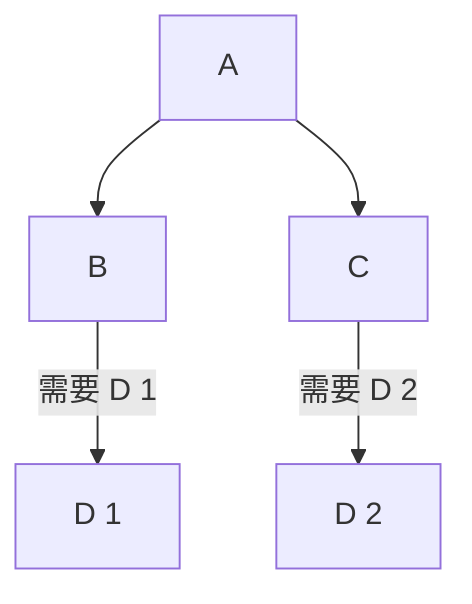

# 17.1 依赖管理的难点

Cox 借用 Titus Winters 的说法，把软件工程定义为「加入了时间与其他程序员之后的编
程」[[Cox, 2019](#ref-cox-2019)]。依赖恰好同时带来了这两样东西：被依赖的代码由别人编写，
并按别人的节奏发布新版本。一个程序今天能够构建，明年能否以同样的方式构建；同一个依赖的两个使用者，
能否在同一个程序中相安无事，都不完全由程序的作者决定。Winters 同样强调，
依赖带来的兼容性问题是软件工程问题而非编程问题：麻烦并不在于让依赖今天能用，而在于依赖随时间的变化
[[Winters et al., 2020](#ref-winters-et-al-2020)]。本节从三个层面说明这一问题：GOPATH 时代的 `go get`
为何在版本问题上失效，版本选择为何在一般情形下是 NP 完全问题，以及「取最新版本」
的策略为何与可重复构建相冲突。Go 模块的回答见 [17.2](./semantics.md) 至 [17.4](./fight.md)。

## 17.1.1 没有版本的 `go get`

Go 的第一个包安装工具是 `goinstall`，由 Cox 于 2010 年 3 月加入代码库，提交标题称之为一次「（外部）
包安装的实验」[[Cox, 2010](#ref-cox-2010)]。Go 1 发布之前，它被 `go get` 取代
[[Niemeyer, 2012](#ref-niemeyer-2012)]。两者遵循同一个模型：导入路径既是代码仓库的地址，也是
`$GOPATH/src` 下的目录，`import "github.com/foo/bar"` 对应磁盘上的 `$GOPATH/src/github.com/foo/bar`。
一个导入路径在磁盘上只有一份代码，至于这份代码是哪个版本，没有任何地方记录。

这并非疏忽。2013 年，Go 1.2 的 FAQ 加入了一条关于版本的问答，说明 `go get` 有意不处理版本
[[Cox, 2013](#ref-cox-2013)]：

```text
"Go get" does not have any explicit concept of package versions.
Versioning is a source of significant complexity, especially in large code bases,
and we are unaware of any approach that works well at scale in a large enough
variety of situations to be appropriate to force on all Go users.
```

FAQ 转而给出两条建议。对包的作者：保持向后兼容，需要不同的功能时增加新的名字而不改变旧的名字，
必须彻底破坏兼容时，改用新的导入路径。对包的使用者：如果担心依赖以意想不到的方式变化，
就把它复制到自己的仓库中，存放在新的导入路径下，FAQ 注明这正是 Google 内部的做法。
前一条后来被命名为导入兼容性规则（[17.2](./semantics.md)），后一条则是 `vendor` 目录的前身。

Boyer 指出，`go get` 的行为只有在两个前提下才是正确的：代码总是向后兼容，并且不存在固定的发布版本
[[Boyer, 2016b](#ref-boyer-2016b)]。由于 `go get` 只取仓库默认分支上的最新代码，
标记发布版本对普通用户没有任何影响，多数开发者也就不再标记版本。前提一旦不成立，`go get`
会以两种相反的方式出错。Cox 用下面的例子说明了这两种失败 [[Cox, 2019](#ref-cox-2019)]：

```text
$ go get D       # 下载 D 的最新版本 D 1.0
$ go get C       # 下载 C 1.8；C 需要 D 1.4，但磁盘上已有 D 1.0，于是沿用：D 太旧
$ go get -u C    # 把所有依赖更新到最新；D 恰好刚刚发布了有缺陷的 D 1.6：D 太新
```

C 的作者在 D 1.4 上开发和测试，构建真正需要的正是 D 1.4。`go get` 不知道版本的存在，只能在「磁盘上已有的」
与「仓库中最新的」两者之间选择，而两者都不是 D 1.4。

社区为此编写了大量工具。Go 团队的回应是 `vendor` 目录：Go 1.5 以环境变量 `GO15VENDOREXPERIMENT`
提供实验性的支持，Go 1.6 默认启用，Go 1.7 起成为标准功能 [[Go Authors, 2016a](#ref-go-authors-2016a);
[Go Authors, 2016b](#ref-go-authors-2016b)]。`vendor` 允许每个项目在自己的目录树中保存依赖的副本，
解决了依赖的隔离，却没有回答依赖应当是哪个版本，也没有统一的方式记录这一选择。
各种工具在此基础上各自记录版本，格式互不相通。2016 年，社区组成委员会，着手设计统一的工具，即后来的
`dep`（[17.4](./fight.md)）。

## 17.1.2 钻石依赖

设程序 A 依赖 B 和 C，B 需要 D 的版本 1，C 需要 D 的版本 2，且两个版本互不兼容。依赖图从 A 分为两支，在 D
处汇合，形如钻石，这一情形因此称为**钻石依赖**（diamond dependency）[[Cox, 2016](#ref-cox-2016)]：



如果一个程序只能包含 D 的一个版本，这张依赖图就无法构建。在 Go 中，这一限制来自构建系统本身：
一个导入路径只能指称唯一的包 [[Cox, 2019](#ref-cox-2019)]。即使构建系统允许两份副本共存，
问题也不会就此消失。两个版本中同名的类型是不同的类型，B 从 D 1 得到的值不能交给期望 D 2 的 C；
包级别的状态也会重复，假如 D 在初始化时注册了一个命令行标志或 HTTP 处理函数，除非两个版本之间显式协调，
否则同时存在就会冲突 [[Cox, 2019](#ref-cox-2019)]。

语义化版本规范在引言中把这类困境称为「依赖地狱」，并指出它有两个方向：依赖关系定得过紧，
升级一个包就必须为每个依赖它的包发布新版本，即版本锁死；定得过松，则假定了与过多未来版本的兼容，
即版本混乱 [[Preston-Werner, 2013](#ref-preston-werner-2013)]。前者让升级寸步难行，
后者让构建随时可能被一个新版本破坏。依赖管理工具的全部设计，都可以看作在这两个方向之间寻找位置。

## 17.1.3 版本选择是 NP 完全问题

钻石依赖说明版本选择可能无解，更深的问题在于，判断它是否有解本身就很困难。Cox 在
2016 年的一篇文章中给出了证明：只要包管理器满足下面四条假设，判定一组依赖能否被满足就是 NP 完全问题
[[Cox, 2016](#ref-cox-2016)]：

1. 一个包可以把零个或多个包、或包的特定版本列为依赖；
2. 安装一个包，必须安装它的全部依赖；
3. 一个包的不同版本可以有不同的依赖；
4. 同一个包的两个不同版本不能同时安装。

证明把 3-SAT 归约为版本选择。每个布尔变量 $x_j$ 对应一个包 $X_j$，它有两个互斥的版本 $X_j{:}0$ 与
$X_j{:}1$，安装 $X_j{:}1$ 表示 $x_j$ 为真。每个子句 $C_i$ 对应一个有三个版本的包，第 $k$
个版本依赖使子句中第 $k$ 个文字为真的那个变量版本。最后，一个包 $F$ 依赖全部的 $C_i$。以子句 $C_5 = (x_1
\lor \lnot x_2 \lor x_4)$ 为例：

```text
C5:0 依赖 X1:1      子句中的第一个文字 x1 为真
C5:1 依赖 X2:0      子句中的第二个文字 ¬x2 为真
C5:2 依赖 X4:1      子句中的第三个文字 x4 为真
F    依赖 C1, C2, ..., Cn
```

$F$ 可以安装，当且仅当每个 $C_i$ 都有一个版本可以安装，即每个子句都有一个文字为真，也就是原公式可满足。
包的「多个版本、每个版本依赖不同」在这里扮演了析取的角色。Cox 在文中说明，EDOS 项目 2005 年的报告已经证明
Debian 与 RedHat 的包安装是 NP 完全的，但那一证明借助了这些系统中「多选一」的依赖语法，而 Cox
的构造只用到上述四条几乎所有包管理器都满足的假设，因此同样适用于 Cargo、npm 这类语言级的包管理器
[[Cox, 2016](#ref-cox-2016)]。文末还致谢 Boyer 指出了 EDOS 的报告；Boyer 本人对包管理器设计空间的梳理见
[[Boyer, 2016a](#ref-boyer-2016a)]。

这一结论有两层含义。第一，在最坏情况下，包管理器要么可能花费极长的时间求解，
要么可能把本可安装的包报告为无法安装。Cox 的考察表明，许多包管理器因此转向 SAT 求解器或回溯搜索
[[Cox, 2016](#ref-cox-2016)]。EDOS 项目本身也把 Debian 的可安装性问题编码为布尔公式，交给 SAT 求解器判定
[[Mancinelli et al., 2006](#ref-mancinelli-et-al-2006)]。第二，求解器的答案未必唯一。当「最新的 B
与较旧的 C」和「较旧的 B 与最新的 C」都满足约束时，选择哪一个并没有明确的标准，使用者也难以预测结果
[[Cox, 2019](#ref-cox-2019)]。何况约束本身往往不完整：求解器只能排除已被声明的不兼容，
一个「尚未被发现有问题」的组合，不等于一个能够工作的组合。

同一篇文章也指出了避开 NP 完全的方向，即放弃四条假设中的某一条 [[Cox, 2016](#ref-cox-2016)]。
如果依赖只能声明最低版本，不能指定特定版本或排除某些版本（放弃第一条），选择就不再需要搜索；
如果允许同一个包的不同版本同时存在（放弃第四条），冲突也就不会出现。若包遵循语义化版本，两者还可以结合：
同一主版本内只取一个版本，不同的主版本视为不同的包。两年后的 Go 模块正是沿着这两个方向设计的
[[Cox, 2018a](#ref-cox-2018a)]（[17.2](./semantics.md)、[17.3](./minimum.md)）。

## 17.1.4 可重复构建与锁文件

第二个难点是时间。如果依赖解析的规则是「取满足约束的最新版本」，解析的结果就成了构建时刻的函数。C
声明需要 D 1.4 或更高版本：昨天，满足条件的最新版本是 D 1.5；今天 D 1.6 发布了，同一份声明就解析出 D 1.6
[[Cox, 2019](#ref-cox-2019)]。没有人修改一行代码或一行依赖声明，构建的产物却变了。一旦 D 1.6 引入缺陷，
线上的问题可能在本地无法复现，因为两处的构建悄悄使用了不同的 D。

`dep`、Bundler、Cargo 等工具以**锁文件**应对：清单文件声明可接受的版本范围，
锁文件记录某次解析得到的每个依赖的确切版本，此后的构建以锁文件为准。锁文件保证了整个程序的可重复构建，
但它只对整个程序有效。当 C 是一个库、作为更大程序的一部分被构建时，C 自己的锁文件不能约束外层程序的解析，
这些工具只能忽略它，退回到依赖于时间的默认决策 [[Cox, 2019](#ref-cox-2019)]。于是同一个库，
在作者那里使用一组版本，在使用者那里使用另一组版本。Cox 把这种无正当理由地偏离作者构建的情形称为
**低保真构建**（low-fidelity build）[[Cox, 2018b](#ref-cox-2018b)]。

可重复还要求同一个版本号始终对应同样的内容。语义化版本规范规定，一个版本一经发布，其内容不得修改
[[Preston-Werner, 2013](#ref-preston-werner-2013)]，但版本控制系统中的标签可以被移动，
托管代码的服务器也可能被篡改。这一问题由 `go.sum` 与校验和数据库解决（[17.4](./fight.md)）。

## 17.1.5 Go 的回答：三条原则

2019 年，Cox 把 Go 模块不沿用 `dep` 设计的原因归结为三条原则 [[Cox, 2019](#ref-cox-2019)]：

```text
Compatibility. The meaning of a name in a program should not change over time.
Repeatability. The result of a build of a given version of a package should not change over time.
Cooperation. To maintain the Go package ecosystem, we must all work together.
Tools cannot work around a lack of cooperation.
```

兼容性是说，程序中一个名字的含义不应随时间改变；可重复性是说，一个包的给定版本，其构建结果不应随时间改变；
协作是说，维护 Go 的包生态需要所有人共同努力，工具无法弥补协作的缺失。
前两条分别消除了时间对程序含义与构建结果的影响，第三条承认，无论工具多么先进，
不兼容最终只能由相关的作者合作修复。三条原则与本节各个难点的对应如下，各项机制的规范定义见 Go
模块参考手册 [[Go Authors, n.d.](#ref-go-authors-nd)]：

| 难点 | 原则 | Go 模块的机制 | 详见 |
|:----|:----|:-------------|:----|
| 钻石依赖中不兼容的主版本 | 兼容性 | 语义化导入版本：不同的主版本使用不同的导入路径 | [17.2](./semantics.md) |
| 版本选择的 NP 完全性 | 兼容性 | 依赖只声明最低版本，不声明不兼容 | [17.3](./minimum.md) |
| 解析结果随时间变化 | 可重复性 | 最小版本选择，无需锁文件 | [17.3](./minimum.md) |
| 版本内容可能被替换 | 可重复性 | `go.sum` 与校验和数据库 | [17.4](./fight.md) |
| 新版本破坏既有组合 | 协作 | 构建不会自动采用新版本，为修复留出时间 | [17.3](./minimum.md) |

## 17.1.6 小结

依赖管理的困难来自两个方面。一是组合：钻石依赖可能无解，而判定是否有解在一般情形下是 NP 完全的。二是时间：
「取最新版本」使构建结果依赖于构建的时刻，锁文件只能修补整个程序，修补不了库。GOPATH 时代的 `go get`
两方面都没有处理，它只认识磁盘上已有的代码和仓库中最新的代码。Go 模块的做法是同时放宽问题的两条前提：
让不兼容的版本拥有不同的名字，从而可以共存；让依赖只声明最低版本，从而选择无需搜索、也不随时间变化。
后续各节依次讨论这两项设计及其由来。

## 延伸阅读

- <a id="ref-boyer-2016a"></a>[Boyer, 2016a] Sam Boyer. *So you want to write a package manager.* 2016.
  https://medium.com/@sdboyer/so-you-want-to-write-a-package-manager-4ae9c17d9527
  `dep` 作者对版本求解与 SAT 复杂度的系统梳理。
- <a id="ref-boyer-2016b"></a>[Boyer, 2016b] Sam Boyer. *The Saga of Go Dependency Management.* Gopher
  Academy Blog, 2016-12-13. https://blog.gopheracademy.com/advent-2016/saga-go-dependency-management/
  `go get` 的隐含前提、`vendor` 的引入，以及 2016 年包管理委员会的成立与工作计划。
- <a id="ref-cox-2010"></a>[Cox, 2010] Russ Cox. goinstall: an experiment in (external) package
  installation. Go commit 3e4e4ec704, 2010. https://golang.org/cl/224043
  随 2010 年 3 月 15 日的周发布版本提供，Go 1 之前移除。
- <a id="ref-cox-2013"></a>[Cox, 2013] Russ Cox. doc/faq: add a FAQ about versioning. Go commit
  dc8d903155, 2013. https://golang.org/cl/14283044
  随 Go 1.2 发布。
- <a id="ref-cox-2016"></a>[Cox, 2016] Russ Cox. *Version SAT.* 2016-12-13.
  https://research.swtch.com/version-sat
  版本选择 NP 完全性的证明、各包管理器的求解方式，以及避开 NP 完全的几个方向。
- <a id="ref-cox-2018a"></a>[Cox, 2018a] Russ Cox. *Go & Versioning.* 2018. https://research.swtch.com/vgo
  2018 年 2 月的七篇系列文章及后续文章的目录，尤见 *Semantic Import Versioning* 与 *Minimal Version
  Selection* 两篇，分别对应钻石依赖与求解复杂度。
- <a id="ref-cox-2018b"></a>[Cox, 2018b] Russ Cox. *Minimal Version Selection.* 2018-02-21.
  https://research.swtch.com/vgo-mvs
  论证 MVS 对应的约束同时属于 2-SAT、Horn-SAT 与 Dual-Horn-SAT，故可在多项式时间内求解；
  低保真构建与高保真构建的对比。
- <a id="ref-cox-2019"></a>[Cox, 2019] Russ Cox. *The Principles of Versioning in Go.* 2019-12-03.
  https://research.swtch.com/vgo-principles
  兼容性、可重复性、协作三条原则，以及 Go 模块与 `dep` 在设计上的差别。
- <a id="ref-go-authors-2016a"></a>[Go Authors, 2016a] The Go Authors. *Go 1.6 Release Notes.* 2016.
  https://go.dev/doc/go1.6
  `vendor` 默认启用。
- <a id="ref-go-authors-2016b"></a>[Go Authors, 2016b] The Go Authors. *Go 1.7 Release Notes.* 2016.
  https://go.dev/doc/go1.7
  移除 `GO15VENDOREXPERIMENT`，`vendor` 成为标准功能。
- <a id="ref-go-authors-nd"></a>[Go Authors, n.d.] The Go Authors. *Go Modules Reference.*
  https://go.dev/ref/mod
  `go.mod`、`go.sum`、模块图、构建列表与 MVS 的权威定义。
- <a id="ref-mancinelli-et-al-2006"></a>[Mancinelli et al., 2006] Fabio Mancinelli, Jaap Boender, Roberto
  Di Cosmo, Jérôme Vouillon, Berke Durak, Xavier Leroy, Ralf Treinen. Managing the Complexity of Large
  Free and Open Source Package-Based Software Distributions. *ASE 2006*, pp. 199–208.
  https://doi.org/10.1109/ASE.2006.49
  EDOS 项目的成果之一，把 Debian 的可安装性问题编码为 SAT 问题求解。
- <a id="ref-niemeyer-2012"></a>[Niemeyer, 2012] Gustavo Niemeyer. cmd/goinstall: remove now that 'go get'
  works. Go commit 1e5b7e706e, 2012. https://golang.org/cl/5572083
  随 Go 1 发布。
- <a id="ref-preston-werner-2013"></a>[Preston-Werner, 2013] Tom Preston-Werner.
  *Semantic Versioning 2.0.0.* 2013. https://semver.org/
  引言中「依赖地狱」的两个方向；第 3 条：已发布版本的内容不得修改。
- <a id="ref-winters-et-al-2020"></a>[Winters et al., 2020] Titus Winters, Tom Manshreck, Hyrum Wright
  (eds.). *Software Engineering at Google.* O'Reilly, 2020. 第 21 章「Dependency Management」（Titus
  Winters 撰写）. https://abseil.io/resources/swe-book/html/ch21.html
  大规模依赖管理的难点与权衡。
- 本书 [17.2 语义化版本管理](./semantics.md)、[17.3 最小版本选择算法](./minimum.md)、[17.4
  vgo 与 dep 之争](./fight.md)。
