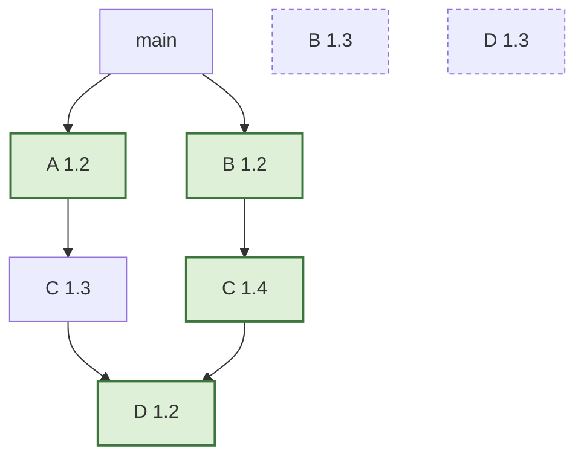

# 17.3 最小版本选择算法

[17.2](./semantics.md) 为版本选择准备了两条前提：同一导入路径下的新版本兼容旧版本，
因此依赖只需声明所需的最低版本；不兼容的主版本是不同的模块，因此不会出现「两个版本只能选一个」的冲突。
在这两条前提下，Cox 在 2018 年的 vgo 系列文章中提出了**最小版本选择**（Minimal Version Selection，
MVS）[[Cox, 2018a](#ref-cox-2018a)]，它不求解布尔公式，只做图的遍历 [[Cox, 2018b](#ref-cox-2018b)]。
本节先介绍算法本身，再说明它为何不会落入 NP 完全，以及它在可重复性上的收益与代价，最后介绍 Go 1.17
以来为适应更大的依赖图所做的扩展。

## 17.3.1 构建列表与四种操作

一次构建所使用的模块及其版本的列表称为**构建列表**（build list）。Cox 认为，为了稳定的开发，
今天的构建列表也必须是明天的构建列表；同时开发者又必须能够改变它。
版本选择问题因此归结为定义以下四种操作的含义，并给出实现它们的算法 [[Cox, 2018b](#ref-cox-2018b)]：

1. 构造当前的构建列表；
2. 把所有模块升级到最新版本；
3. 把一个模块升级到指定的较新版本；
4. 把一个模块降级到指定的较旧版本。

MVS 假设每个模块在 `go.mod` 中以 `require` 指令列出它对其他模块的最低版本要求，从不声明最高版本，
也不声明与哪些较新的版本不兼容。在这一假设下，构造构建列表的规则很简单：从目标模块出发，
把它的每个要求连同该要求自己的构建列表依次加入；同一个模块出现多次时，只保留最新的版本。Go
模块参考手册中的例子如下 [[Go Authors, n.d.a](#ref-go-authors-nda)]：



主模块要求 A 1.2 与 B 1.2，二者分别要求 C 1.3 与 C 1.4，C 的两个版本都要求 D 1.2。遍历结束时，C
出现过两个版本，取较高的 C 1.4，构建列表为 A 1.2、B 1.2、C 1.4、D 1.2（图中以绿色标出）。B 1.3 与 D 1.3
虽然存在，但没有任何模块要求它们，因此不会被选中。

「最小」一词有两层含义。其一，对每个模块，MVS 选择满足全部要求的最低版本，也就是全部要求中的最高者；其二，
Cox 认为这大概是可行方案中最简单的一种 [[Cox, 2019](#ref-cox-2019)]。被选中的每个版本，
都是构建中某个模块明确提到过的版本。构建列表因此不随新版本的发布而改变，`go`
命令也就无须把它保存在锁文件中，每个模块感知的命令开始时都重新计算一次
[[Go Authors, n.d.a](#ref-go-authors-nda)]。`go.sum` 只用来校验下载内容的完整性，
不参与版本的选择（[17.4](./fight.md)）。

## 17.3.2 遍历每一个可达的版本

构造构建列表有两种等价的定义 [[Cox, 2018b](#ref-cox-2018b)]。递归的定义如上所述，它适合作为思维模型，
但照字面实现可能需要指数时间，遇到环还会无限递归（依赖图中允许出现环）。高效的定义基于图的可达性：
从目标出发沿要求的边能够到达的全部模块版本，构成「粗构建列表」，对其中的每个模块保留最高的版本，
就得到最终的构建列表。每个可达的版本只访问一次，耗时与粗构建列表的大小 $|B|$ 加上需要遍历的边数（至多
$|B|^2$）成正比。不可达的版本完全不会被加载，在依赖管理中，加载一个版本的信息往往意味着一次网络往返，
这一点相当重要。

这里有一个容易被忽略的细节：遍历必须展开每一个可达的版本，包括最终没有被选中的版本。
下面的程序比较了两种做法。`mvs` 访问每一个可达的版本；`naive` 则只展开抬高了已选版本的需求，
一个版本若在出现时已被更高的版本压过，就不再展开。

```go {run=true}
package main

import (
	"fmt"
	"slices"
	"strings"
)

// 需求图：每个模块版本 path@version 列出它所要求的最低版本。
// 本例的版本号形如 1.x 且 x 只有一位，可以直接按字符串比较。
var reqs = map[string][]string{
	"A@1.1": {"C@1.1"},
	"B@1.1": {"C@1.2"},
	"C@1.1": {"D@1.3"},
	"C@1.2": {"D@1.1"},
}

// mvs 访问从根出发可达的每一个模块版本，对每个模块取见过的最高版本。
func mvs(roots []string) []string {
	selected := map[string]string{}
	visited := map[string]bool{}
	var visit func(m string)
	visit = func(m string) {
		if visited[m] {
			return
		}
		visited[m] = true
		path, v, _ := strings.Cut(m, "@")
		if v > selected[path] {
			selected[path] = v
		}
		for _, r := range reqs[m] {
			visit(r)
		}
	}
	for _, r := range roots {
		visit(r)
	}
	return list(selected)
}

// naive 只展开抬高了已选版本的需求，没有抬高的版本不再继续遍历。
func naive(roots []string) []string {
	selected := map[string]string{}
	queue := slices.Clone(roots)
	for len(queue) > 0 {
		m := queue[0]
		queue = queue[1:]
		path, v, _ := strings.Cut(m, "@")
		if v <= selected[path] {
			continue
		}
		selected[path] = v
		queue = append(queue, reqs[m]...)
	}
	return list(selected)
}

func list(selected map[string]string) []string {
	var out []string
	for path, v := range selected {
		out = append(out, path+"@"+v)
	}
	slices.Sort(out)
	return out
}

func main() {
	for _, roots := range [][]string{{"A@1.1", "B@1.1"}, {"B@1.1", "A@1.1"}} {
		fmt.Println("roots:", roots)
		fmt.Println("  mvs:  ", mvs(roots))
		fmt.Println("  naive:", naive(roots))
	}
}
```

输出如下：

```text
roots: [A@1.1 B@1.1]
  mvs:   [A@1.1 B@1.1 C@1.2 D@1.3]
  naive: [A@1.1 B@1.1 C@1.2 D@1.3]
roots: [B@1.1 A@1.1]
  mvs:   [A@1.1 B@1.1 C@1.2 D@1.3]
  naive: [A@1.1 B@1.1 C@1.2 D@1.1]
```

C 1.1 最终没有被选中，但它要求的 D 1.3 仍然计入构建列表。`naive` 的结果取决于遍历的次序：先访问 B 时，C
1.2 抢先被选中，C 1.1 就不再展开，D 只得到 1.1。Cox 在描述升级算法时用同样的道理解释了为何只能新增边：
在该文的例子中，C 1.2 要求 D 1.4，C 1.3 则不依赖 D；若把 A 指向 C 1.2 的边换成指向 C 1.3 的边，D 1.4
就会从构建列表中消失，升级 C 反而降级了 D，这是一种意料之外、也不必要的改变
[[Cox, 2018b](#ref-cox-2018b)]。只要遍历全部可达的版本，结果就只取决于依赖图本身，与访问的次序无关。

`go` 命令的实现与此相同。Cox 在设计之初估计，完整的实现只需几百行 Go 代码 [[Cox, 2018b](#ref-cox-2018b)]。
MVS 的代码于 2018 年 6 月由 `vgo` 原型复制到 `cmd/go` [[Cox, 2018c](#ref-cox-2018c)]，现位于
`cmd/go/internal/mvs`，Go 1.26 中不含测试约 800 行。`Reqs` 接口的注释说明了两项设计
[[Go Authors, 2026a](#ref-go-authors-2026a)]：

```go
// The version strings are opaque except for the special version "none"
// (see the documentation for module.Version). In particular, MVS does not
// assume that the version strings are semantic versions; instead, the Max method
// gives access to the comparison operation.
//
// It must be safe to call methods on a Reqs from multiple goroutines simultaneously.
// Because a Reqs may read the underlying graph from the network on demand,
// the MVS algorithms parallelize the traversal to overlap network delays.
```

其一，算法把版本字符串视为不透明的值，比较交给 `Max` 方法，因此并不依赖语义化版本
（[17.3.6](#1736-规模化剪枝工作区与工具链) 将用到这一点）；其二，读取一个模块的要求可能需要访问网络，
遍历因此以最多 10 个 goroutine 并行进行，`par.Work` 保证每个模块版本只被处理一次。Go 1.17 起，
选择的逻辑由 Mills 抽出为增量式的 `Graph` 类型 [[Mills, 2021](#ref-mills-2021)]，其 `Require`
方法记录一个模块版本的要求，并对每个被要求的版本更新所选的版本，无论它此后是否被选中
[[Go Authors, 2026b](#ref-go-authors-2026b)]：

```go
	for _, dep := range reqs {
		// Mark dep reachable, regardless of whether it is selected.
		if _, ok := g.isRoot[dep]; !ok {
			g.isRoot[dep] = false
		}

		if g.cmp(dep.Path, g.Selected(dep.Path), dep.Version) < 0 {
			g.selected[dep.Path] = dep.Version
		}
	}
```

用真实的 `go` 命令也能验证这一规则。以 replace 指令把上例中的六个模块版本指向本地目录，每个依赖的
`go.mod` 都声明 `go 1.17`，主模块声明 `go 1.16`（结果以 Go 1.26.10 为准，各 `go.mod` 从略）：

```bash
$ go list -m all
example.com/main
example.com/a v1.1.0 => ../a11
example.com/b v1.1.0 => ../b11
example.com/c v1.2.0 => ../c12
example.com/d v1.3.0 => ../d13
```

选中的 D 同样是 v1.3.0。主模块声明 `go 1.17` 或更高版本时，结果会有所不同，见 17.3.6。

## 17.3.3 升级与降级

其余三种操作都先修改依赖图，再运行同一个遍历 [[Cox, 2018b](#ref-cox-2018b)]。升级全部模块时，
把图中指向任一模块任一版本的边都改为指向该模块的最新版本；升级一个模块时，只从目标模块向新版本添加一条边，
原有的边一律保留，这样升级 C 只会带来 C 的新版本确实需要的那些变化，而不会顺带把 C 的每个依赖都升到最新。
降级一个模块时，从图中划去高于目标的版本，再沿边反向划去要求这些版本的模块；目标模块的每个要求，
回退到尚未被划去的最新版本。降级只降低版本，若需要先升级其他模块，必须由使用者明确提出。

修改依赖图得到新的构建列表之后，还需要把结果写回 `go.mod`，使下一次构建能由第一种操作重新得到它。Cox
为此给出了「算法 R」：按逆后序访问构建列表中的模块，即只在考虑过所有指向某模块的模块之后才访问它，
只保留尚未被已访问模块蕴含的那些 [[Cox, 2018b](#ref-cox-2018b)]。`mvs.Req` 实现了这一算法
[[Go Authors, 2026a](#ref-go-authors-2026a)]。在参考手册的例子中，一次升级把 B、C、D 分别升到 1.3、1.4、
1.3，`go` 命令随后把对 B 的要求改为 1.3，并以 `// indirect` 注释加入对 C 1.4 与 D 1.3 的要求，
否则这两个版本不会被选中 [[Go Authors, n.d.a](#ref-go-authors-nda)]。

在 `go` 命令中，这些操作都由 `go get` 发起：`go get -u ./...` 升级主模块中各个包所导入的模块，
`go get example.com/c@v1.4.0` 升级或降级一个模块，`@none` 则移除对一个模块的要求，
并相应降级或移除依赖它的模块 [[Go Authors, n.d.a](#ref-go-authors-nda)]。升级因此总是一次显式的操作，
构建本身从不升级任何依赖。

## 17.3.4 为何不是 SAT

[17.1](./challenges.md) 说明了一般的版本选择是 NP 完全问题，MVS 的复杂度则可以由 Schaefer 二分定理解释。
该定理给出了六类可在多项式时间内判定可满足性的布尔公式，并证明超出这六类的公式类，其可满足性问题都是 NP
完全的 [[Schaefer, 1978](#ref-schaefer-1978)]。Cox 指出，MVS 所产生的公式同时属于其中三类：2-SAT、
Horn-SAT 与 Dual-Horn-SAT [[Cox, 2018b](#ref-cox-2018b)]。公式是若干子句的合取，每个子句只有三种形式：
单个正文字（这个版本必须安装，例如升级时），单个负文字（这个版本不可用，例如降级时），
或一个负文字与一个正文字的析取，即蕴含 $X \to Y$（安装了 $X$，就必须安装 $Y$）。每个子句至多两个变量，
所以是 2-CNF 公式；至多一个正文字，所以是 Horn 公式；至多一个负文字，所以是对偶 Horn 公式。

Cox 认为后两点更有意义。每个 Horn 公式都有唯一的一个使最少变量为真的满足赋值，
这证明了构建列表与每次升级都有唯一的最小解：不到绝对必要，不会使用一个模块的更新版本。每个对偶 Horn
公式都有唯一的一个使最少变量为假的满足赋值，这证明了每次降级也有唯一的最小解。（Cox 还附带指出，MVS
所解决的问题是 NL 完全的，但这一点没有多少实际意义：属于 NL 只保证多项式时间，而 MVS
已有线性时间的算法。）

这一理论也划定了扩展的边界 [[Cox, 2018b](#ref-cox-2018b)]。若要保持唯一性与最小性，
新增的约束必须同时能写成 Horn 与对偶 Horn 公式：可以有无条件的肯定 $X$（必须安装 $X$）、
无条件的否定 $\lnot Y$（不得安装 $Y$）与肯定的蕴含 $X \to Z$（安装了 $X$ 就必须安装 $Z$），
不能有否定的蕴含 $X \to \lnot Y$（安装了 $X$ 就不得安装 $Y$）。
声明「C 1.2 不能与 D 1.3 一起构建」就是否定的蕴含，MVS 不接受这类声明。Cox 的说法是，
声明一项不兼容只描述了如何失败，声明「C 1.2 必须与 D 1.4 一起构建」则描述了如何成功。
排除某个版本因此必须是无条件的，即在构建开始之前就已确定，不随选择的过程而变化。
`go.mod` 中的 `exclude` 与 `replace` 只在主模块中生效，依赖中的这两种指令一律被忽略。
主模块是唯一一定参与构建的模块；此外，最低要求可以无冲突地合并，排除与替换则可能相互冲突。
模块的作者因此对以该模块为主模块的构建拥有完全的控制，却不能完全控制依赖它的其他构建。

`exclude` 的语义后来还修订过一次。按照 Cox 最初的设计，被排除的版本从依赖图中移除，
对它的要求改为指向下一个较新的版本 [[Cox, 2018b](#ref-cox-2018b)]。然而「下一个较新的版本」
会随新版本的发布而改变，构建也就不再可重复。Mills 在 2020 年把规则改为直接丢弃对被排除版本的要求，
并指出实践中被排除版本所在的模块通常已有更高或更低的版本被要求，为它另行解析一个升级版本本就是多余的工作；
这一修改随 Go 1.16 发布 [[Mills, 2020a](#ref-mills-2020a); [Go Authors, 2021a](#ref-go-authors-2021a)]，
现行的实现见 `modload` 读取 `go.mod` 时的过滤 [[Go Authors, 2026c](#ref-go-authors-2026c)]。
参考手册中 `exclude` 指令一节已说明这一变化，最小版本选择一节的「Exclusion」示例则仍按最初的规则描述
[[Go Authors, n.d.a](#ref-go-authors-nda)]。

## 17.3.5 高保真构建及其代价

可重复构建通常被理解为整个程序的二元性质：使用者的构建要么与作者的完全相同，要么不同。
库作为大程序的一部分被构建时，往往不可能与作者的构建完全一致，因为构建的其他部分可能要求更新的依赖。Cox
因此把只为满足构建中其他地方的要求才偏离作者自己构建的构建，称为**高保真构建**（high-fidelity
build）[[Cox, 2018b](#ref-cox-2018b)]。在 17.3.1 的例子中，A 1.2 的作者是用 C 1.3 开发和测试的，
主模块的构建因 B 1.2 的要求而改用 C 1.4，这一偏离是必要的；如果像 `go get -u`、`dep` 与 Cargo
通常所做的那样选用已经存在的 D 1.3，偏离就不再必要。MVS 选择满足要求的最旧版本，
新版本的发布对构建没有任何影响。Winters 指出了这一选择背后的事实：一个库声明需要某个依赖的 1.7
或更高版本，几乎可以肯定它的作者装的就是 1.7，只要发布前做过最基本的测试，
这两个版本能够协同工作就至少有了一份经验上的证据 [[Winters et al., 2020](#ref-winters-et-al-2020)]。
高保真并非 MVS 独有的性质：Boyer 指出，`dep` 的求解器 `gps` 设计了「首选版本」机制，
可以优先选用依赖作者使用的版本，只是当时尚未启用 [[Boyer, 2018](#ref-boyer-2018)]。

这一性质也服务于协作的原则 [[Cox, 2019](#ref-cox-2019)]。假设 C 1.8 要求 D 1.4，后来发布的 D 1.6 与 C 1.8
不能一起工作。在 `dep` 这类默认选用最新版本的工具中，D 1.6 一经发布，C 的每个新使用者的构建都会失败，C
的作者不得不立即发布 C 1.9，声明与 D 1.6 不兼容；等 D 的作者发布修复后的 D 1.7，这一声明又会把 D 1.7
一并排除，C 的作者还得再发布 C 1.10 撤销它。使用 MVS 时，在有人明确要求 D 1.6 之前，没有任何构建会用到它，
C 与 D 的作者因此有时间协作，从根本上修复问题。

MVS 也有代价。首先，它要求最低版本的声明是准确的：一个依赖若声明了自己实际上并不能工作的最低版本，MVS
就会如实选中它。Cox 认为，默认选用最新版本的系统反而更容易让最低要求出错，
因为清单中的下限此后不再被构建和测试 [[Cox, 2018b](#ref-cox-2018b)]。有人在 Cargo 中尝试选择最低版本，
发现生态中许多声明的下限根本无法编译 [[illicitonion, 2018](#ref-illicitonion-2018)]，Cox 引用这一分析，
认为 Cargo 对最新版本的偏好掩盖了清单中大量缺失的约束 [[Cox, 2019](#ref-cox-2019)]。在 Go 中，`go.mod`
的要求通常由 `go get` 与 `go mod tidy` 写入，记录的是构建时实际选中的版本，
作者自己构建和测试时用的正是这些下限。Boyer 则从另一面指出，这样一来，`require` 把「最低可用版本」
与「当前使用的版本」合并成了一个数，真正的下限反而无从得知 [[Boyer, 2018](#ref-boyer-2018)]。其次，
修复与改进不会自动到达。Cox 的判断是，选中的版本是所有要求中的最高者，依赖中只要有一个模块及时提高了要求，
整个构建就会随之前进；如果说有问题，倒更可能是相反的问题：这种「最低要求中的最大者」像棘轮一样，
把依赖推进得太快 [[Cox, 2018b](#ref-cox-2018b)]。但安全修复不能依靠这种偶然，
仍需要工具报告构建中有哪些版本存在已知的问题，再由使用者显式升级，Cox 在 2019 年的文章中也提出了这一要求
[[Cox, 2019](#ref-cox-2019)]。Winters 承认，MVS 能否让语义化版本「够用」尚无办法从经验上验证，
但仍认为它明显改进了当前使用语义化版本约束的方式 [[Winters et al., 2020](#ref-winters-et-al-2020)]。
求解器一方也在继续演进，例如 Weizenbaum 提出的 PubGrub [[Weizenbaum, 2018](#ref-weizenbaum-2018)]。

## 17.3.6 规模化：剪枝、工作区与工具链

**模块图剪枝。** Go 1.17 之前，`go` 命令须加载依赖图的完整传递闭包，读取每一个可达版本的 `go.mod`。Mills
在 2020 年的设计中提出了模块图剪枝与惰性加载 [[Mills, 2020b](#ref-mills-2020b)]，随 Go 1.17 发布
[[Go Authors, 2021b](#ref-go-authors-2021b)]：若主模块声明 `go 1.17` 或更高版本，用于 MVS
的模块图只包含每个声明了 `go 1.17` 或更高版本的依赖的直接要求，它们的传递依赖则被剪去。作为交换，声明
`go 1.17` 及以上版本的 `go.mod` 须为每个提供了被传递导入的包的模块写出显式的 `require`。参考手册的理由是，
构建某个模块的任何包或测试都不需要的依赖，不可能影响这些包的运行时行为，
被剪去的依赖只会在彼此无关的模块之间造成干扰 [[Go Authors, n.d.b](#ref-go-authors-ndb)]。

剪枝确实可能改变选中的版本。在 17.3.2 的例子中为每个模块加上包，使主模块导入 A 与 B，A、B 导入 C，C 导入
D，再把主模块改为声明 `go 1.26` 并运行 `go mod tidy`（以 Go 1.26.10 为准）：

```bash
$ go mod tidy
$ go list -m all
example.com/main
example.com/a v1.1.0 => ../a11
example.com/b v1.1.0 => ../b11
example.com/c v1.2.0 => ../c12
example.com/d v1.1.0 => ../d11
```

C 1.1 是 A 的直接要求，但它自己对 D 1.3 的要求被剪去了，D 因此只取 C 1.2 所要求的 1.1，`go mod tidy` 以
`// indirect` 把 C v1.2.0 与 D v1.1.0 写入主模块的 `go.mod`。C 1.1 并不参与构建，它对 D
的要求正属于参考手册所说的「干扰」。为了平稳迁移，Go 1.17 为 `go mod tidy` 增加了 `-go` 标志，
可以把现有模块转换为 `go 1.17` 而不改变依赖的选中版本 [[Go Authors, 2021b](#ref-go-authors-2021b)]：
对声明 `go 1.16` 的同一个模块运行 `go mod tidy -go=1.17`，写入的是 `example.com/d v1.3.0 // indirect`，
原有的选择得以保留。

**工作区。** Go 1.18 引入了工作区 [[Go Authors, 2022](#ref-go-authors-2022)]，`go.work`
文件列出的多个模块共同作为 MVS 的主模块，即遍历的根 [[Matloob, 2021a](#ref-matloob-2021a)]。为此，
`mvs.BuildList` 的参数在同一开发周期中由单个目标改为一组目标 [[Matloob, 2021b](#ref-matloob-2021b)]；
遍历本身不必改变，多个根与单个根的处理方式相同。

**工具链。** Go 1.21 之前，`go.mod` 中的 `go` 指令只是建议性的：构建成功，就认为一切正常，
失败时再提示可能需要更新的 Go 版本 [[Go Authors, n.d.c](#ref-go-authors-ndc)]。Cox 在
2022 年的提案中指出，人们起初都以为 `go.mod` 中列出的每个版本都是该模块任何构建所使用的最低版本，
这一点唯独对 `go` 指令不成立；让 `go` 指令规定最低的工具链版本，更符合使用者的预期
[[Cox, 2022](#ref-cox-2022)]。Go 1.21 起，`go` 指令成为强制的最低要求，新增的 `toolchain`
指令给出建议使用的最低工具链 [[Go Authors, 2023](#ref-go-authors-2023)]。在实现上，`go` 与 `toolchain`
被当作两个虚拟的模块：一个依赖声明的 `go` 版本若不低于 1.21，读取其 `go.mod` 时就被加入一条对模块 `go`
的要求 [[Go Authors, 2026c](#ref-go-authors-2026c)]：

```go
	if summary.goVersion != "" && gover.Compare(summary.goVersion, gover.GoStrictVersion) >= 0 {
		summary.require = append(summary.require, module.Version{Path: "go", Version: summary.goVersion})
		if gover.Compare(summary.goVersion, gover.Local()) > 0 {
			return summary, &gover.TooNewError{What: "module " + m.String(), GoVersion: summary.goVersion}
		}
	}
```

于是，选中的 `go` 版本就是主模块与各依赖的 `go` 指令中的最大值（依赖的 `go` 指令须不低于 1.21 才计入），
MVS 本身无须任何修改。Go 的版本号不是语义化版本，
`1.21`、`1.21rc1`、`1.21.0` 自有其次序，这正是 `Reqs` 把版本视为不透明值的用处：比较函数按模块路径分派
[[Go Authors, 2026d](#ref-go-authors-2026d)]：

```go
func ModCompare(path string, x, y string) int {
	if path == "go" {
		return Compare(x, y)
	}
	if path == "toolchain" {
		return Compare(maybeToolchainVersion(x), maybeToolchainVersion(y))
	}
	return semver.Compare(x, y)
}
```

Go 1.22 起，同样的次序由标准库的 `go/version` 包提供：

```go {run=true}
package main

import (
	"fmt"
	"go/version"
	"slices"
)

func main() {
	vs := []string{"go1.21.0", "go1.21rc1", "go1.21", "go1.20.14", "go1.22rc2"}
	slices.SortFunc(vs, version.Compare)
	fmt.Println(vs)
	fmt.Println(version.Lang("go1.21.0"), version.Lang("go1.21rc1"))
}
```

输出为 `[go1.20.14 go1.21 go1.21rc1 go1.21.0 go1.22rc2]` 与 `go1.21 go1.21`：语言版本 `go1.21`
低于它的候选版本与正式版本。`go get go@1.22.1` 像修改其他要求一样修改 `go` 指令
[[Cox, 2023](#ref-cox-2023)]。需要切换工具链时，`go` 命令在可用的候选版本中选择满足要求的最旧版本，
工具链文档称这一做法与最小版本选择一致 [[Go Authors, n.d.c](#ref-go-authors-ndc)]。

## 17.3.7 小结

MVS 把版本选择化为图的遍历：访问每一个可达的模块版本，对每个模块取被要求过的最高版本。它之所以能避开 NP
完全，是因为要求只有最低版本一种形式，对应的公式同时是 Horn 与对偶 Horn 公式，构建、
升级与降级都有唯一的最小解；它之所以无须锁文件，是因为结果只取决于 `go.mod` 中写明的要求，
不随新版本的发布而改变。排除与替换只在主模块中生效，`exclude` 在 Go 1.16 被修订为不再依赖「下一个版本」，
都是为了守住这两项性质。此后的剪枝、工作区与工具链管理，都在不改变核心算法的前提下扩展了它的适用范围。
[17.4](./fight.md) 回到历史，介绍这一设计与 `dep` 之间的争论，以及 Go 模块此后的演进。

## 延伸阅读

- <a id="ref-boyer-2018"></a>[Boyer, 2018] Sam Boyer. *An Analysis of Vgo.* 2018-05-14.
  https://sdboyer.io/vgo/intro/
  存档：https://web.archive.org/web/20180708073730/https://sdboyer.io/vgo/intro/
  `dep` 作者对 vgo 与 MVS 的技术评价；17.4 介绍其主要论点。
- <a id="ref-cox-2018a"></a>[Cox, 2018a] Russ Cox. *Go & Versioning.* 2018. https://research.swtch.com/vgo
  语义化导入版本、最小版本选择与模块协议的整体设计。
- <a id="ref-cox-2018b"></a>[Cox, 2018b] Russ Cox. *Minimal Version Selection.* 2018-02-21.
  https://research.swtch.com/vgo-mvs
  MVS 的原始设计：四种操作及其算法、算法 R、与 Schaefer 二分定理的关系、排除与替换、高保真构建。
- <a id="ref-cox-2018c"></a>[Cox, 2018c] Russ Cox. cmd/go: add dark copy of golang.org/x/vgo. Go commit
  5756895877, 2018. https://go.dev/cl/118095
  随 Go 1.11 发布。
- <a id="ref-cox-2019"></a>[Cox, 2019] Russ Cox. *The Principles of Versioning in Go.* 2019-12-03.
  https://research.swtch.com/vgo-principles
  可重复性与协作原则；以 C 与 D 为例比较 MVS 与 SAT 求解。
- <a id="ref-cox-2022"></a>[Cox, 2022] Russ Cox. *Proposal: Extended forwards compatibility in Go.* 2022.
  https://go.dev/design/57001-gotoolchain
- <a id="ref-cox-2023"></a>[Cox, 2023] Russ Cox. cmd/go: add go get go@version and toolchain@version. Go
  commit ff07c540b1, 2023. https://go.dev/cl/497081
  随 Go 1.21 发布。
- <a id="ref-go-authors-2021a"></a>[Go Authors, 2021a] The Go Authors. *Go 1.16 Release Notes.* 2021.
  https://go.dev/doc/go1.16#modules
  模块感知模式默认启用；`exclude` 不再改用下一个较新的版本。
- <a id="ref-go-authors-2021b"></a>[Go Authors, 2021b] The Go Authors. *Go 1.17 Release Notes.* 2021.
  https://go.dev/doc/go1.17#graph-pruning
  模块图剪枝与惰性加载；`go mod tidy -go`。
- <a id="ref-go-authors-2022"></a>[Go Authors, 2022] The Go Authors. *Go 1.18 Release Notes.* 2022.
  https://go.dev/doc/go1.18#go-work
  工作区模式。
- <a id="ref-go-authors-2023"></a>[Go Authors, 2023] The Go Authors. *Go 1.21 Release Notes.* 2023.
  https://go.dev/doc/go1.21#tools
  `go` 指令成为强制的最低要求；`toolchain` 指令。
- <a id="ref-go-authors-2026a"></a>[Go Authors, 2026a] The Go Authors. src/cmd/go/internal/mvs/mvs.go. Go
  1.26 源码. https://github.com/golang/go/blob/release-branch.go1.26/src/cmd/go/internal/mvs/mvs.go
- <a id="ref-go-authors-2026b"></a>[Go Authors, 2026b] The Go Authors. src/cmd/go/internal/mvs/graph.go.
  Go 1.26 源码. https://github.com/golang/go/blob/release-branch.go1.26/src/cmd/go/internal/mvs/graph.go
- <a id="ref-go-authors-2026c"></a>[Go Authors, 2026c] The Go Authors.
  src/cmd/go/internal/modload/modfile.go. Go 1.26 源码.
  https://github.com/golang/go/blob/release-branch.go1.26/src/cmd/go/internal/modload/modfile.go
- <a id="ref-go-authors-2026d"></a>[Go Authors, 2026d] The Go Authors. src/cmd/go/internal/gover/mod.go.
  Go 1.26 源码. https://github.com/golang/go/blob/release-branch.go1.26/src/cmd/go/internal/gover/mod.go
- <a id="ref-go-authors-nda"></a>[Go Authors, n.d.a] The Go Authors. *Go Modules Reference: Minimal
  version selection.* https://go.dev/ref/mod#minimal-version-selection
  官方规范，含 A、B、C、D 的构建列表示例与升级、降级的图示。
- <a id="ref-go-authors-ndb"></a>[Go Authors, n.d.b] The Go Authors. *Go Modules Reference: Module graph
  pruning.* https://go.dev/ref/mod#graph-pruning
  剪枝的规则与理由。
- <a id="ref-go-authors-ndc"></a>[Go Authors, n.d.c] The Go Authors. *Go Toolchains.*
  https://go.dev/doc/toolchain
  `go` 与 `toolchain` 指令、`GOTOOLCHAIN`，以及工具链的选择。
- <a id="ref-illicitonion-2018"></a>[illicitonion, 2018] illicitonion. *Rust minimum versions: SemVer is a
  lie!* 2018-06-03. https://illicitonion.blogspot.com/2018/06/rust-minimum-versions-semver-is-lie.html
  在 Cargo 中选择最低版本的尝试；Cox 2019 年的文章引用了这一分析。
- <a id="ref-matloob-2021a"></a>[Matloob, 2021a] Michael Matloob. *Proposal: Multi-Module Workspaces in
  cmd/go.* 2021. https://go.dev/design/45713-workspace
- <a id="ref-matloob-2021b"></a>[Matloob, 2021b] Michael Matloob. [dev.cmdgo] cmd/go: replace Target with
  MainModules, allowing for multiple targets. Go commit a627fcd3c4, 2021. https://go.dev/cl/334932
  随 Go 1.18 发布。
- <a id="ref-mills-2020a"></a>[Mills, 2020a] Bryan C. Mills. cmd/go/internal/modload: drop requirements on
  excluded versions. Go commit 5a69192765, 2020. https://go.dev/cl/244773
  随 Go 1.16 发布。
- <a id="ref-mills-2020b"></a>[Mills, 2020b] Bryan C. Mills. *Proposal: Lazy Module Loading.* 2020.
  https://go.dev/design/36460-lazy-module-loading
- <a id="ref-mills-2021"></a>[Mills, 2021] Bryan C. Mills. cmd/go/internal/mvs: factor out an incremental
  implementation. Go commit f9ed8b3f1e, 2021. https://go.dev/cl/244760
  随 Go 1.17 发布。
- <a id="ref-schaefer-1978"></a>[Schaefer, 1978] Thomas J. Schaefer. The Complexity of Satisfiability
  Problems. *STOC '78*, pp. 216–226. https://doi.org/10.1145/800133.804350
  二分定理：六类可在多项式时间内判定的布尔公式，其余均为 NP 完全。
- <a id="ref-weizenbaum-2018"></a>[Weizenbaum, 2018] Natalie Weizenbaum. *PubGrub: Next-Generation Version
  Solving.* 2018. https://medium.com/@nex3/pubgrub-2fb6470504f
  求解器路线的代表，对照 MVS 的另一条道路。
- <a id="ref-winters-et-al-2020"></a>[Winters et al., 2020] Titus Winters, Tom Manshreck, Hyrum Wright
  (eds.). *Software Engineering at Google.* O'Reilly, 2020. 第 21 章「Dependency Management」（Titus
  Winters 撰写）. https://abseil.io/resources/swe-book/html/ch21.html
  对最小版本选择的评价。
- 本书 [17.1 依赖管理的难点](./challenges.md)、[17.2 语义化版本管理](./semantics.md)、
  [17.4 vgo 与 dep 之争](./fight.md)。
