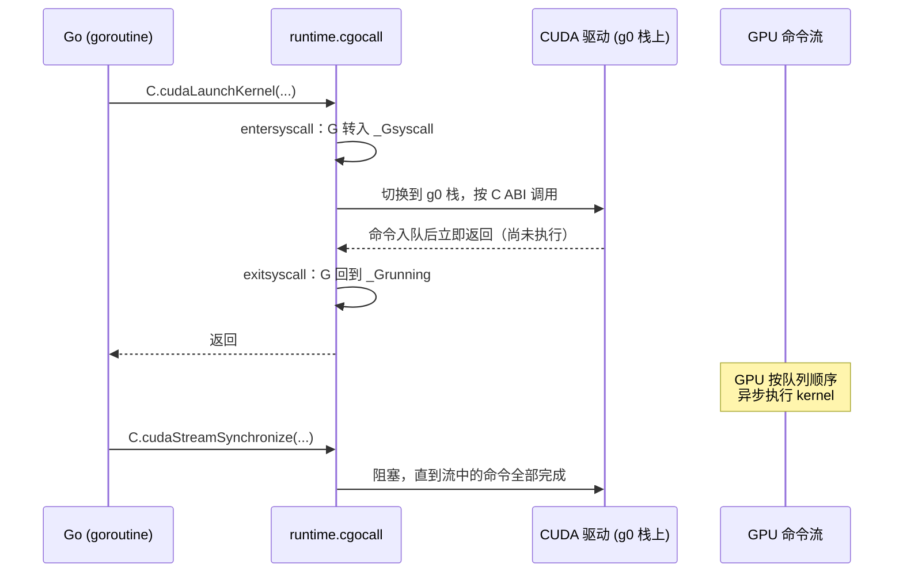
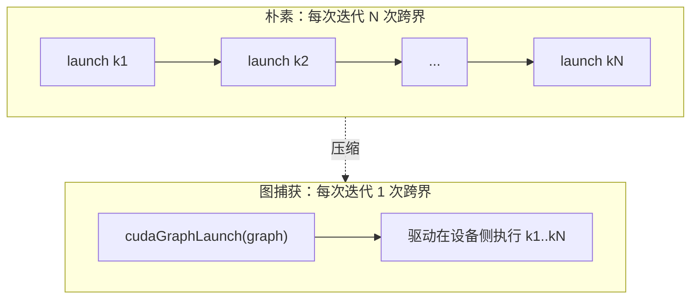

# 18.1 跨越 FFI 边界

[15.6](../../part5toolchain/ch15compile/cgo.md) 分析了一次 cgo 调用的全过程：切换到系统栈、`entersyscall`、
按 C 的调用约定调用、`exitsyscall`。按该节在 Apple M5 Pro 上的测量（以 Go 1.26.10 为准），
一次空的 C 调用约 16 ns，是一次不内联的 Go 调用（约 2 ns）的 8 倍左右，接近一个数量级；若 C 函数再回调
Go，开销约为 72 ns。由此得出的建议是：cgo 适合少量、粗粒度的调用，不宜出现在热点循环中。

GPU 程序恰恰需要频繁地跨越这条边界。一次推理或渲染，CPU 一侧的工作主要有三类：把数据从主机内存拷贝到显存，
逐个启动 kernel，再把结果拷回。每一步都是一次从 Go 进入驱动的调用。一个由数百个算子构成的神经网络，
若逐个启动，关键路径上便串着数百次跨界调用。本节讨论的问题是：跨界既然无法避免，边界应当如何设计，
才不至于让固定开销主导整体性能。

## 18.1.1 边界的另一端：异步的命令队列

从 Go 调用一个普通的 C 库函数，调用返回时工作已经完成。GPU 驱动不同：CPU 一侧的调用并不执行计算本身，
而是向设备提交一条命令。

以 CUDA 为例，主机端接口分为两层。**驱动 API**（driver API，库为 `libcuda`，函数前缀 `cu`）
提供细粒度的控制，例如显式地加载与卸载模块；**运行时 API**（runtime API，库为 `libcudart`，前缀 `cuda`）
建立在其上，隐式地初始化和管理主上下文（primary context）与模块，代码更简单，控制力也相应较弱
[[NVIDIA, n.d.b](#ref-nvidia-ndb)]。两层的提交语义相同：`cudaLaunchKernel`、`cudaMemcpyAsync`
等调用只是把一条命令放入**流**（stream）这一工作队列，随即返回 [[NVIDIA, n.d.a](#ref-nvidia-nda)]。新版
CUDA 编程指南的表述是：

```text
The concurrency is expressed via an asynchronous interface, where a
dispatching function call or kernel launch returns immediately.
Asynchronous calls usually return before the dispatched operation has
completed and may return before the asynchronous operation has started.
```

即：并发经由异步接口表达，提交函数或 kernel 启动调用立即返回，通常在操作完成之前、
甚至在操作开始之前就已返回 [[NVIDIA, n.d.c](#ref-nvidia-ndc)]。计算由 GPU 在自己的时间线上进行，CPU 与
GPU 各自推进。



「入队即返回」是本节其余优化的前提。它使边界穿越的开销可以与 GPU 的计算重叠：CPU 完成一次调用、回到 Go
继续提交下一条命令时，GPU 仍在执行此前的命令。只要提交的速度跟得上、队列不为空，GPU 就不会空闲，
跨界开销也就不在关键路径上。反之，若每提交一条命令就调用 `cudaStreamSynchronize` 等待其完成，
异步带来的重叠便不复存在，每一次跨界的固定开销都会完整地计入总时间。

## 18.1.2 两种延迟

边界上叠加着两种来源不同的开销，应分开考虑。

第一种是 **cgo 的边界穿越开销**，产生于 Go 一侧，即 15.6 分析的状态转换：切换栈、`entersyscall` 与
`exitsyscall`、按 C 的调用约定传递参数。无论被调用的是不是 GPU 驱动，每次进入 C 都要付出这笔开销。

第二种是 **kernel 的启动开销**（launch overhead），产生于驱动与设备一侧：一条命令从提交、经驱动处理，到
GPU 开始执行，本身需要时间。这与 Go 无关，用 C++ 直接调用 CUDA 同样存在。NVIDIA 的 Alan Gray 指出，现代
GPU 上单个 kernel 或内存拷贝的执行时间常以微秒计，而每次向 GPU 提交操作的开销同样在微秒量级
[[Gray, 2019](#ref-gray-2019)]。


区分两者，是因为应对手段不同。第一种是 cgo 特有的，可以通过绕开 cgo 来削减（18.1.4）；
第二种对任何语言都一样，只能通过异步与批处理隐藏或摊薄（18.1.3）。从量级看，一次空的 cgo
调用在十纳秒量级，一次提交的开销则在微秒量级。因此把 GPU 程序的性能问题归咎于 cgo，
往往是把第二种开销记到了第一种名下。对于执行时间达到毫秒级的大 kernel，两种开销都可以忽略；
真正受其影响的是大量执行时间很短的小 kernel，此时固定开销在总时间中占了主要部分。

## 18.1.3 异步、批处理与图捕获

边界穿越与启动开销都是按次计算的固定成本，削减它们的思路因此是一致的：减少跨界的次数，
让每次跨界承载更多工作。这与 15.6 对 cgo 的建议相同，在 GPU 上有三种具体做法。

**异步提交、延迟同步。** 不在每条命令之后同步，而是把一系列 kernel 与拷贝都异步地放入同一个流，
只在需要结果时同步一次。这样，各次调用的开销彼此重叠，也与 GPU 的计算重叠，
关键路径上只剩最后一次同步的等待。下面的示意代码对比了两种写法（`launch` 是假设的 C 包装函数）：

```go
// 每条命令之后都同步：N 个 kernel 付出 N 次完整的提交与等待
for _, op := range ops {
	C.launch(op, stream)
	C.cudaStreamSynchronize(stream)
}

// 全部异步提交，末尾同步一次
for _, op := range ops {
	C.launch(op, stream)
}
C.cudaStreamSynchronize(stream)
```

Gray 的实验量化了这一差别 [[Gray, 2019](#ref-gray-2019)]。在 Tesla V100 与 CUDA 10.1 上，一个执行时间为
2.9 µs 的 kernel 被重复启动 20000 次（每组 20 次，共 1000 组）：每次启动后都同步时，平均每个 kernel 耗时
9.6 µs；去掉组内的同步、只在每组末尾同步后，降到 3.8 µs。

**批处理与算子融合。** 在算法层面把多个小 kernel 合并成一个大 kernel，从源头减少启动次数。
深度学习框架中的算子融合（operator fusion）即属此类，例如把矩阵乘、加偏置与激活函数三步合并为一个 kernel，
三次启动减为一次。融合通常由 Go 之外的计算图编译器完成，但它直接决定了 Go 一侧需要跨界多少次。

**图捕获（CUDA Graphs）。** 许多负载在每次迭代中提交的命令序列结构相同，变化的只是数据。CUDA 10.1 引入的
CUDA Graphs 允许把这样一段命令序列捕获（`cudaStreamBeginCapture` 与 `cudaStreamEndCapture`）为一张图，
实例化（`cudaGraphInstantiate`）之后，每次迭代只需一次 `cudaGraphLaunch` 即可提交整张图。用 Gray 的话说，
它提供了「通过单个 CPU 操作启动多个 GPU 操作」的机制。在同一实验中，改用图之后每个 kernel 的平均耗时从
3.8 µs 进一步降到 3.4 µs；创建并实例化图约需 400 µs，但只发生一次，摊到每个 kernel 上约 0.02 µs。
这组数字也说明了收益的来源：主要的改善（从 9.6 µs 到 3.8 µs）来自去掉逐条同步，
图捕获在此基础上削减剩余的逐次提交开销；图的结构越复杂、重复使用的次数越多，收益越明显。



三种做法遵循同一条原则：对 Go 一侧而言，真正可以控制的变量是跨界的次数。kernel 的执行速度取决于 GPU，Go
能做的是让每一次跨界承载尽可能多的工作。

## 18.1.4 绕开 cgo：一条光谱

前面提到第一种开销可以通过绕开 cgo 来削减。各种绕开 cgo 的做法可以排成一条光谱：一端仍以函数为粒度跨界，
只是换一种方式调用；另一端则完全不跨界。为了比较各档的取舍，先把 cgo 的代价分成两部分：
一部分在**构建期**，即需要 C 工具链、交叉编译与静态链接变得困难（见
[15.6.6](../../part5toolchain/ch15compile/cgo.md)）；另一部分在**运行期**，即每次跨界的固定开销（18.1.2
的第一种开销）。

**其一，purego：免除构建期代价。** Ebitengine 项目维护的 purego 在运行时用 `Dlopen` 与 `Dlsym`
加载共享库、查找符号，再经一段汇编跳板按平台 ABI 调用函数地址，整个过程不经过 cgo 的代码生成，以
`CGO_ENABLED=0` 也能构建。项目说明列出的收益是：不需要 C 编译器，交叉编译简单；纯 Go 的构建可以充分缓存；
二进制更小，因为 cgo 会为每个被调用的 C 函数生成一个包装函数 [[Ebitengine, n.d.](#ref-ebitengine-nd)]。但
purego 并没有绕开运行期的状态转换。它经 `go:linkname` 直接调用运行时的 `cgocall`，`runtime/cgocall.go` 在
`cgocall` 的注释中专门列出了它 [[Go Authors, 2026b](#ref-go-authors-2026b)]：

```go
// cgocall should be an internal detail,
// but widely used packages access it using linkname.
// Notable members of the hall of shame include:
//   - github.com/ebitengine/purego
//
// Do not remove or change the type signature.
// See go.dev/issue/67401.
//
//go:linkname cgocall
//go:nosplit
func cgocall(fn, arg unsafe.Pointer) int32 {
```

因此，经 purego 的每次调用同样要经过 `entersyscall` 与 `exitsyscall`，运行期的开销与 cgo 属于同一类。

golang.design/x/accel 是建立在这一档上的一个完整实例 [[Ou, 2026a](#ref-ou-2026a)]。它以 `CGO_ENABLED=0`
在 GPU 上运行计算：kernel 用 Go 的一个子集编写并预先编译，目前可以在 CPU 后端与 Metal 后端上运行；
项目自述仍处于早期阶段。在 darwin 上，它经 purego 打开 `/System/Library/Frameworks/Metal.framework/Metal`
与 Objective-C 运行时，Metal 调用都经 purego 发出，其中绝大多数是 `objc_msgSend` 消息发送。
其设计文档把「不使用 cgo」列为硬性要求，也写明了代价：这排除了链接 cuBLAS、cuDNN 等厂商库，所有 kernel
都要自行编写，在原始吞吐上短期内不会胜过厂商库 [[Ou, 2026b](#ref-ou-2026b)]。

accel 的测量也说明运行期代价并未消失。其后端设计文档记录了在 M2 上的一次归因：提交一张约
790 个节点的图时，每个节点的大部分开销来自外部调用本身，而非 Metal 的编码器。purego 的通用调用路径经
`reflect.MakeFunc` 每次重建参数帧，单次消息发送约 667 ns；改为经 `purego.SyscallN` 直接调用
`objc_msgSend` 后降到约 180 ns，每个节点的开销从 14.7 µs 降到 7.0 µs。文档由此得出的经验是：在不使用 cgo
的后端上，逐操作的开销首先要在 FFI 绑定中寻找，其次才是驱动 [[Ou, 2026c](#ref-ou-2026c)]。在 Apple M5 Pro
上以 Go 1.26.10 运行其中的基准（10 次），直接发送的中位数约 67 ns，经反射的发送约 207 ns，
后者仍是前者的三倍左右：

```shell
$ CGO_ENABLED=0 go test -run '^$' -bench '^BenchmarkFFICost$' -count 10 ./internal/mtl/
```

15.6.6 在同一台机器上测得的空 C 调用约为 16 ns。两者测量的对象不同，前者是一次完整的 Objective-C
消息发送，后者是空的 C 函数，只宜作量级上的参考。

accel 把「可录制、可重放的命令图」作为整个设计所依托的决定：工作先录制为一张 `Graph`，`Build`
时一次性完成校验、内存规划与屏障计算，之后的每次提交都是重放 [[Ou, 2026b](#ref-ou-2026b)]。这与 CUDA
Graphs 的动机相同，但能节省多少取决于后端。Metal 的命令缓冲区只能提交一次，
因此每次提交仍要按规划好的节点列表重新编码，省下的是校验与规划，逐节点的外部调用依然存在
[[Ou, 2026c](#ref-ou-2026c)]。上面那次针对 FFI 绑定的优化，正是在这一背景下变得必要。

**其二，WebAssembly 与 wazero：不经 cgo 运行 C 库。** 更彻底的一种做法，是把 C 库编译为 WebAssembly，
再用纯 Go 实现的 Wasm 运行时执行。wazero 就是这样一个运行时，它没有外部依赖，也不使用 cgo，
因而不需要共享库或 libc，并保留了交叉编译的能力 [[Tetrate, n.d.](#ref-tetrate-nd)]。
这样做同时免除了构建期与运行期的 cgo 代价，换来的是 Wasm 自身的执行开销（解释执行或编译执行，
通常慢于原生代码），以及宿主与沙箱之间的调用边界。`ncruces/go-sqlite3` 曾是这一路线的代表，它把 SQLite 的
Wasm 构建交给 wazero 执行。2026 年起，它改用 wasm2go 把 Wasm 构建翻译成 Go 源码，v0.32.0
的发布说明称这很可能是最后一个依赖 wazero 的版本 [[ncruces, 2026](#ref-ncruces-2026)]。此后的版本不再需要
Wasm 运行时，实际上移到了光谱上的下一档。对本章而言，这一档有一项硬性限制：Wasm
模块只能调用宿主显式导入的函数，无法直接访问 GPU 驱动。它能把 CPU 上的 C 库（编解码、加密、SQLite）搬进纯
Go，却不能代替程序向 GPU 提交命令。

**其三，用纯 Go 重写：没有边界。** 最彻底的做法是不再使用 C 库，用纯 Go 重新实现。FFI 边界不复存在，
构建期与运行期的代价同时消失。[19.3](../ch19graphics/software.md) 的软件渲染属于这一档：
不调用任何图形驱动，用 Go 直接计算每个像素。代价同样明显：重写的工程量，以及 C 库多年积累的、针对 SIMD
与具体硬件的优化，纯 Go 实现往往更慢。这一档适合 C 库的价值主要在于功能、而非极致性能的场合。go-sqlite3
的 wasm2go 路线则表明，重写不一定由人完成，也可以由工具把编译产物翻译为 Go。

**其四，进程外：把边界移出进程。** 当所需的能力可以作为独立服务提供时，就不必把它链接进同一个进程。把 GPU
推理放进一个独立的服务进程（通常用 C++ 或 Python 编写，直接调用 CUDA），Go 一侧经 gRPC
或共享内存与之通信。Go 进程中不再有 cgo，边界从进程内的 FFI 变为进程间通信，代价是序列化与跨进程的拷贝。[第
20 章](../ch20inference/readme.md)会反复看到这种部署形态：Go 负责服务与编排，
直接与设备打交道的部分隔离在另一个进程中。accel 的设计文档在否决「经子进程或 IPC 绑定 C 库」时给出的理由，
恰好划出了这一档的适用范围：逐次调用的延迟使它无法用于 kernel 级的提交 [[Ou, 2026b](#ref-ou-2026b)]。

把四档放在一起看：cgo 与 purego 以函数为粒度跨界，最直接，但有运行期的跨界开销，cgo 还有构建期的代价；Wasm
免除了 cgo，但带来 Wasm 自身的开销，且无法访问 GPU；纯 Go 重写没有边界，但需要重写，且常常更慢；
进程外的方案最为隔离，但每次交互都要序列化，只适合粗粒度的请求。选择哪一档，取决于调用的频率、数据的规模、
是否必须直接访问 GPU，以及对纯 Go 工具链的重视程度。即使最终选择了 cgo，运行期的开销也在下降：Go 1.26 把
cgo 调用的基础运行时开销降低了约 30% [[Go Authors, 2026a](#ref-go-authors-2026a)]，[18.2](./sched.md)
会介绍其中一项改动。

## 小结

GPU 使 15.6「减少跨界」的建议成为设计的主线：GPU 的工作负载由大量细粒度的命令构成，每条命令都是一次跨界。
单次跨界的成本由其结构决定，难以继续压缩，有效的办法是减少跨界的次数：用异步使跨界与 GPU 计算重叠，
用批处理与算子融合从源头减少命令，用图捕获把整段命令序列压缩为一次提交。此外，还可以沿着一条光谱绕开 cgo：
换用 purego，把 C 库编译为 Wasm 后用 wazero 执行，用纯 Go 重写，或把边界移到进程之外。

本节只讨论了跨界的次数与开销，还有两个问题留待后两节。某次跨界确实长时间阻塞时（例如末尾那次
`cudaStreamSynchronize`），调度器如何处理被占用的线程，是 [18.2](./sched.md) 的内容；跨界传递的指针中，
哪些属于 Go、哪些属于设备，垃圾回收器如何对待它们，是 [18.3](./memory.md) 的内容。

## 延伸阅读

- <a id="ref-ebitengine-nd"></a>[Ebitengine, n.d.] Ebitengine. *purego.*
  https://github.com/ebitengine/purego
  无需 cgo 的运行时 FFI：`Dlopen`/`Dlsym` 加汇编跳板。
- <a id="ref-go-authors-2026a"></a>[Go Authors, 2026a] The Go Authors. *Go 1.26 Release Notes.* 2026.
  https://go.dev/doc/go1.26
  其中「Faster cgo calls」一节。
- <a id="ref-go-authors-2026b"></a>[Go Authors, 2026b] The Go Authors. src/runtime/cgocall.go. Go 1.26
  源码. https://github.com/golang/go/blob/release-branch.go1.26/src/runtime/cgocall.go
  `cgocall` 的注释点名了经 linkname 复用它的 `purego`。
- <a id="ref-gray-2019"></a>[Gray, 2019] Alan Gray. *Getting Started with CUDA Graphs.* NVIDIA Technical
  Blog, 2019. https://developer.nvidia.com/blog/cuda-graphs/
  逐条同步、重叠启动与图捕获三种方式下每个 kernel 的实测耗时。
- <a id="ref-ncruces-2026"></a>[ncruces, 2026] ncruces. *go-sqlite3 v0.32.0.* GitHub release, 2026.
  https://github.com/ncruces/go-sqlite3/releases/tag/v0.32.0
  发布说明称这很可能是最后一个依赖 wazero 的版本，此后改用 wasm2go。
- <a id="ref-nvidia-nda"></a>[NVIDIA, n.d.a] NVIDIA. *CUDA C++ Programming Guide.*
  https://docs.nvidia.com/cuda/cuda-c-programming-guide/
  异步并发执行、流、`cudaMemcpyAsync` 与同步语义的权威定义。
  自 CUDA 13.0 起该文档标为 Legacy、不再更新，由新版 *CUDA Programming Guide*（[NVIDIA, n.d.c]）取代。
- <a id="ref-nvidia-ndb"></a>[NVIDIA, n.d.b] NVIDIA. *CUDA Driver API* 与 *CUDA Runtime API.*
  <https://docs.nvidia.com/cuda/cuda-driver-api/>、<https://docs.nvidia.com/cuda/cuda-runtime-api/>
  驱动 API 与运行时 API 的分层，两者的差异见
  https://docs.nvidia.com/cuda/cuda-runtime-api/driver-vs-runtime-api.html
- <a id="ref-nvidia-ndc"></a>[NVIDIA, n.d.c] NVIDIA. *CUDA Programming Guide: Asynchronous Execution.*
  https://docs.nvidia.com/cuda/cuda-programming-guide/02-basics/asynchronous-execution.html
  新版编程指南中关于流、事件与异步语义的一节。
- <a id="ref-ou-2026a"></a>[Ou, 2026a] Changkun Ou. *accel: Run compute on the GPU from Go.*
  https://github.com/golang-design/accel, 2026.
  不使用 cgo 的 GPU 计算库，目前有 CPU 与 Metal 两个后端，项目处于早期阶段。
- <a id="ref-ou-2026b"></a>[Ou, 2026b] Changkun Ou. *accel: design.* specs/000-decisions.md, 2026.
  https://github.com/golang-design/accel/blob/main/specs/000-decisions.md
  「可录制、可重放的命令图」与「不使用 cgo」两项锁定决定，以及各自否决的备选方案。
- <a id="ref-ou-2026c"></a>[Ou, 2026c] Changkun Ou. *Backends: the contract, the set, and the capability
  matrix.* specs/006-backends.md, 2026.
  https://github.com/golang-design/accel/blob/main/specs/006-backends.md
  §4.3 记录了 Metal 后端逐节点开销的测量与归因。
- <a id="ref-tetrate-nd"></a>[Tetrate, n.d.] Tetrate. *wazero: the zero dependency WebAssembly runtime for
  Go.* <https://wazero.io/>，及 *ncruces/go-sqlite3*（把 SQLite 编成 Wasm 跑进纯 Go）
  https://github.com/ncruces/go-sqlite3
  纯 Go、不含 cgo 的 Wasm 运行时，绕开 cgo 运行 C 库的代表作。go-sqlite3 自 v0.33 起改用 wasm2go。
- 本书 [15.6 cgo](../../part5toolchain/ch15compile/cgo.md)、[2.3
  调用约定与寄存器 ABI](../../part1overview/ch02asm/callconv.md)、[18.2
  调度器与阻塞的外部调用](./sched.md)、[18.3
  显存与垃圾回收的分界](./memory.md)、[19.3
  软件渲染与并行](../ch19graphics/software.md)、[第
  20 章 推理服务](../ch20inference/readme.md)。
