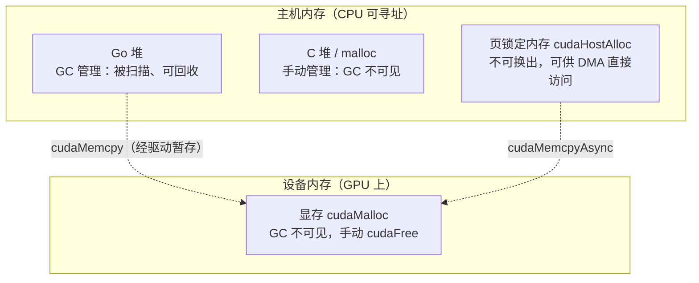

# 18.3 显存与垃圾回收的分界

[15.6](../../part5toolchain/ch15compile/cgo.md) 讨论了 cgo 的指针传递规则：传给 C 的 Go
指针必须指向被固定（pinned）的 Go 内存；作为参数传入的指针在调用期间被隐式固定；调用返回之后，C
只有在内存仍由 `runtime.Pinner` 固定时才能继续持有 Go 指针 [[Go Authors, 2026b](#ref-go-authors-2026b)]。
这些规则建立在 Go 与 C 两块内存的划分之上。GPU 使这张地图变得更复杂：一个驱动 GPU
的程序至少要面对四种内存，它们分属不同的管理者，遵循不同的规则。本节先画出这张地图，
再看垃圾回收器与各块内存的分界在哪里，以及哪一条分界最容易在异步传输中被越过。

## 18.3.1 一张内存地图

一个用 Go 驱动 GPU 的程序，大致面对以下四块内存：



四块之中，只有 Go 堆由垃圾回收器管理，第 12、13 章讨论的分配、标记与清扫，作用范围到此为止。
其余三块对垃圾回收器而言都在管辖之外：C 堆由 `malloc` 与 `free` 手动管理，页锁定内存由 CUDA 分配，
显存则由驱动在设备上分配，在使用独立显卡的系统上，CPU 甚至不能直接解引用它的地址。本节的讨论，
归根结底是要始终分清一个指针落在哪一块。

这里还要澄清一点。当前的垃圾回收器不移动堆上的对象，`runtime/mgc.go` 开头的注释称其为「non-generational
and non-compacting」[[Go Authors, 2026c](#ref-go-authors-2026c)]；会移动的是 goroutine 的栈，
栈增长时整段被拷贝到新的位置（[14.4](../../part4memory/ch14stack/copy.md)）。传给 C 的 Go
指针会使所指对象逃逸到堆上（除非 C 函数同时声明了 `noescape` 与 `nocallback`，见 15.6），
因而不会随栈移动。但 cgo 的规则与 `runtime.Pinner` 的契约都不以「堆对象不移动」为前提，
它们同时排除了移动与释放。对 GPU 程序而言，现实的风险主要是释放：一块缓冲在调用返回后不再被引用，
被回收并挪作他用，而设备还在读它。

## 18.3.2 设备指针不是 Go 指针

`cudaMalloc` 返回的是一个**设备地址**，指向显存中的某个位置。它不指向主机内存，更不指向 Go 堆。

由此直接得出：cgo 的指针规则不适用于设备地址，垃圾回收器也不会处理它。15.6 中 `cgoCheckPointer` 的检查、
「传给 C 的内存不得包含指向未固定内存的 Go 指针」这条规则，针对的都是指向 Go 内存的指针。设备地址不指向
Go 内存，可以自由地传给 C、存入 C 的结构体、长期持有，不违反任何一条规则，
回收器也不会因为它多扫描一个字节。在 Go 中，把它保存为整数（例如 `uintptr`）最为清楚，表明这是一个 Go
不必理解的值。

代价在另一面：**设备内存完全由程序手动管理**。垃圾回收器不会回收 `cudaMalloc` 分配的显存，必须显式调用
`cudaFree`，遗漏即是显存泄漏。在这块内存上，适用的是 C 的规则，而不是 Go 的内存安全。常见的做法是用一个
Go 类型包装设备地址，提供 `Free` 方法，再用 `runtime.AddCleanup`（Go 1.24 引入）或 `runtime.SetFinalizer`
兜底：包装对象变得不可达之后，运行时在一个单独的 goroutine 中调用清理函数，释放它名下的显存
[[Go Authors, n.d.b](#ref-go-authors-ndb)]。

这种兜底有两处局限，在 GPU 上尤为明显。第一，回收的时机由 Go 堆决定。垃圾回收的触发取决于 Go
运行时管理的内存，软内存限制的文档明确说明，它不计入 C 代码分配的内存等「Go
之外的内存」[[Go Authors, 2026d](#ref-go-authors-2026d)]。一个只有几十字节的包装对象可能持有数 GB 的显存，
而 Go 堆的增长并不会因此加快，显存可能在下一次垃圾回收之前就已耗尽。第二，清理函数运行在运行时的
goroutine 上，所在的线程不确定，对于需要线程上已有上下文的驱动调用（18.2.5），
直接在清理函数中调用驱动并不可靠。下面的示意代码把释放请求交还给持有上下文的设备 goroutine（`devAlloc`
为假设的 C 包装函数，`freeQueue` 由 18.2.5 中的设备 goroutine 消费）：

```go
type DeviceBuffer struct {
	ptr     uintptr // 设备地址：Go 不解引用，也不追踪
	cleanup runtime.Cleanup
}

func NewDeviceBuffer(size int) *DeviceBuffer {
	b := &DeviceBuffer{ptr: uintptr(C.devAlloc(C.size_t(size)))}
	// 兜底：调用者忘记 Free 时，b 不可达之后把释放请求交给设备 goroutine
	b.cleanup = runtime.AddCleanup(b, func(p uintptr) { freeQueue <- p }, b.ptr)
	return b
}

// Free 显式释放显存，并取消兜底的清理函数。
func (b *DeviceBuffer) Free() {
	b.cleanup.Stop()
	freeQueue <- b.ptr
}
```

`AddCleanup` 的文档要求，运行时间较长的清理函数应当另起一个 goroutine，以免阻塞其他清理函数；示意中的
`freeQueue` 应带有足够的缓冲。显式调用 `Free` 仍是主要手段，清理函数只是最后的保障。

## 18.3.3 两种「固定」

GPU 编程中有两种都称为「固定」（pin）的机制，分属上面地图的不同区域，容易混淆。

**其一，垃圾回收意义上的固定：`runtime.Pinner`。** 它在 Go 1.21 引入
[[Anderson, 2023](#ref-anderson-2023)]，作用于 Go 堆上的对象。`Pin` 方法的文档写道
[[Go Authors, 2026a](#ref-go-authors-2026a)]：

```go
// Pin pins a Go object, preventing it from being moved or freed by the garbage
// collector until the [Pinner.Unpin] method has been called.
//
// A pointer to a pinned object can be directly stored in C memory or can be
// contained in Go memory passed to C functions. If the pinned object itself
// contains pointers to Go objects, these objects must be pinned separately if they
// are going to be accessed from C code.
```

即：`Pin` 固定一个 Go 对象，在调用 `Unpin` 之前，垃圾回收器既不会移动也不会释放它；
指向被固定对象的指针可以直接存入 C 内存，也可以包含在传给 C 的 Go 内存中；被固定的对象若还包含指向其他 Go
对象的指针，而 C 代码要访问它们，这些对象需要分别固定。`Pinner` 类型的文档还说明了它的两个用途
[[Go Authors, n.d.a](#ref-go-authors-nda)]：让 C 代码安全地使用并非经由参数显式传入的 Go 指针，以及让 C
内存在 cgo 调用返回之后继续持有 Go 指针，只要对象保持固定。

accel 的 Metal 后端提供了一个实例 [[Ou, 2026a](#ref-ou-2026a)]。它的 `SetBytes` 经 purego 把一小段 Go
字节切片的地址以 `uintptr` 的形式传给 Metal。`uintptr` 不是回收器认可的引用，
编译器也无从得知这个地址会被外部代码使用，切片可能分配在栈上，而栈可能在调用期间增长并移动。
因此它在调用前先 `Pin(&data[0])`，调用后 `Unpin`。与 cgo 不同，经 `uintptr`
的调用不会让参数自动逃逸到堆上，也没有隐式固定，这一步必须由代码自己完成。

**其二，操作系统意义上的固定：页锁定内存**（page-locked memory，又称 pinned memory，由 `cudaMallocHost`、
`cudaHostAlloc` 分配，或由 `cudaHostRegister` 把已有的内存页锁定）[[NVIDIA, n.d.a](#ref-nvidia-nda)]。
它与垃圾回收无关，作用于操作系统的分页。CUDA 编程指南写道 [[NVIDIA, n.d.b](#ref-nvidia-ndb)]：

```text
Host allocations made through traditional allocation mechanisms like malloc,
new, or mmap are not page-locked, which means they may be swapped to disk or
physically relocated by the operating system. Page-locked host memory is
required for asynchronous copies between the CPU and GPU.
```

即：经 `malloc`、`new` 或 `mmap` 等常规方式分配的主机内存不是页锁定的，
操作系统可能把它换出到磁盘或在物理上重新安置；CPU 与 GPU 之间的异步拷贝要求使用页锁定的主机内存。原因在于
GPU 经 DMA 直接读写主机内存，DMA 要求目标物理页固定不变。从可换页内存拷贝时，
驱动必须先分配一块临时的页锁定缓冲，把数据拷入，再从这块缓冲传输到显存
[[Harris, 2012](#ref-harris-2012)]。

| | `runtime.Pinner` | 页锁定内存 |
|---|---|---|
| 管理者 | Go 的垃圾回收器 | 操作系统的分页机制 |
| 作用对象 | Go 堆上的对象 | 主机的物理页 |
| 防止的是 | 回收器移动或释放对象 | 操作系统换出或重新安置物理页 |
| 解决的问题 | C 安全地持有 Go 指针 | DMA 直接访问、异步传输 |

两者名称相同，含义却正交。Go 堆上的一个 `[]byte` 既受垃圾回收器管理，又可被操作系统换出；`Pinner`
只解决前一个问题，不能解决后一个。下一小节的异步传输正是两者同时出现的场合。

## 18.3.4 异步传输与隐式固定

把 Go 的 `[]byte` 拷贝到显存，同步与异步两种写法的安全性不同。

**同步拷贝是安全的。** 作为参数传给 C 的 Go 指针在调用期间被隐式固定。CUDA 对同步拷贝的约定是：
从可换页主机内存到设备的拷贝，函数在数据被拷入暂存缓冲后返回；从设备到主机的拷贝，函数在拷贝完成后才返回
[[NVIDIA, n.d.c](#ref-nvidia-ndc)]。无论哪个方向，驱动对 Go 内存的访问都发生在调用返回之前，
落在隐式固定的范围之内：

```go
buf := make([]byte, n)
// 同步：驱动在调用返回前读完 buf，隐式固定覆盖了全过程
C.cudaMemcpy(dst, unsafe.Pointer(&buf[0]), C.size_t(n), C.cudaMemcpyHostToDevice)
```

**异步拷贝则可能越过这个范围。** `cudaMemcpyAsync` 把传输命令放入流后即可返回，
真正的传输可能在之后才发生（18.1）。而隐式固定只持续到调用返回为止。对于可换页的主机内存，CUDA
的约定只说异步拷贝「可能」相对于主机是同步的，驱动可能先与流同步、把数据暂存到页锁定内存
[[NVIDIA, n.d.c](#ref-nvidia-ndc)]。这是实现可以选择的行为，并非程序可以依赖的保证。按 cgo 的规则，只要 C
代码仍能访问一块 Go 内存，这块内存就必须保持固定；调用返回之后驱动是否还会读 `buf`，程序无从确知，
因此必须按「还会读」来处理。否则，`buf` 一旦不再被引用，就可能被回收并挪作他用，而传输还没有完成。

```go
// 错误：调用返回后隐式固定即告结束，驱动却可能还要读 buf
C.cudaMemcpyAsync(dst, unsafe.Pointer(&buf[0]), C.size_t(n), kindH2D, stream)

// 做法一：用 Pinner 把固定延长到传输确实完成（流同步）之后
var pinner runtime.Pinner
pinner.Pin(&buf[0])
C.cudaMemcpyAsync(dst, unsafe.Pointer(&buf[0]), C.size_t(n), kindH2D, stream)
C.cudaStreamSynchronize(stream) // 传输到此确已完成
pinner.Unpin()

// 做法二：数据直接放在不受 GC 管理、又是页锁定的主机内存中，
// 既没有 GC 的生命周期问题，又满足 DMA 的要求；代价是自己调用 cudaFreeHost
var h unsafe.Pointer
C.cudaHostAlloc(&h, C.size_t(n), C.cudaHostAllocDefault)
// ……把数据写入 h……
C.cudaMemcpyAsync(dst, h, C.size_t(n), kindH2D, stream)
```

这个例子把 18.3.3 中两种固定的正交性具体化了。做法一用 `Pinner` 解决了生命周期问题，`buf`
在传输期间不会被释放，但它仍是可换页内存，驱动仍要经暂存缓冲中转，传输也未必真正异步。
做法二用页锁定内存同时解决了生命周期（它不在 GC 的管辖之内）与 DMA（它是页锁定的）两个问题，
代价是回到手动管理。高性能的数据通路通常采用做法二，并把这样一块页锁定缓冲复用为暂存区（staging buffer），
在 Go 堆与显存之间往返搬运数据。

accel 把这一模式放在了 API 之后 [[Ou, 2026a](#ref-ou-2026a)]。它的 `Queue.WriteBuffer`
把调用者的数据拷入队列持有的暂存区，并把传输追加到下一次提交的前序步骤中；
函数在数据不再与调用者的切片共享内存时返回，而不是等设备读完。文档写明，
调用者在函数返回后即可复用或修改自己的切片，并称这就是「异步」要做到安全所必须具备的含义。Go
的切片因此从不跨越异步的边界，固定的问题也就不会出现。

## 18.3.5 统一内存：模糊了分界，但没有取消

近年的硬件与驱动提供了**统一内存**（unified memory）：用 `cudaMallocManaged` 分配的内存，CPU 与 GPU
都能通过同一个指针访问，由驱动在主机与设备之间迁移数据；在支持 HMM 或 ATS 的系统上，
所有系统内存都隐式地成为受管内存 [[NVIDIA, n.d.b](#ref-nvidia-ndb)]。Apple silicon 上的 Metal
设备同样使用统一内存。accel 为此设有 `MemoryShared` 这一内存类型，表示既可由主机访问、又位于设备本地，
在统一内存硬件上可以完全省去一次拷贝；它按设备报告，而不是按平台推定 [[Ou, 2026a](#ref-ou-2026a)]。

统一内存确实消除了主机指针与设备指针的区分，代码也简单得多。但它模糊的是**地址空间**的分界，
而不是**所有权**的分界。用 `cudaMallocManaged` 分配的内存依然由 `cudaFree` 释放，依然在 Go 堆之外，
依然不归垃圾回收器管理。在 HMM 或 ATS 系统上，GPU 甚至可以直接读取 Go 堆上的内存，此时 18.3.4
的结论更加重要：设备访问一块 Go 内存期间，它必须保持固定，而固定的范围要覆盖到设备的访问真正结束为止。
统一内存把「是否手动拷贝」交给了驱动，却没有把「这块内存归谁回收」交给垃圾回收器。结论没有变：内存不在 Go
堆中，垃圾回收器既不负责回收它，也不保证访问它的安全；内存在 Go 堆中而被设备访问，
则必须由程序保证它在访问期间存活。

## 小结

GPU 把 cgo 的两块内存扩展成了四块，而垃圾回收器的管辖始终只到 Go 堆为止。由此得出几条分界。设备地址不是
Go 指针，不受指针规则约束，也不会被回收，必须手动释放；`AddCleanup` 可以兜底，但回收的时机取决于 Go
堆而非显存。两种固定分属垃圾回收器与操作系统，彼此正交，不能互相替代。异步传输最容易出错，
因为隐式固定只持续到调用返回，而传输可能在此之后才发生：要么用 `Pinner` 把固定延长到流同步之后，
要么把数据放入页锁定的非 Go 内存，由暂存区在两侧之间搬运。统一内存模糊了地址空间，却没有改变所有权。

[18.1](./boundary.md) 的跨界开销、[18.2](./sched.md) 的线程占用，加上本节的内存归属，构成了 FFI
边界上的三个问题。最后一节 [18.4](./model.md) 回到并发模型本身，讨论 GPU 的异步执行、设备的数据并行与
goroutine 的并发三者之间的关系。

## 延伸阅读

- <a id="ref-anderson-2023"></a>[Anderson, 2023] Sven Anderson. runtime: implement Pinner API for object
  pinning. Go commit 251daf46fb, 2023. https://go.dev/cl/367296
  随 Go 1.21 发布。
- <a id="ref-go-authors-2026a"></a>[Go Authors, 2026a] The Go Authors. src/runtime/pinner.go. Go 1.26
  源码. https://github.com/golang/go/blob/release-branch.go1.26/src/runtime/pinner.go
  `Pinner` 类型与 `Pin` 方法的文档。
- <a id="ref-go-authors-2026b"></a>[Go Authors, 2026b] The Go Authors. src/cmd/cgo/doc.go. Go 1.26 源码.
  https://github.com/golang/go/blob/release-branch.go1.26/src/cmd/cgo/doc.go
  「Passing pointers」一节：隐式固定与 `runtime.Pinner`。
- <a id="ref-go-authors-2026c"></a>[Go Authors, 2026c] The Go Authors. src/runtime/mgc.go. Go 1.26 源码.
  https://github.com/golang/go/blob/release-branch.go1.26/src/runtime/mgc.go
  开头的注释：回收器是非分代、不压缩的。
- <a id="ref-go-authors-2026d"></a>[Go Authors, 2026d] The Go Authors. src/runtime/debug/garbage.go. Go
  1.26 源码. https://github.com/golang/go/blob/release-branch.go1.26/src/runtime/debug/garbage.go
  `SetMemoryLimit` 的文档：内存限制不计入 C 代码分配的内存等 Go 之外的内存。
- <a id="ref-go-authors-nda"></a>[Go Authors, n.d.a] The Go Authors. *runtime.Pinner.*
  https://pkg.go.dev/runtime#Pinner
  `Pin`/`Unpin` 的语义：阻止 GC 移动或回收，并支持 C 在调用返回后持有。
- <a id="ref-go-authors-ndb"></a>[Go Authors, n.d.b] The Go Authors. *runtime.AddCleanup* 与
  *runtime.SetFinalizer.* https://pkg.go.dev/runtime#AddCleanup
  为包装设备内存的 Go 对象挂上释放回调，兜底显存生命周期。
- <a id="ref-harris-2012"></a>[Harris, 2012] Mark Harris. *How to Optimize Data Transfers in CUDA C/C++.*
  NVIDIA Technical Blog, 2012. https://developer.nvidia.com/blog/how-optimize-data-transfers-cuda-cc/
  页锁定暂存区与异步传输为何更快。
- <a id="ref-nvidia-nda"></a>[NVIDIA, n.d.a] NVIDIA. *CUDA C++ Programming Guide: Page-Locked Host Memory
  / Unified Memory.* https://docs.nvidia.com/cuda/cuda-c-programming-guide/
  `cudaHostAlloc` 页锁定内存与 DMA、`cudaMallocManaged` 统一内存。
  自 CUDA 13.0 起该文档标为 Legacy、不再更新，由新版 *CUDA Programming Guide*（[NVIDIA, n.d.b]）取代。
- <a id="ref-nvidia-ndb"></a>[NVIDIA, n.d.b] NVIDIA. *CUDA Programming Guide: Understanding Memory.*
  https://docs.nvidia.com/cuda/cuda-programming-guide/02-basics/understanding-memory.html
  新版编程指南中关于页锁定主机内存、`cudaHostRegister` 与统一内存的一节。
- <a id="ref-nvidia-ndc"></a>[NVIDIA, n.d.c] NVIDIA. *CUDA Runtime API: API Synchronization Behavior.*
  https://docs.nvidia.com/cuda/cuda-runtime-api/api-sync-behavior.html
  同步与异步 memcpy 在可换页内存与页锁定内存上的约定。
- <a id="ref-ou-2026a"></a>[Ou, 2026a] Changkun Ou. *accel: Run compute on the GPU from Go.*
  https://github.com/golang-design/accel, 2026.
  `internal/mtl/queue_darwin.go` 中的 `SetBytes`、`transfer.go` 中的 `WriteBuffer`、`memory.go` 中的
  `MemoryShared`。项目处于早期阶段。
- 本书 [12 内存分配](../../part4memory/ch12alloc/readme.md)、
  [13 垃圾回收](../../part4memory/ch13gc/readme.md)、
  [14.4 栈的拷贝与指针调整](../../part4memory/ch14stack/copy.md)、
  [15.6 cgo 指针传递规则](../../part5toolchain/ch15compile/cgo.md)、
  [18.1 跨越 FFI 边界](./boundary.md)、[18.2 调度器与阻塞的外部调用](./sched.md)。
