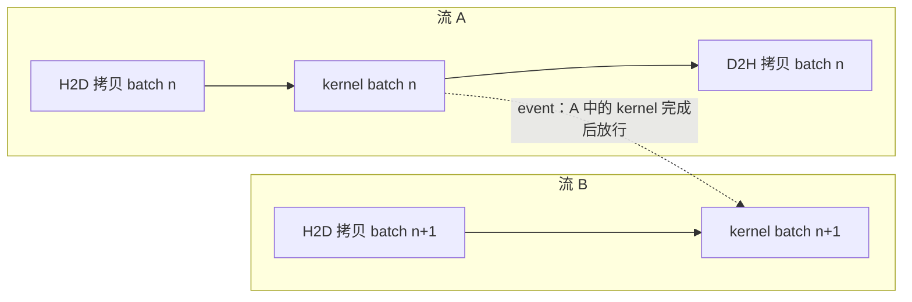

# 18.4 异步编程模型

前三节讨论的都是 FFI 边界上的成本：跨界的开销（[18.1](./boundary.md)）、
跨界对线程的占用（[18.2](./sched.md)）、跨界传递的内存归谁管理（[18.3](./memory.md)）。
本节转向并发模型本身。Go 的并发由 goroutine 与通道构成，GPU 有另一套并行模型，CPU 自身还有第三套。
厘清这三者各自的位置以及它们如何衔接，是本章的收尾，也是判断一段计算是否值得推过边界的依据。

## 18.4.1 三种并行

Rob Pike 在 2012 年的演讲中区分了并发（concurrency）与并行（parallelism）[[Pike, 2012](#ref-pike-2012)]。
The Go Blog 对这次演讲的介绍概括道 [[Gerrand, 2013](#ref-gerrand-2013)]：

```text
In programming, concurrency is the composition of independently executing
processes, while parallelism is the simultaneous execution of (possibly
related) computations. Concurrency is about dealing with lots of things at
once. Parallelism is about doing lots of things at once.
```

即：并发是把程序组织为若干独立执行的部分，并行是同时执行（可能相关的）计算；并发关乎同时应对许多事情，
并行关乎同时做许多事情。以此为标准，可以看清以下三者各自的位置。

- **goroutine 的并发。** Go 的 M:N 调度提供的是**任务级**的并发。每个 goroutine 是一段独立的控制流，
  创建代价低，可以阻塞，经通道通信。它解决的是如何把程序组织成许多并发的任务。

- **SIMT（GPU）。** 即单指令多线程（Single Instruction, Multiple Thread）。一次 kernel
  启动展开一个由大量线程组成的网格，这些线程执行同一段程序，通常各自处理一个数据元素。CUDA
  编程指南描述了它的执行方式 [[NVIDIA, n.d.b](#ref-nvidia-ndb)]：多处理器以 32 个线程为一组创建、管理、
  调度和执行线程，这样的一组称为 warp；warp 中的线程从同一个程序地址开始，
  但各有自己的指令地址计数器与寄存器状态，可以独立分支；warp 每次执行一条公共指令，
  32 个线程的执行路径一致时效率最高，若因数据相关的条件分支而分化，warp 会依次执行每条被选中的路径，
  并屏蔽不在该路径上的线程。自 Volta 架构起，独立线程调度（Independent Thread Scheduling）
  为每个线程维护程序计数器与调用栈，使线程之间不论是否同属一个 warp 都能完全并发。编程模型是：
  为单个元素写好 kernel，再启动一整个网格。

- **SIMD（CPU）。** 即单指令多数据（Single Instruction, Multiple Data）。在一个 CPU 核内，
  一条指令同时作用于向量寄存器中的多个数据通道。它是 CPU 自带的**数据级**并行，不需要 GPU，
  也不跨越任何边界。

这三者是相互正交的维度，可以叠加使用：一个 Go 程序可以用 goroutine 并发地处理多个请求，在每个请求的 CPU
内层循环中使用 SIMD，再把最重的矩阵乘交给 GPU。把它们混为一谈，例如认为「一个 GPU 线程就像一个
goroutine」，会使设计从一开始就出现偏差。goroutine 面向的是可以阻塞、彼此差异很大的任务；GPU
线程面向的是大量同构的数据并行计算，同一 warp 内的分支分化会直接降低效率。

accel 的 CPU 后端恰好可以说明两者的差别 [[Ou, 2026a](#ref-ou-2026a)]。它的 kernel 用 Go 的一个子集编写，
形式上就是 SIMT 的单元素程序：

```go
//accel:kernel workgroup=64
func Scale(t accel.Thread, in []float32, out []float32) {
	i := t.GlobalID().X
	if i < uint32(len(out)) {
		out[i] = in[i] * 2
	}
}
```

把每次调用（invocation）映射为一个 goroutine，在语义上是可行的，accel 用于测试的「原样执行」
形式就是这样做的。正式的执行路径则不把调用映射为 goroutine：编译器在屏障与子组汇合点处把 kernel
切分为若干状态，每次调用只携带一个程序计数器与自己的局部变量，再由工作组调度器把所有活跃的调用逐一推进到下
一个挂起点 [[Ou, 2026b](#ref-ou-2026b)]。这与 GPU 上一个工作组的线程在屏障处汇合、再继续执行的方式相对应。
goroutine 在这里承担的是另一层工作：CPU 后端把一次 dispatch 的各个工作组同时分给多个核执行。

## 18.4.2 流与事件：设备自带的并发

[18.1](./boundary.md) 已经介绍了 GPU 的异步：命令入队后立即返回，GPU 在自己的时间线上执行。
组织这种异步执行的是两个原语。

**流（stream）是设备上的并发单元。** 同一个流中的操作按提交顺序执行；不同的流彼此独立，可以重叠。
于是可以一边用流 A 把下一批数据拷入显存，一边用流 B 计算上一批的 kernel，使传输与计算并行。
**事件（event）是流中的标记**：`cudaEventRecord` 在流中插入一个事件，`cudaStreamWaitEvent`
让另一个流中此后加入的命令等到该事件完成后再执行。CUDA 编程指南指出，借助多个流与 `cudaStreamWaitEvent`
建立的跨流依赖，应用程序可以表达一个完整的有向无环图（DAG）[[NVIDIA, n.d.c](#ref-nvidia-ndc)]：

```text
Using multiple streams and cross-stream dependencies with
cudaStreamWaitEvent, an application can specify a full directed acyclic
graph (DAG) of operations.
```



由此可见，设备已经自带一套完整的并发模型，流与事件构成的 DAG 就是 GPU 一侧组织异步工作的方式
[[NVIDIA, n.d.a](#ref-nvidia-nda)]。Go 一侧要做的不是用 goroutine 把它重新实现一遍，而是向它提交工作、
观察它的进度。一个常见的反模式是为每个 kernel 启动一个 goroutine，让它同步等待 kernel 完成。这既造成了
[18.2](./sched.md) 中的线程膨胀，又用一组昂贵的阻塞线程重复表达了设备本已具备的依赖关系。

更合适的衔接方式，是让 Go 的并发粒度对齐到**独立的流水线**，而不是单个 kernel。
下面是示意代码（`submitAsync`、`collect` 为假设的函数）：

```go
// 每条独立的流水线一个 goroutine，各自拥有一个流（沿用 18.2.5 的单一拥有者形态）
// goroutine 之间用通道传递「这一批已完成」，而不是传递每个 kernel
func pipeline(in <-chan Batch, out chan<- Result) {
	var stream C.cudaStream_t
	C.cudaStreamCreate(&stream)
	defer C.cudaStreamDestroy(stream)
	for b := range in {
		submitAsync(stream, b)          // 拷入、计算、拷出，整条异步地放入流
		C.cudaStreamSynchronize(stream) // 只在这条流水线的批次边界上同步一次
		out <- collect(b)
	}
}
```

goroutine 负责**任务级**的编排：有哪些流水线，批次如何流动，结果交给谁。
流与事件负责**设备级**的异步执行与依赖。两套并发各司其职，在「一个 goroutine 拥有一个流」之处衔接。
这是把[第 10 章](../../part3concurrency/ch10chan/readme.md)的通道与 18.2.5
的单一拥有者形态用于异构计算的结果。

## 18.4.3 SIMD：不跨越边界的并行

回到 CPU，第三种并行有一个前两者不具备的性质：它不跨越任何边界。

SIMD 是 CPU 核内的数据并行。数据就在主机内存、就在 Go 堆中，计算就地进行。前三节讨论的成本在这里都不存在：
没有 cgo 的边界穿越，没有启动开销，没有主机与设备之间的拷贝，没有显存，没有页锁定，没有 `Pinner`，
也不给调度器增加负担。

过去，Go 程序要使用 SIMD，只能手写汇编（运行时、`crypto` 与不少高性能库都是这样做的），或者经 cgo 调用 C
代码，两条路都使代码离开了可移植、可读的 Go。Go 1.26 引入了实验性的 `simd/archsimd` 包，需要在构建时设置
`GOEXPERIMENT=simd`，当时只支持 amd64，提供 128、256 与 512 位的向量类型，API 刻意保持与体系结构相关，
因而不可移植 [[Go Authors, 2026a](#ref-go-authors-2026a)]。Go 1.27 在此之上加入了可移植的 `simd` 包，
同样需要 `GOEXPERIMENT=simd`，在所有体系结构上可用；`simd/archsimd` 则增加了对 arm64 Neon 与 WebAssembly
128 位 SIMD 的支持 [[Go Authors, 2026b](#ref-go-authors-2026b)]。`simd` 包的文档开宗明义
[[Go Authors, 2026d](#ref-go-authors-2026d)]：

```text
Package simd implements portable and vector-size-agnostic SIMD types,
and functions and methods for working with these types.  SIMD types
are either implemented in hardware (for example, arm64 "Neon" or
amd64 "AVX/AVX2/AVX512") using the corresponding types in the
[simd/archsimd] package, or emulated in pure Go.  In all cases, the
vector length is at least 128 bits, and within a given program
execution, all vectors have the same length.
```

即：`simd` 包提供可移植、与向量长度无关的 SIMD 类型及相应的函数与方法；这些类型或者借助 `simd/archsimd`
中对应的类型由硬件实现，例如 arm64 的 Neon 或 amd64 的 AVX、AVX2 与 AVX512，或者用纯 Go 模拟；
在任何情况下，向量长度至少为 128 位，并且在一次程序执行中所有向量长度相同。下面的程序把两段 `float32`
逐元素相加：

```go
package main

import (
	"fmt"
	"simd"
)

// addVec 计算 dst[i] = a[i] + b[i]，一次处理一整个向量宽度的元素。
func addVec(a, b, dst []float32) {
	var z simd.Float32s
	lanes := z.Len() // 每个向量容纳的 float32 个数，由目标硬件决定
	i := 0
	for ; i+lanes <= len(dst); i += lanes {
		va := simd.LoadFloat32s(a[i:])
		vb := simd.LoadFloat32s(b[i:])
		va.Add(vb).Store(dst[i:])
	}
	for ; i < len(dst); i++ { // 不足一个向量的尾部逐个处理
		dst[i] = a[i] + b[i]
	}
}

func main() {
	a := []float32{1, 2, 3, 4, 5, 6, 7, 8, 9, 10}
	b := []float32{10, 20, 30, 40, 50, 60, 70, 80, 90, 100}
	dst := make([]float32, len(a))
	addVec(a, b, dst)
	var z simd.Float32s
	fmt.Println("lanes:", z.Len())
	fmt.Println(dst)
}
```

以 Go 1.27.3 为准，在 Apple M5 Pro（darwin/arm64）上运行：

```shell
$ GOEXPERIMENT=simd go run .
```

```text
lanes: 4
[11 22 33 44 55 66 77 88 99 110]
```

arm64 的 Neon 寄存器宽 128 位，恰好容纳 4 个 `float32`，前 8 个元素由两次向量加法完成，最后
2 个由尾部的标量循环处理。同一份源码以 `GOARCH=amd64` 也能编译，宽度由运行时的硬件决定，写代码时不必假定。
不设置 `GOEXPERIMENT=simd` 时，`simd` 包的所有文件都被构建约束排除，导入即失败。

`simd` 包的设计有两点值得注意。其一是**与向量长度无关**：`Float32s`、`Int8s` 等类型不把宽度写进类型名，
宽度由 `Len` 在运行时给出。其二是**硬件有则用、无则模拟**：在有对应指令的平台上映射到 `simd/archsimd`，
否则以纯 Go 模拟，保证可移植。它还提供掩码类型，用来表达「只对满足条件的通道操作」，以及 `MulAdd`
这样的融合乘加，后者正是矩阵乘、卷积与几何变换等热点内层循环最常用的运算。

需要说明的是，截至本书写作时，`simd` 仍是 Go 1.27 的实验特性，相应的提案（#78902）仍未关闭
[[Go Authors, 2026c](#ref-go-authors-2026c)]，API 可能调整，使用时必须显式设置 `GOEXPERIMENT`。
但它的方向是清楚的：把一类此前只能依赖汇编或 GPU 获得的并行能力，收回到 Go 语言内部，
收回到不跨越边界的路径上。

## 18.4.4 是否跨越边界

有了 SIMD 这个不跨越边界的参照，就可以把整章的成本放在一起比较。对于同一段数据并行的计算，
常见的选择有两个：在 CPU 上就地用 SIMD 计算，或者把它交给 GPU。

Roofline 模型为这类比较提供了一个简单的框架 [[Williams et al., 2009](#ref-williams-et-al-2009)]：
一个计算所能达到的性能，受限于处理器的峰值算力与「算术强度乘以内存带宽」两者中的较小者，
其中算术强度是每传输一个字节所做的浮点运算次数。把它用在跨界的问题上，需要再加上一道更窄的带宽：
数据在主机与设备之间往返的链路。以 Harris 2012 年的文章中所举的数字为例，Tesla C2050 上设备内存与 GPU
之间的峰值带宽为 144 GB/s，而经 PCIe x16 Gen2 在主机内存与设备内存之间的峰值带宽只有 8 GB/s
[[Harris, 2012](#ref-harris-2012)]。GPU 的吞吐远高于 CPU，但要兑现这份吞吐，必须先付清 18.1 到 18.3
讨论的全部代价：边界穿越、启动开销、双向的数据拷贝与显存的手动管理。SIMD 没有这些代价，
但单核的并行宽度有限，吞吐的上限低得多。于是：

- **数据量小、算术强度低，或者数据本就在 Go 堆中，且只使用一次**：SIMD 往往更合适。跨界的代价会抵消 GPU
  的吞吐优势，甚至得不偿失。
- **数据量大、算术强度高，且会被反复使用**：GPU 更合适。kernel 的计算量足够大时，
  跨界的代价被摊薄到可以忽略。把数据一次搬到显存、在设备上反复计算、最后才取回结果，
  目的正是把固定的跨界成本分摊到尽可能多的计算上。

统一内存的硬件（18.3.5）改变了这道算式中的一项：省去主机与设备之间的拷贝后，跨界的代价主要剩下提交与同步，
天平因此向 GPU 一侧倾斜。这一取舍没有放之四海而皆准的阈值，它随数据规模、算术强度与硬件而变化。
但可以把本章归结为一句话：**FFI 边界的成本，是判断一段计算是否值得交给 GPU 的标尺。** 把边界的代价算清楚，
才能决定一段计算应当留在 Go 中就地用 SIMD 完成，还是值得推过边界、借助 GPU 的大规模并行。

## 小结

本章用四节剖析了 Go 与 GPU 之间的 FFI 边界。跨界的固定成本要求减少跨界次数，
用异步把代价隐藏在重叠之中（18.1）。一次真正的阻塞会占用整条线程，由 sysmon 取回 P；
大量并发的阻塞则导致线程膨胀，设计因此趋向于锁定线程的单一拥有者（18.2）。在四种内存中只有 Go
堆归垃圾回收器管理，设备地址不受指针规则约束，也不会被回收，异步传输最容易在生命周期上出错（18.3）。
在并发模型上，设备自带由流与事件组成的异步 DAG，Go 只需以「一个 goroutine 拥有一个流」的方式向它提交工作；
至于不跨越边界的数据并行，Go 1.27 的实验性 `simd` 包把它带回了语言内部（18.4）。

贯穿全章的是同一条线索：边界既是成本的来源，也是设计的依据。下一章转向图形这一最早的异构负载，
同一条边界会在渲染管线、图形上下文与浏览器中以不同的形式再次出现。

## 延伸阅读

- <a id="ref-gerrand-2013"></a>[Gerrand, 2013] Andrew Gerrand. *Concurrency is not parallelism.* The Go
  Blog, 2013. https://go.dev/blog/waza-talk
  对 Pike 演讲的介绍，含并发与并行的简明定义。
- <a id="ref-go-authors-2026a"></a>[Go Authors, 2026a] The Go Authors. *Go 1.26 Release Notes.* 2026.
  https://go.dev/doc/go1.26
  「New experimental simd/archsimd package」一节。
- <a id="ref-go-authors-2026b"></a>[Go Authors, 2026b] The Go Authors. *Go 1.27 Release Notes.* 2026.
  https://go.dev/doc/go1.27
  「New experimental simd package」与「Experimental simd/archsimd package」两节。
- <a id="ref-go-authors-2026c"></a>[Go Authors, 2026c] The Go Authors. *simd: architecture and vector-size
  agnostic SIMD intrinsics under a GOEXPERIMENT.* Go issue #78902, 2026. https://go.dev/issue/78902
  可移植 `simd` 包的提案。
- <a id="ref-go-authors-2026d"></a>[Go Authors, 2026d] The Go Authors. *Package simd（Go 1.27 实验特性，需
  GOEXPERIMENT=simd）.* 实现见 `src/simd/`，文档见 `simd/doc.go`：
  https://github.com/golang/go/tree/master/src/simd
  可移植、向量长度无关的 SIMD 类型与操作，AVX/NEON 后端或纯 Go 模拟。
  Go 1.27 源码：https://github.com/golang/go/blob/release-branch.go1.27/src/simd/doc.go
- <a id="ref-harris-2012"></a>[Harris, 2012] Mark Harris. *How to Optimize Data Transfers in CUDA C/C++.*
  NVIDIA Technical Blog, 2012. https://developer.nvidia.com/blog/how-optimize-data-transfers-cuda-cc/
  设备内存带宽与主机到设备链路带宽的差距。
- <a id="ref-nvidia-nda"></a>[NVIDIA, n.d.a] NVIDIA. *CUDA C++ Programming Guide: Streams and Events.*
  https://docs.nvidia.com/cuda/cuda-c-programming-guide/
  流的并发与重叠、事件与 `cudaStreamWaitEvent` 构成的依赖 DAG。
  自 CUDA 13.0 起该文档标为 Legacy、不再更新，由新版 *CUDA Programming Guide*（[NVIDIA, n.d.c]）取代。
- <a id="ref-nvidia-ndb"></a>[NVIDIA, n.d.b] NVIDIA. *Volta Architecture / Independent Thread
  Scheduling*（SIMT 与 warp 的执行模型）.
  https://docs.nvidia.com/cuda/cuda-c-programming-guide/#simt-architecture
  CUDA C++ Programming Guide 中的「SIMT Architecture」一节。
- <a id="ref-nvidia-ndc"></a>[NVIDIA, n.d.c] NVIDIA. *CUDA Programming Guide: Asynchronous Execution.*
  https://docs.nvidia.com/cuda/cuda-programming-guide/02-basics/asynchronous-execution.html
  新版编程指南中关于流、事件与跨流依赖的一节。
- <a id="ref-ou-2026a"></a>[Ou, 2026a] Changkun Ou. *accel: Run compute on the GPU from Go.*
  https://github.com/golang-design/accel, 2026.
  README 中的 `Scale` kernel 与 CPU 后端。项目处于早期阶段。
- <a id="ref-ou-2026b"></a>[Ou, 2026b] Changkun Ou. *Sequencing.* specs/009-sequencing.md, 2026.
  https://github.com/golang-design/accel/blob/main/specs/009-sequencing.md
  里程碑 M4「Cooperative execution model on the CPU」：以可恢复的协作式降级取代每次调用一个 goroutine。
- <a id="ref-pike-2012"></a>[Pike, 2012] Rob Pike. *Concurrency Is Not Parallelism.* Heroku Waza, 2012.
  https://go.dev/blog/waza-talk
  并发与并行的经典区分，理解三种并行各自位置的起点。
  介绍文章由 Andrew Gerrand 发表于 The Go Blog（2013 年 1 月 16 日），幻灯片见 https://go.dev/talks/2012/waza.slide
- <a id="ref-williams-et-al-2009"></a>[Williams et al., 2009] Samuel Williams, Andrew Waterman, David
  Patterson. *Roofline: An Insightful Visual Performance Model for Multicore Architectures.*
  Communications of the ACM, 52(4):65–76, 2009. https://doi.org/10.1145/1498765.1498785
- 本书 [9 goroutine 调度器](../../part3concurrency/ch09sched/readme.md)、
  [10 通道与 select](../../part3concurrency/ch10chan/readme.md)、
  [18.1 跨越 FFI 边界](./boundary.md)、[18.2 调度器与阻塞的外部调用](./sched.md)、
  [18.3 显存与垃圾回收的分界](./memory.md)、
  [19.3 软件渲染与并行](../ch19graphics/software.md)。
