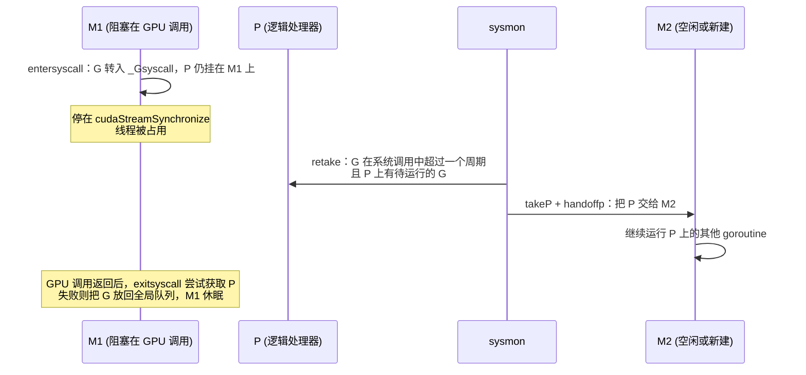

# 18.2 调度器与阻塞的外部调用

[18.1](./boundary.md) 的建议是异步提交、减少同步：把命令放入流，立即返回，只在末尾等待一次。
但末尾的那一次终究要等。`cudaStreamSynchronize` 会一直阻塞，直到 GPU 执行完流中的全部命令；一次同步的
`cudaMemcpy`，或任何没有走异步路径的驱动调用，都会让 Go 一侧的线程停留在 C 代码中。CUDA
等待设备的方式还可以配置：默认的 `cudaDeviceScheduleAuto` 在进程中活跃的 CUDA
上下文数不超过逻辑处理器数时让等待的线程自旋，否则让出处理器；`cudaDeviceScheduleBlockingSync`
则让线程阻塞在同步原语上 [[NVIDIA, n.d.d](#ref-nvidia-ndd)]。无论哪一种，在等待期间这条线程都在 C 代码中。
本节讨论的问题是：当一次跨界调用长时间不返回时，[第 9 章](../../part3concurrency/ch09sched/readme.md)的调
度器如何应对，它会不会被一个停在 GPU 上的调用拖住。

这个问题有两个方向：Go 阻塞在 C 中，以及 C 反过来回调 Go。调度器对两者各有一套处理。

## 18.2.1 调度器眼中的阻塞调用

第 9 章的调度器在 M（系统线程）、P（逻辑处理器，数量由 `GOMAXPROCS` 决定）与 G（goroutine）
三者之间编排并发，M 必须持有一个 P 才能运行 Go 代码。这一模型来自 Vyukov 2012 年的调度器设计：P 是执行 Go
代码所需的资源，M 空闲或处于系统调用中时并不需要 P [[Vyukov, 2012](#ref-vyukov-2012)]。

15.6 讲过，`cgocall` 在调用 C 函数之前会调用 `entersyscall`。在调度器的记账中，一次 cgo
调用与一次系统调用是同一回事：G 的状态由 `_Grunning` 变为 `_Gsyscall`。Go 1.26 在这里做了一处简化。
此前的运行时为 P 也设有一个 `_Psyscall` 状态，表示该 P 的 M 正在系统调用中；Go 1.26 删除了这个状态，
只在源码中保留一个占位名 [[Go Authors, 2026c](#ref-go-authors-2026c)]：

```go
	// _Psyscall_unused is a now-defunct state for a P. A P is
	// identified as "in a system call" by looking at the goroutine's
	// state.
	_Psyscall_unused
```

此后，判断一个 P 是否处于系统调用中，只看它上面那个 goroutine 的状态。`entersyscall` 也不再修改 P 的状态，
P 在整个调用期间仍然挂在当前 M 上，只是随时可能被取走。提交说明指出，
这一改动省去了系统调用路径上的一次原子存储与一次原子 CAS，在 AMD EPYC 7B13 上把 `CgoCall` 基准从 43.69 ns
降到 35.83 ns [[Knyszek, 2025](#ref-knyszek-2025)]。它是 Go 1.26 精简系统调用路径的三次提交之一，
发布说明给出的合计效果是 cgo 调用的基础运行时开销降低约 30% [[Go Authors, 2026a](#ref-go-authors-2026a)]，
也就是 18.1.2 中第一种开销的缩减。

从 `entersyscall` 到 C 函数返回，这个 goroutine 不受调度器控制。C 代码运行在 M 的系统栈上，
运行时不能移动它，也不能在其中插入抢占点；基于信号的异步抢占同样只对 Go 代码有效。`retake`
中的一段注释说明了这一点 [[Go Authors, 2026b](#ref-go-authors-2026b)]：

```go
			// If pp is in a syscall, preemptone doesn't work.
			// The goroutine nor the thread can respond to a
			// preemption request because they're not in Go code,
			// so we need to take the P ourselves.
```

即：P 处于系统调用中时 `preemptone` 不起作用，goroutine 与线程都不在 Go 代码中，无法响应抢占请求，
运行时只能自己把 P 取走。因此在整个 C 调用期间，承载它的 M 被完全占用。需要注意的是，被占用的是 M，而不是
P。P 的数量受 `GOMAXPROCS` 限制，是稀缺资源；M 的创建代价相对较低。调度器要避免的，
是一个阻塞的调用长期占着 P，使其他 goroutine 无法运行。

## 18.2.2 sysmon 取回 P

处理这种情况的是第 9 章介绍的 **sysmon**，一个不持有 P、独立运行的监控线程。它的休眠间隔从 20 µs 开始，
连续空闲一段时间后逐步加倍，最长 10 ms。每轮巡查中，`retake` 会检查所有 P，把在系统调用中停留过久的 P
取回，交给其他 M。阻塞的 cgo 调用由同一套机制处理。下面是 Go 1.26 中 `retake` 处理系统调用的部分
[[Go Authors, 2026b](#ref-go-authors-2026b)]：

```go
		// Try to prevent the P from continuing in the syscall, if it's in one at all.
		thread, ok := setBlockOnExitSyscall(pp)
		if !ok {
			// Not in a syscall, or something changed out from under us.
			goto done
		}

		// Retake the P if it's there for more than 1 sysmon tick (at least 20us).
		if syst := int64(pp.syscalltick); !sysretake && int64(pd.syscalltick) != syst {
			pd.syscalltick = uint32(syst)
			pd.syscallwhen = now
			thread.resume()
			goto done
		}

		// On the one hand we don't want to retake Ps if there is no other work to do,
		// but on the other hand we want to retake them eventually
		// because they can prevent the sysmon thread from deep sleep.
		if runqempty(pp) && sched.nmspinning.Load()+sched.npidle.Load() > 0 && pd.syscallwhen+10*1000*1000 > now {
			thread.resume()
			goto done
		}

		// Take the P. Note: because we have the scan bit, the goroutine
		// is at worst stuck spinning in exitsyscall.
		thread.takeP()
		thread.resume()
		n++

		// Handoff the P for some other thread to run it.
		handoffp(pp)
```

`setBlockOnExitSyscall` 先确认该 P 上的 goroutine 确实处于 `_Gsyscall`，并暂时阻止它退出系统调用，
使检查与取走之间不会发生竞争。随后有两道条件。第一，这次系统调用必须已经持续超过一个 sysmon 周期（至少 20
µs）；首次观察到时只记下时间。第二，如果这个 P 的本地运行队列为空，而系统中又有自旋的 M 或空闲的 P，
说明暂时没有别的工作需要这个 P，那么在 10 ms 以内不取走它。两道条件都不满足时，`takeP` 把 P 从阻塞的 M
上摘下，`handoffp` 把它交给另一个 M 继续运行队列中的 goroutine。

因此，一次阻塞的 GPU 调用不会冻结整个程序：只要有其他 goroutine 等待运行，P 在数十微秒的量级上就会被移交，
其余 `GOMAXPROCS - 1` 份并行照常推进。被占用的 M 等到 GPU 调用返回后，在 `exitsyscall` 中设法重新获得一个
P：原来的 P 仍在就继续使用，否则尝试获取一个空闲的 P；都拿不到时，这个 goroutine 被放回全局运行队列，M
随即休眠。



这是第一个方向的结论：阻塞的跨界调用不会拖垮调度器，稀缺的 P 由 sysmon 保住。代价是那个 M 被占用一段时间，
以及一次 P 的移交。还有一处需要留意：若 CUDA 以自旋方式等待设备，被占用的线程在等待期间持续消耗一个处理器
核，而 P 已经交给了另一个 M，此时实际运行的线程数会超过 `GOMAXPROCS`。

## 18.2.3 线程膨胀

单次阻塞的代价不大，但在并发场景下会被放大。

比较两种阻塞。goroutine 阻塞在通道或互斥锁上时，调度器把它挂起（park），M 随即去运行别的 goroutine，一个
M 可以服务大量这样阻塞着的 goroutine，这是 goroutine 廉价的基础。goroutine 阻塞在 cgo 调用中时则无法挂起：
C 代码占用着这条线程的栈，运行时无法把它移走，这个 goroutine 与它的 M 绑定在一起，直到 C 函数返回。
由此可以得出：

每一个同时阻塞在 GPU 调用中的 goroutine，都独占一个操作系统线程。

如果为每个请求启动一个 goroutine，并让它同步地等待 GPU 完成，那么 N 个并发请求就可能产生多达 N 个线程。
goroutine 的低成本在这里不再成立，付出的是线程的成本。而且这些线程大部分时间只是在等待：
它们提交给的往往是同一块 GPU，增加线程并不会增加设备的吞吐。线程数也有上限，运行时默认最多允许
10000 个线程（可以用 `debug.SetMaxThreads` 调整），超过时程序以「thread exhaustion」终止；C
创建的线程不计入这一上限 [[Go Authors, 2026b](#ref-go-authors-2026b)]。

这正是 15.6 中「高并发且 C 调用可能阻塞」需要谨慎对待的原因，也说明了 18.1 为何强调异步。落到设计上，
有两条取向：

- **不要把同步的设备调用分散到大量 goroutine 中。** 同步等待 GPU 的 goroutine 越多，线程越多，
  收益却不随之增长。
- **用少数 goroutine 异步地向流提交命令。** 少数几个 goroutine 把命令异步地放入流（18.1），
  等待期间不必占用线程，设备同样可以保持忙碌。

18.2.5 会给出一种更彻底的形态：由一个专门的 goroutine 独占设备。

## 18.2.4 反方向：外部线程回调 Go

以上讨论的都是 Go 阻塞在 C 中。跨界也可以反向发生。CUDA 允许用 `cudaLaunchHostFunc`
在流中插入一个主机函数 [[NVIDIA, n.d.a](#ref-nvidia-nda)]，它在此前提交的工作完成后被调用，
并阻塞此后加入的工作；`cudaStreamAddCallback` 也有类似的作用，但已计划弃用
[[NVIDIA, n.d.b](#ref-nvidia-ndb)]。提交这个主机函数的线程早已返回，调用它的是 CUDA 运行时自己管理的线程，
文档没有规定具体是哪一条。如果主机函数要调用一个 Go 函数，问题就出现了：这条线程不是 Go 运行时创建的，
没有对应的 M，也就没有 `g0` 与调度上下文，Go 代码无从运行。

运行时为此准备了 **extra M**。`runtime/proc.go` 中的 `needm` 专门处理这种情形，它的注释说明了整个设计
[[Go Authors, 2026b](#ref-go-authors-2026b)]：

```go
// In order to make sure that there is always an m structure
// available to be stolen, we maintain the invariant that there
// is always one more than needed. At the beginning of the
// program (if cgo is in use) the list is seeded with a single m.
// If needm finds that it has taken the last m off the list, its job
// is - once it has installed its own m so that it can do things like
// allocate memory - to create a spare m and put it on the list.
//
// Each of these extra m's also has a g0 and a curg that are
// pressed into service as the scheduling stack and current
// goroutine for the duration of the cgo callback.
//
// It calls dropm to put the m back on the list,
// 1. when the callback is done with the m in non-pthread platforms,
// 2. or when the C thread exiting on pthread platforms.
```

即：为保证总有一个 M 可以借用，运行时维持「备用的 M 总比需要的多一个」这一不变量。启用 cgo
的程序在启动时向链表放入一个 M；`needm` 若发现自己取走了最后一个，便在装好自己的 M、能够分配内存之后，
再创建一个备用 M 放回链表。每个 extra M 都带有自己的 `g0` 与 `curg`，在回调期间分别充当调度栈与当前
goroutine。归还的时机分平台：非 pthread 平台在每次回调结束时调用 `dropm`，pthread 平台则等到这条 C
线程退出时才归还。

第二种做法始于 Go 1.21。此前，每次回调结束都要归还 M，下一次回调再重新借用；Go 1.21 改为在 pthread
平台上用线程局部的 pthread key 记住这条 C 线程的 M，线程退出时才归还 [[Mui, 2023](#ref-mui-2023)]。
发布说明给出的效果是，同一条 C 线程上后续的回调开销从每次约 1–3 µs 降到约 100–200 ns
[[Go Authors, 2023](#ref-go-authors-2023)]。因此在类 Unix 平台上，一条频繁回调 Go
的驱动线程主要在第一次回调时付出借用 M 的代价，此后每次回调的开销与一次普通的 C 到 Go 回调相当（15.6.6
测得一次带回调的 cgo 调用约 72 ns）。

CUDA 对主机函数还有两条限制：它不得调用任何 CUDA API，也不得执行任何可能依赖尚未完成的 CUDA
工作的同步操作 [[NVIDIA, n.d.c](#ref-nvidia-ndc)]。落到 Go 上，回调里能做的基本只有通知：
例如向一个带缓冲的通道发送完成信号，而不是在回调中继续提交命令，也不应阻塞等待某个本身在等 GPU 的
goroutine。另一种做法是不用回调，改由 Go 一侧查询状态（`cudaStreamQuery`、`cudaEventQuery`）
或直接阻塞等待。accel 的 Metal 后端即采用后者：它没有注册任何完成回调，
而是阻塞等待或查询命令缓冲区的状态，其文档也提醒，一旦加入第一个完成回调，Objective-C
对象生命周期上的问题就会随之出现 [[Ou, 2026d](#ref-ou-2026d)]。

## 18.2.5 锁定线程以独占设备

前两个方向的压力最终指向同一种设计，它还解决了一个尚未讨论的问题：**上下文的线程亲和性**。

许多设备 API 的状态是按线程保存的。CUDA 驱动 API 中，`cuCtxSetCurrent` 把指定的上下文绑定到调用它的 CPU
线程，`cuCtxGetCurrent` 返回绑定在调用线程上的上下文 [[NVIDIA, n.d.e](#ref-nvidia-nde)]。运行时 API
的情况稍好：它默认使用每个设备一个、在进程内共享的主上下文 [[NVIDIA, n.d.f](#ref-nvidia-ndf)]，
单设备程序通常不受影响；但 `cudaSetDevice` 设置的「当前设备」仍是调用线程的状态
[[NVIDIA, n.d.d](#ref-nvidia-ndd)]，多设备程序依然要面对同样的问题。OpenGL
的上下文同样是「当前于某条线程」的（[19.2](../ch19graphics/bindings.md)）。goroutine 却会在不同的 M
之间迁移：这一刻在线程 A 上运行，下一刻可能被调度到线程 B。在 A 上设置好的上下文，在 B 上并不存在。

`runtime.LockOSThread` 用于解决这个问题，它的文档写道 [[Go Authors, n.d.](#ref-go-authors-nd)]：

```go
// LockOSThread wires the calling goroutine to its current operating system thread.
// The calling goroutine will always execute in that thread,
// and no other goroutine will execute in it,
// until the calling goroutine has made as many calls to
// [UnlockOSThread] as to LockOSThread.
// If the calling goroutine exits without unlocking the thread,
// the thread will be terminated.
//
// All init functions are run on the startup thread. Calling LockOSThread
// from an init function will cause the main function to be invoked on
// that thread.
//
// A goroutine should call LockOSThread before calling OS services or
// non-Go library functions that depend on per-thread state.
```

即：调用者被绑定到当前的操作系统线程，此后始终在这条线程上运行，其他 goroutine 也不会在这条线程上运行，
直到 `UnlockOSThread` 的调用次数与 `LockOSThread` 相等；依赖线程状态的系统服务或非 Go 库函数，
应当在调用之前先锁定线程。

accel 为 CUDA 后端起草的设计文档记录了一次探测，说明这一点在实践中有多重要 [[Ou, 2026c](#ref-ou-2026c)]。
这个后端尚未实现，探测程序经 purego 直接调用驱动 API，在一台 GB10（CUDA 13.0）上用 8 个 goroutine
各自循环执行分配、上传、启动、同步、下载与校验。不锁定线程、也不设置上下文时，调用总是返回
`CUDA_ERROR_INVALID_CONTEXT`；在每次驱动调用之前都调用 `cuCtxSetCurrent`，结果时好时坏，重复 5 次运行中有
2 次或 3 次失败，因为 goroutine 可能恰好在设置上下文与随后的调用之间换了线程；先 `LockOSThread`、
再在锁定的区间内设置一次上下文，结果才稳定。同一份文档还发现，显式传入流句柄的调用（`cuLaunchKernel`、
`cuMemcpyHtoDAsync`、`cuStreamSynchronize` 等）从句柄中取得上下文，即使当前线程没有上下文也能正确执行；
需要线程上已有上下文的，是 `cuMemAlloc`、同步拷贝、`cuModuleLoadData` 与 `cuStreamCreate`
这类没有句柄可携带上下文的调用。由于 Go 无法指定 goroutine 在哪条线程上运行，
已经设置好上下文的线程也无法事后借用，需要上下文的工作只能交给自始至终锁定在同一条线程上的 goroutine。

线程亲和性也不限于 GPU 上下文。accel 的 Metal 后端在调用可能返回自动释放对象的 Objective-C 方法时，
要在外面包一层自动释放池，而这个池必须在压入它的同一条线程上弹出，因此 `withPool` 在压入之前先锁定线程
[[Ou, 2026a](#ref-ou-2026a)]：

```go
func withPool(f func()) {
	runtime.LockOSThread()
	defer runtime.UnlockOSThread()
	p, _, _ := purego.SyscallN(fnPoolPush)
	defer purego.SyscallN(fnPoolPop, p)
	f()
}
```

把线程亲和性与前面的线程成本合起来考虑，就得到一种简洁的形态：由一个专门的 goroutine 锁定线程、独占设备，
其余 goroutine 经通道向它提交请求。下面是这种形态的示意（`createContext`、`submit` 等为假设的函数）：

```go
// 一个专门的设备 goroutine：独占设备、锁定线程，对外只暴露通道
func deviceWorker(reqs <-chan Request) {
	runtime.LockOSThread()         // 锁定：上下文从此只在这条线程上
	defer runtime.UnlockOSThread()
	ctx := C.createContext()       // 上下文绑定到这条线程
	defer C.destroyContext(ctx)
	for r := range reqs {          // 依次处理请求，命令异步地放入流
		r.result <- submit(ctx, r) // 其余 goroutine 经通道与它通信
	}
}
```

这种形态同时解决了三个问题。其一是线程亲和性：上下文始终在同一条锁定的线程上，不会因为 goroutine
迁移而失效。其二是线程数量：无论上游有多少 goroutine 发出请求，真正触及设备的只有这一个 goroutine，
不会出现 18.2.3 的线程膨胀。其三是它符合 Go 的并发风格：设备这一共享资源由一个 goroutine 独占，其余
goroutine 通过通道与之通信，即「不要通过共享内存来通信，而应通过通信来共享内存」。accel
为没有命令缓冲区的 OpenGL ES 后端规划的正是这种形态：后端拥有一个锁定线程、持有上下文的 goroutine，
把录制好的命令列表在其上重放 [[Ou, 2026b](#ref-ou-2026b)]。[第 21 章](../ch21agent/readme.md) 的 Agent
也会用到这种「单一拥有者加通道」的结构。

## 小结

FFI 边界不会压垮调度器，但会从两个方向给它施加压力。Go 阻塞在 C 中时，M 被整段占用、无法挂起，只能由
sysmon 把稀缺的 P 取回；大量并发的阻塞调用会导致线程膨胀，因为停在 cgo 调用中的 goroutine
不像停在通道上的那样廉价。反方向上，外部线程回调 Go 需要借用一个 extra M；自 Go 1.21 起，类 Unix
平台上同一条线程只在第一次回调时付出这笔代价。两方面的压力把设计推向同一种形态：
不把阻塞的设备调用分散给大量 goroutine，而是由少数几个、必要时锁定线程的 goroutine 独占设备，
再用通道把它与程序的其余部分连接起来。

调度上的问题讨论完毕，还剩内存：跨界传递的指针中，哪些由垃圾回收器管理，哪些是设备地址，
回收器为什么不会触碰后者。这是 [18.3](./memory.md) 的内容。

## 延伸阅读

- <a id="ref-go-authors-2023"></a>[Go Authors, 2023] The Go Authors. *Go 1.21 Release Notes.* 2023.
  https://go.dev/doc/go1.21
  运行时一节：在 C 创建的线程上，后续 C 到 Go 调用的开销从约 1–3 µs 降到约 100–200 ns。
- <a id="ref-go-authors-2026a"></a>[Go Authors, 2026a] The Go Authors. *Go 1.26 Release Notes.* 2026.
  https://go.dev/doc/go1.26
  其中「Faster cgo calls」一节。
- <a id="ref-go-authors-2026b"></a>[Go Authors, 2026b] The Go Authors. src/runtime/proc.go. Go 1.26 源码.
  https://github.com/golang/go/blob/release-branch.go1.26/src/runtime/proc.go
  `entersyscall`/`exitsyscall`、sysmon 的 `retake`/`handoffp`、`needm`/`dropm` 与 extra M、线程数上限。
- <a id="ref-go-authors-2026c"></a>[Go Authors, 2026c] The Go Authors. src/runtime/runtime2.go. Go 1.26
  源码. https://github.com/golang/go/blob/release-branch.go1.26/src/runtime/runtime2.go
  P 的状态定义，其中 `_Psyscall_unused` 的注释。
- <a id="ref-go-authors-nd"></a>[Go Authors, n.d.] The Go Authors. *runtime.LockOSThread.*
  https://pkg.go.dev/runtime#LockOSThread
  把 goroutine 锁定在一条操作系统线程上，用于要求线程亲和的设备与图形上下文。
- <a id="ref-knyszek-2025"></a>[Knyszek, 2025] Michael Knyszek. runtime: eliminate _Psyscall. Go commit
  7244e9221f, 2025. https://go.dev/cl/646198
  随 Go 1.26 发布。
- <a id="ref-mui-2023"></a>[Mui, 2023] Cherry Mui. runtime/cgo: store M for C-created thread in pthread
  key. Go commit c426c87012, 2023. https://go.dev/cl/495855
  随 Go 1.21 发布。重新应用 doujiang24 的 CL 481061 及其后续修复。
- <a id="ref-nvidia-nda"></a>[NVIDIA, n.d.a] NVIDIA. *CUDA C++ Programming Guide: Asynchronous Concurrent
  Execution / Stream Callbacks.* https://docs.nvidia.com/cuda/cuda-c-programming-guide/
  `cudaLaunchHostFunc` 等在驱动线程上回调主机代码的机制。
  自 CUDA 13.0 起该文档标为 Legacy、不再更新，由新版 *CUDA Programming Guide*（[NVIDIA, n.d.b]）取代。
- <a id="ref-nvidia-ndb"></a>[NVIDIA, n.d.b] NVIDIA. *CUDA Programming Guide: Asynchronous Execution.*
  https://docs.nvidia.com/cuda/cuda-programming-guide/02-basics/asynchronous-execution.html
  新版编程指南，其中「Callback Functions from Streams」一节介绍 `cudaLaunchHostFunc`。
- <a id="ref-nvidia-ndc"></a>[NVIDIA, n.d.c] NVIDIA. *CUDA Runtime API: Execution Control.*
  https://docs.nvidia.com/cuda/cuda-runtime-api/group__CUDART__EXECUTION.html
  `cudaLaunchHostFunc` 的语义与对主机函数的限制。
- <a id="ref-nvidia-ndd"></a>[NVIDIA, n.d.d] NVIDIA. *CUDA Runtime API: Device Management.*
  https://docs.nvidia.com/cuda/cuda-runtime-api/group__CUDART__DEVICE.html
  `cudaSetDeviceFlags` 中 `cudaDeviceScheduleAuto`、`Spin`、`Yield` 与 `BlockingSync` 的等待策略；
  `cudaSetDevice` 设置调用线程的当前设备。
- <a id="ref-nvidia-nde"></a>[NVIDIA, n.d.e] NVIDIA. *CUDA Driver API: Context Management.*
  https://docs.nvidia.com/cuda/cuda-driver-api/group__CUDA__CTX.html
  `cuCtxSetCurrent` 与 `cuCtxGetCurrent`：上下文绑定在调用它的 CPU 线程上。
- <a id="ref-nvidia-ndf"></a>[NVIDIA, n.d.f] NVIDIA. *CUDA Runtime API: Difference between the driver and
  runtime APIs.* https://docs.nvidia.com/cuda/cuda-runtime-api/driver-vs-runtime-api.html
  运行时 API 隐式使用每个设备一个、在进程内共享的主上下文。
- <a id="ref-ou-2026a"></a>[Ou, 2026a] Changkun Ou. *accel: Run compute on the GPU from Go.*
  https://github.com/golang-design/accel, 2026.
  `internal/mtl/objc_darwin.go` 中的 `withPool`。项目处于早期阶段。
- <a id="ref-ou-2026b"></a>[Ou, 2026b] Changkun Ou. *Backends: the contract, the set, and the capability
  matrix.* specs/006-backends.md, 2026.
  https://github.com/golang-design/accel/blob/main/specs/006-backends.md
  OpenGL ES 后端以一个锁定线程的 goroutine 持有上下文。
- <a id="ref-ou-2026c"></a>[Ou, 2026c] Changkun Ou. *CUDA bring-up: the loader shim, a thread-local
  context, and one dispatch.* specs/060-cuda-bringup.md, 2026.
  https://github.com/golang-design/accel/blob/main/specs/060-cuda-bringup.md
  起草中的设计文档，§4 记录了 CUDA 上下文的线程亲和性与 goroutine 迁移之间冲突的实测。
- <a id="ref-ou-2026d"></a>[Ou, 2026d] Changkun Ou. *Backend conventions.* docs/conventions.md, 2026.
  https://github.com/golang-design/accel/blob/main/docs/conventions.md
  「Objective-C object lifetime across completion handlers」一节。
- <a id="ref-vyukov-2012"></a>[Vyukov, 2012] Dmitry Vyukov. *Scalable Go Scheduler Design Doc.* 2012.
  https://golang.org/s/go11sched
  M/P/G 模型与系统调用下的 P 移交，sysmon 设计的源头。
- 本书 [9.5 线程管理](../../part3concurrency/ch09sched/thread.md)、
  [9.8 系统监控](../../part3concurrency/ch09sched/sysmon.md)、
  [15.6 cgo](../../part5toolchain/ch15compile/cgo.md)、
  [18.1 跨越 FFI 边界](./boundary.md)、[18.3 显存与垃圾回收的分界](./memory.md)、
  [19.2 图形绑定与线程亲和](../ch19graphics/bindings.md)。
