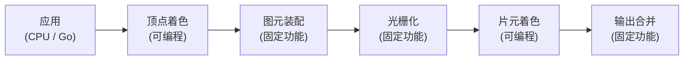

# 19.1 渲染管线与 Go 的位置

第 18 章把 GPU 当作通用的并行计算设备来讨论。GPU 中的 G 指图形（graphics）：
这种硬件最初是为实时渲染设计的，它的大规模并行结构首先服务于逐顶点、逐像素的着色计算，
通用计算是后来才发展起来的用途。本章回到图形。本节先说明渲染管线的结构，再确定 Go 代码在管线中的位置，
以及这个位置让 Go 程序面对哪些边界。

## 19.1.1 管线：分段的数据流

把一组三维顶点变成屏幕上的一帧图像，GPU 采用流水线的方式：每个阶段读入上一阶段的输出，完成一类变换，
再交给下一阶段。经典的光栅化管线大致如下：

管线中的阶段分为两类。**固定功能**阶段由硬件实现，程序只能设置参数，例如图元装配、光栅化，以及最后把片元
写入帧缓冲时的深度测试与混合。**可编程**阶段执行由程序提供的小程序，这种程序称为**着色器**（shader）：
顶点着色器逐个处理顶点，片元着色器逐个处理光栅化产生的片元。WebGPU 规范对 GPU 工作方式的概括正是如此：
GPU 让数据流过一条由固定功能阶段与可编程阶段组成的管线，以此执行命令缓冲中编码的命令
[[W3C, n.d.](#ref-w3c-webgpu)]。光栅化位于两类着色器之间，它确定一个三角形覆盖了哪些像素，并为每个
被覆盖的像素生成一个片元。各阶段的详细讨论见 [[Akenine-Möller et al., 2018](#ref-akenine-moller-2018)]
第 2、3 章。

这条管线适合 GPU，原因在于它的工作单元彼此独立：同一段着色器作用于成千上万个顶点或片元，相互之间没有依赖，
这正是 [18.4](../ch18gpu/model.md) 所讨论的 SIMT 执行方式擅长的负载。

## 19.1.2 Go 的位置：CPU 一侧的编排者

Go 代码只位于管线最左端的应用阶段。它运行在 CPU 上，负责组织场景数据，包括顶点、纹理与变换矩阵，
把它们上传到显存，然后发出**绘制调用**（draw call），指定用哪些数据与哪些着色器绘制。绘制调用发出之后，
顶点着色、光栅化与片元着色都在 GPU 上进行，Go 代码不再参与，只在需要时取回结果，
或把完成的帧交给窗口系统显示。

这个位置意味着图形程序要面对两道边界。

第一道是 FFI 边界。图形 API 是 C 接口，Go 程序经 cgo 或 purego 调用图形驱动
（[18.1](../ch18gpu/boundary.md)）。一次绘制调用本质上是一次命令提交：OpenGL 驱动把 `glDrawElements`
这样的命令放入队列后即返回，Vulkan 的 `vkCmdDraw` 只把命令录入命令缓冲，等到 `vkQueueSubmit` 才真正提交。
无论哪种形式，GPU 都在自己的时间线上异步执行，18.1 讨论的异步提交模型在这里同样适用。
一帧往往包含大量绘制调用，因此「减少跨越边界的次数」在图形领域表现为「减少绘制调用的次数」。

第二道是语言边界。着色器运行在 GPU 上，驱动接受的是各图形 API 规定的着色语言或中间表示：OpenGL 的 GLSL、
Direct3D 的 HLSL、Metal 的 MSL、WebGPU 的 WGSL，以及 Vulkan 使用的二进制中间表示 SPIR-V。Go 编译器不生成
GPU 代码，Go 程序中的着色器最终总要以这些形式之一交给驱动。Go 生态中也有让着色器在形式上接近 Go 的做法：
Ebitengine 的着色语言 Kage 在语法层面与 Go 相同，可以用 `gofmt` 格式化，
运行时再编译为当前图形后端所需的语言 [[Ebitengine, n.d.b](#ref-ebitengine-ndb)]；polyred 把带有
`//gpu:vertex`、`//gpu:fragment` 等注释的 Go 函数编译为后端的着色语言 [[Ou, n.d.](#ref-ou-nd)]。
但这些着色器并不是普通的 Go 程序。以 Kage 为例，除 `int` 外的大多数类型（字符串、切片、指针、接口、
通道等）、结构体、`import`、goroutine 与 `defer` 都不受支持 [[Ebitengine, n.d.b](#ref-ebitengine-ndb)]。
语言边界仍然存在，只是被移到了工具链内部。

CPU 与 GPU 两侧通过约定的接口衔接：顶点属性、uniform 变量（WebGPU 中组织为绑定组）与纹理。Go
负责准备并绑定这些数据，着色器负责逐顶点、逐片元的计算。

## 19.1.3 绘制调用的开销与显式 API

每次绘制调用都要经过驱动。在 OpenGL 这类 API 中，驱动要在调用时检查并转换当前状态，这部分 CPU 开销长期是
图形程序的性能瓶颈。在 GDC 2014 上，来自 NVIDIA、Intel 与 AMD 的四位工程师以「Approaching Zero Driver
Overhead in OpenGL」（简称 AZDO）为题指出，驱动开销在桌面系统上降低帧率，在移动设备上同时损耗电量与帧率；
他们介绍的手段在现有 OpenGL 实现中即可使用，能把驱动开销降低到原来的十分之一乃至更低
[[Everitt et al., 2014](#ref-everitt-2014)]。

这些手段的思路与 18.1 相同：在一次调用中完成更多工作。最常见的两种是：

- **批处理**（batching）：把使用同一组状态的多个物体合并为一次绘制调用。Ebitengine 在内部把多张图像合并进
  纹理图集，并在可能时自动批量执行绘制操作 [[Ebitengine, n.d.a](#ref-ebitengine-nda)]。
- **实例化**（instancing）：用一次绘制调用画出同一网格的大量副本（如草叶、人群），
  各副本只在变换等少量参数上不同。

更大的变化发生在 API 层面。OpenGL 维护一个隐式的状态机，状态的管理与校验由驱动在背后完成；Vulkan、Metal、
Direct3D 12 与 WebGPU 这一代**显式** API 则把这部分工作交给应用。应用先把一串命令录制进**命令缓冲**
（command buffer），再提交给设备队列执行。Vulkan 规范对命令缓冲的定义是：用来录制命令的对象，所录制的命令
随后被提交到设备队列执行 [[Khronos, n.d.](#ref-khronos-vulkan)]。WebGPU 也采用这一模型，其规范称这套 API
从设计之初就以高效映射到 2014 年以后的原生 GPU API 为目标 [[W3C, n.d.](#ref-w3c-webgpu)]。

录制与提交分离之后，构造命令的开销可以在多次提交之间分摊。Vulkan 的命令缓冲录制一次后可以多次提交，
除非录制时声明了 `VK_COMMAND_BUFFER_USAGE_ONE_TIME_SUBMIT_BIT` [[Khronos, n.d.](#ref-khronos-vulkan)]；
WebGPU 的命令缓冲只能提交一次，需要在多次提交中重用的渲染命令改用渲染包 `GPURenderBundle`
[[W3C, n.d.](#ref-w3c-webgpu)]。这与 18.1 讨论的 CUDA Graph 是同一种思路：构造一次，执行多次。

显式 API 还改变了多线程的条件。Vulkan 规范写明，它的目标之一是在多个主机线程上取得可扩展的性能：所有命令都
可以被多个线程并发调用，只是部分参数要求**外部同步**，即由调用者保证同一时刻至多一个线程使用该参数
[[Khronos, n.d.](#ref-khronos-vulkan)]。命令池（command pool）就属于这一类，它不能被多个线程并发使用。
要并行录制，就让每个线程各持一个命令池，各自录制命令缓冲，最后统一提交。这一安排与 goroutine 相合：
每个 goroutine 持有一个命令池，录制场景的一部分。外部同步只要求同一时刻只有一个使用者，并不要求限定在
某一条线程上，这一点与下一节讨论的 OpenGL 上下文有本质区别。

Go 生态中的图形库都在 CPU 一侧完成这类编排。除前述 Ebitengine 的自动批处理外，Gio 是一个即时模式
（immediate mode）的 GUI 库，它的矢量渲染器在 GPU 上绘制图形与文字，主页介绍其实现基于 OpenGL ES 与
Direct3D 11，并正在转向基于计算着色器的渲染器 [[Gio, n.d.](#ref-gio-nd)]。

## 小结

渲染管线是一条分段的数据流，固定功能阶段与可编程的着色器阶段交替出现。Go 代码只位于其中的应用阶段：在 CPU
上准备数据并发出绘制调用。由此，图形程序面对两道边界：一道是 18.1 讨论的 FFI 边界，绘制调用就是命令提交，
减少绘制调用就是减少跨越边界的次数；另一道是语言边界，着色器必须以 GPU 驱动接受的语言或中间表示交付，Kage
这类语法接近 Go 的着色语言只是把这道边界移进了工具链。绘制调用的固定开销催生了批处理与实例化；Vulkan、
WebGPU 等显式 API 进一步把命令的录制与提交分开，并允许多个线程分别录制命令缓冲，为 goroutine 参与 CPU
一侧的编排提供了条件。

下一节讨论第一道边界在图形中的特殊约束：OpenGL 上下文为何与线程绑定，窗口系统为何要求主线程，以及
`runtime.LockOSThread` 在其中的作用（[19.2](./bindings.md)）。

## 延伸阅读

- [Akenine-Möller et al., 2018] Tomas Akenine-Möller, Eric Haines,
  Naty Hoffman, et al. *Real-Time Rendering, 4th Edition.* A K Peters/CRC Press, 2018.
  https://www.routledge.com/Real-Time-Rendering-Fourth-Edition/Akenine-Moller-Haines-Hoffman/p/book/9781138627000
  实时渲染的标准教材；第 2 章讨论图形渲染管线，第 3 章讨论 GPU。
- [Ebitengine, n.d.a] Ebitengine. https://ebitengine.org/
  Go 的二维游戏引擎；纹理图集与绘制操作的自动批处理。
- [Ebitengine, n.d.b] Ebitengine. *Shader.*
  https://ebitengine.org/en/documents/shader.html
  着色语言 Kage：语法与 Go 相同，运行时编译到各图形后端；不支持的 Go 特性列表。
- [Everitt et al., 2014] Cass Everitt, Tim Foley, John McDonald, Graham
  Sellers. *Approaching Zero Driver Overhead in OpenGL (AZDO).* GDC, 2014.
  https://gdcvault.com/play/1020791/Approaching-Zero-Driver-Overhead-in
  绘制调用驱动开销的来源，以及在现有 OpenGL 中削减它的手法。
- [Gio, n.d.] Gio. https://gioui.org/
  Go 的跨平台即时模式 GUI 库，在 GPU 上绘制矢量图形。
- [Khronos, n.d.] The Khronos Group. *Vulkan Specification: Rendering and
  Command Buffers.* https://registry.khronos.org/vulkan/
  命令缓冲：https://docs.vulkan.org/spec/latest/chapters/cmdbuffers.html
  线程行为与外部同步：https://docs.vulkan.org/spec/latest/chapters/fundamentals.html
  显式 API 如何用命令缓冲把命令的录制与提交分开。
- [Ou, n.d.] Changkun Ou. *polyred: 3D graphics in Go.*
  https://github.com/changkun/polyred
  用 Go 编写着色器并编译到 Metal 等后端的着色语言。
- [W3C, n.d.] W3C GPU for the Web Working Group. *WebGPU Specification.* W3C
  Candidate Recommendation Draft. https://www.w3.org/TR/webgpu/
  Web 上的显式图形与计算 API；命令缓冲、渲染包与管线模型。与 19.4 相关。
- 本书 [18.1 跨越 FFI 边界](../ch18gpu/boundary.md)、[18.4 异步编程模型](../ch18gpu/model.md)、
  [19.2 图形绑定与线程亲和](./bindings.md)。
