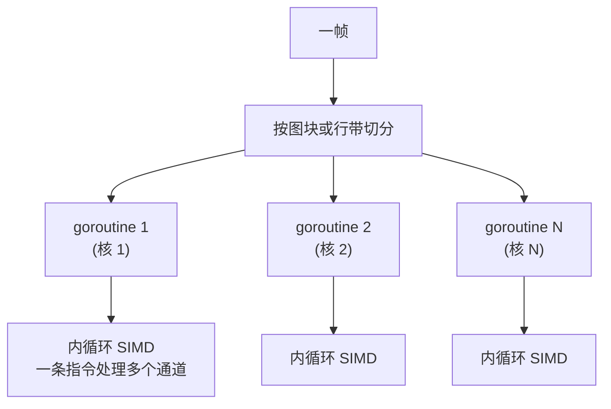

# 19.3 软件渲染与并行

前两节的渲染都要经过一道边界：数据与命令交给 GPU，承担第 18 章讨论的各项开销，还要遵守图形上下文的线程纪律
（[19.2](./bindings.md)）。本节讨论另一条路线：**软件渲染**，即完全在 CPU 上计算每个像素，不经过 GPU、驱动
与 FFI 边界。没有了边界，问题就变成了如何利用 CPU 自身的并行能力。CPU 上可用的并行有两层：多个核之间的任务
并行，由 goroutine 提供；单个核之内的数据并行，由 SIMD 提供。

## 19.3.1 为什么还要软件渲染

GPU 的吞吐远高于 CPU，但在以下几类场景中，GPU 要么不可用，要么不划算。

- **没有 GPU。** 服务器端批量生成图片、缩略图、图表或渲染 PDF，往往运行在没有显卡也没有显示器的无头
  （headless）机器上。这正是 Go 程序常见的部署环境。
- **需要可复现的结果。** 软件渲染的结果不受驱动版本与显卡型号的影响，适合用作测试基线或生成文档。
  但可复现并非自动成立：Go 语言规范允许实现把多个浮点运算合并为一次融合运算（如 FMA），
  其结果可能与逐条执行并舍入不同；显式的浮点类型转换会按目标精度舍入，从而阻止这种合并
  [[Go Authors, 2026a](#ref-go-authors-2026a)]。要在不同架构上得到逐位相同的图像，
  就要在关键的运算处写出这类转换，或者只用整数运算。
- **完全的控制。** 没有上下文、线程约束与边界，渲染器就是普通的 Go 代码，可以阅读、调试和单步执行。Go
  标准库的 `image` 与 `image/draw`、扩展库 `golang.org/x/image`（其中 `vector` 包是一个矢量光栅化器），
  以及 polyred 的 CPU 渲染路径 [[Ou, n.d.](#ref-ou-nd)]，都属于这一类。

## 19.3.2 分块：goroutine 级的并行

软件渲染有一个有利的性质：像素之间大多互不依赖，画面不同区域的像素可以完全独立地计算。
这是典型的易并行（embarrassingly parallel）问题。标准做法是**分块**（tiling）：把画面切成若干图块或行带，
每个 goroutine 负责一块。成熟的渲染器都这样做，例如 pbrt 所有基于 CPU 的积分器都把图像切分为图块，
交给不同的处理器渲染 [[Pharr et al., 2023](#ref-pharr-2023)]。

下面的程序把一幅 300×203 的图像切成 4 条行带并行渲染，再与串行渲染的结果逐字节比较：

```go {run=true}
package main

import (
	"bytes"
	"fmt"
	"hash/crc32"
	"image"
	"image/color"
	"sync"
)

// shade 计算像素 (x, y) 的颜色，只依赖像素自己的坐标
func shade(x, y int) color.RGBA {
	return color.RGBA{uint8(x ^ y), uint8(x), uint8(y), 255}
}

// renderRows 渲染第 y0 行到第 y1-1 行
func renderRows(img *image.RGBA, y0, y1 int) {
	for y := y0; y < y1; y++ {
		for x := 0; x < img.Rect.Dx(); x++ {
			img.SetRGBA(x, y, shade(x, y))
		}
	}
}

// renderParallel 把画面切成 workers 条互不重叠的行带，每个 goroutine 渲染一条
func renderParallel(img *image.RGBA, workers int) {
	h := img.Rect.Dy()
	var wg sync.WaitGroup
	for w := range workers {
		y0, y1 := w*h/workers, (w+1)*h/workers // 最后一条带止于 h，不会遗漏余下的行
		wg.Go(func() { renderRows(img, y0, y1) })
	}
	wg.Wait()
}

func main() {
	r := image.Rect(0, 0, 300, 203) // 203 行不能被 4 整除
	serial, parallel := image.NewRGBA(r), image.NewRGBA(r)
	renderRows(serial, 0, r.Dy())
	renderParallel(parallel, 4)
	fmt.Println("与串行结果相同:", bytes.Equal(serial.Pix, parallel.Pix))
	fmt.Printf("CRC-32: %08x\n", crc32.ChecksumIEEE(parallel.Pix))
}
```

以 Go 1.26.10 运行（加 `-race` 亦无报告），输出为：

```text
与串行结果相同: true
CRC-32: e1bf1a5f
```

着色函数只用整数运算，因此在任何架构上校验和都相同。行带的边界按 `w*h/workers` 计算，最后一条带恰好止于
`h`。若改用常见的 `rows := h / workers` 再取 `w*rows` 与 `(w+1)*rows`，203 行中最后 3 行就不会被任何
goroutine 渲染，程序会输出 `false`。

这段代码没有使用任何锁，因为每个 goroutine 只写自己那条行带中的像素，彼此的写入区域不重叠，
也就不存在数据竞争。`image.RGBA` 按行连续存储像素，一条行带在内存中是一段连续的区间，
相邻两条带至多在边界处共享一个缓存行，伪共享（[12.2](../../part4memory/ch12alloc/component.md)）
的影响很小。若改为让多个 goroutine 交错地写同一片区域，就需要同步，或者会因伪共享而损失性能。

均分行带的前提是各行的计算量相近。若画面不同区域的开销差别很大（例如只有部分区域有复杂的几何与光照），
静态均分会让一些 goroutine 早早空闲。此时可以把画面切得更细，让 goroutine
从共享的计数器或通道中动态领取下一块：先完成的 goroutine 随即领取新的图块，各核的负载因而趋于均衡。

## 19.3.3 内循环的向量化：SIMD

分块把工作分配到多个核上，每个核内部的数据并行则要靠 SIMD。渲染最内层的循环逐像素地做颜色混合、
插值与光照计算，是对一组数据执行相同运算的规整算术，正适合 [18.4](../ch18gpu/model.md) 讨论的 SIMD：
一条指令同时处理一个向量寄存器中的多个数据通道。

在 Go 1.26 之前，Go 程序使用 SIMD 的唯一途径是编写 Go 汇编，这只对性能最关键的计算核心才值得，
大量本可受益于 SIMD 的代码因此没有用上它 [[Chase and Shao, 2026](#ref-chase-and-shao-2026)]。
图像库的情况也是如此：标准库的 `image/draw` 完全用 Go 实现，`golang.org/x/image` 中只有 `vector`
包为光栅化的累加步骤提供了 amd64 汇编实现，在支持 SSE4.1 的处理器上启用
[[Go Authors, n.d.](#ref-go-authors-nd)]。

Go 1.26 引入了实验性的 `simd/archsimd` 包，提供 amd64 上 128、256 与 512 位的定宽向量类型；Go 1.27
在此基础上增加了可移植的 `simd` 包，两者都需在构建时设置 `GOEXPERIMENT=simd`
[[Go Authors, 2026b](#ref-go-authors-2026b)] [[Go Authors, 2026c](#ref-go-authors-2026c)]。`simd`
包的向量类型不规定宽度，如 `Float32s`、`Int8s`；同一次程序执行中所有向量的宽度相同，在程序启动时根据 CPU
特性确定：amd64 上视 AVX、AVX2 或 AVX-512 的支持情况取 128、256 或
512 位（缺少部分指令时会降到较窄的宽度），arm64 上目前取 NEON 的 128 位，wasm 上取 128 位；其他架构，
或设置了 `GODEBUG=simd=0` 时，使用纯 Go 的模拟实现 [[Chase and Shao, 2026](#ref-chase-and-shao-2026)]。

以最常见的 alpha 混合为例，`dst = src·α + dst·(1−α)` 在每个通道上是一次乘加，正好对应 `simd` 包的
`MulAdd`：

```go
//go:build goexperiment.simd

package main

import (
	"fmt"
	"simd"
)

// blendRow 把一行像素的一个颜色通道按 alpha 与背景混合：
// dst = src*alpha + dst*(1-alpha)。
func blendRow(dst, src, alpha []float32) {
	var z simd.Float32s
	lanes := z.Len()
	one := simd.BroadcastFloat32s(1)
	i := 0
	for ; i+lanes <= len(dst); i += lanes {
		s := simd.LoadFloat32s(src[i:])
		d := simd.LoadFloat32s(dst[i:])
		a := simd.LoadFloat32s(alpha[i:])
		// x.MulAdd(y, z) 逐元素计算 x*y + z
		s.MulAdd(a, d.Mul(one.Sub(a))).Store(dst[i:])
	}
	for ; i < len(dst); i++ { // 不足一个向量的尾部用标量处理
		dst[i] = src[i]*alpha[i] + dst[i]*(1-alpha[i])
	}
}

func main() {
	var z simd.Float32s
	fmt.Println("lanes:", z.Len())
	dst := []float32{0, 0, 0, 0, 1, 1, 1, 1, 0.5, 0.5}
	src := []float32{1, 1, 1, 1, 0, 0, 0, 0, 1, 0}
	alpha := []float32{0, 0.25, 0.5, 1, 0, 0.25, 0.5, 1, 0.5, 0.5}
	blendRow(dst, src, alpha)
	fmt.Println(dst)
}
```

这个程序需要 Go 1.27，无法在本书的页面中直接运行。以 Go 1.27.3 在 darwin/arm64 上设置 `GOEXPERIMENT=simd`
运行，输出为：

```text
lanes: 4
[0 0.25 0.5 1 1 0.75 0.5 0 0.75 0.25]
```

前 8 个元素由两次向量运算完成，最后 2 个由标量循环收尾；加上 `GODEBUG=simd=0` 改用模拟实现，输出相同。
同一份 `blendRow` 不必为每种向量宽度各写一份：在支持 AVX-512 的 amd64 机器上，`lanes` 可以是 16。`simd`
包仍是实验特性，API 可能调整；设计上的更多讨论见 18.4。

## 19.3.4 两层并行的叠加，与 GPU 的分工

把两层并行叠加起来，就得到软件渲染在 CPU 上的完整并行结构：



外层用 goroutine 把画面切块，分布到所有核上（任务并行）；内层用 SIMD
让每个核一次处理多个数据通道（数据并行）。两层相互独立，可以相乘：N 个核、每核每条指令处理 W 个通道，
相对朴素的标量串行实现，理想的加速上限约为 N×W 倍。实际的加速比通常低于这个上限，因为内存带宽、
负载不均与标量尾部处理都会削减收益。

软件渲染与 GPU 渲染的分工，是 18.4 中成本权衡在图形上的具体体现。GPU 渲染的吞吐高得多，
但要承担跨越边界的开销与上下文的线程约束；软件渲染的吞吐有上限，却没有边界，结果可控，
可以在任何无头机器上运行。因此，实时、高分辨率、着色复杂的交互式渲染（游戏、实时三维）适合 GPU；
无头的批量出图、需要可复现结果的场景、规模中等的图像处理，以及没有显卡的环境，适合软件渲染。polyred
的渲染器同时提供两条路径：默认使用 GPU，获取设备失败时逐个渲染阶段回退到 CPU，也可以用 `render.CPU()`
强制使用 CPU 路径 [[Ou, n.d.](#ref-ou-nd)]。

## 小结

软件渲染位于 FFI 边界的另一侧：放弃 GPU 的吞吐，换来零边界开销、可控的结果与在无头机器上照常出图的能力。CPU
上的并行分两层：外层用 goroutine 把画面切成互不重叠的区域，分布到多个核上，无须加锁；内层用 SIMD
向量化逐像素的算术，Go 1.27 实验性的 `simd` 包使这一层可以用可移植的 Go 代码表达，而不必编写汇编。
两层相乘，构成 CPU 并行能力的上限。是否改用 GPU，仍取决于 18.4 讨论的边界成本。

本机上的两条渲染路线已经讨论完毕。最后一节 [19.4](./wasm.md) 转向浏览器，讨论 Go 编译为 WebAssembly
之后渲染的边界落在哪里，以及本节的两层并行在浏览器中还剩下多少。

## 延伸阅读

- <a id="ref-chase-and-shao-2026"></a>[Chase and Shao, 2026] David Chase and Junyang Shao.
  *Platform-independent SIMD in Go.* The Go Blog, 2026-09-24. https://go.dev/blog/simd-experiment
  `simd` 包的动机与设计：可移植、不规定向量宽度、硬件不支持时的模拟实现与 `GODEBUG=simd` 设置。
- <a id="ref-go-authors-nd"></a>[Go Authors, n.d.] The Go Authors. *Package image/draw 与
  golang.org/x/image.* https://pkg.go.dev/image/draw ，https://pkg.go.dev/golang.org/x/image
  Go 的标准与扩展图像库。`image/draw` 为纯 Go 实现；`x/image/vector`
  的累加步骤在 amd64 上有 SSE4.1 汇编实现。
- <a id="ref-go-authors-2026a"></a>[Go Authors, 2026a] The Go Authors. *The Go Programming Language
  Specification: Floating-point operators.* https://go.dev/ref/spec#Floating_point_operators
  实现可以把多个浮点运算合并为融合运算；显式类型转换阻止合并。
- <a id="ref-go-authors-2026b"></a>[Go Authors, 2026b] The Go Authors. *Go 1.26 Release Notes.* 2026.
  https://go.dev/doc/go1.26
  实验性的 `simd/archsimd` 包（amd64，128、256 与 512 位向量）。
- <a id="ref-go-authors-2026c"></a>[Go Authors, 2026c] The Go Authors. *Package simd（Go 1.27 实验特性，需
  GOEXPERIMENT=simd）.* https://github.com/golang/go/tree/master/src/simd
  文档：https://pkg.go.dev/simd ；发布说明：https://go.dev/doc/go1.27
  `Float32s` 等不定宽向量类型，`LoadFloat32s`、`BroadcastFloat32s`、`MulAdd` 等操作。
- <a id="ref-ou-nd"></a>[Ou, n.d.] Changkun Ou. *polyred: 3D graphics in Go.*
  https://github.com/changkun/polyred
  原题 *polyred: a 3D graphics facility in pure Go*。Go
  的三维渲染器，同时提供 GPU 路径与纯 Go 的 CPU 路径。
- <a id="ref-pharr-2023"></a>[Pharr et al., 2023] Matt Pharr, Wenzel Jakob, Greg Humphreys. *Physically
  Based Rendering: From Theory to Implementation, 4th ed.* 2023. https://pbr-book.org/
  软件渲染器的体系结构；第 1.3.4 节的 `ImageTileIntegrator` 把图像切分为图块并行渲染。
- 本书 [第 9 章 goroutine 调度器](../../part3concurrency/ch09sched/readme.md)、[第
  11 章 同步原语与模式](../../part3concurrency/ch11sync/readme.md)、[12.2
  组件](../../part4memory/ch12alloc/component.md)、[18.4 异步编程模型](../ch18gpu/model.md)、[19.1
  渲染管线与 Go 的位置](./pipeline.md)、[19.4 浏览器中的渲染](./wasm.md)。
