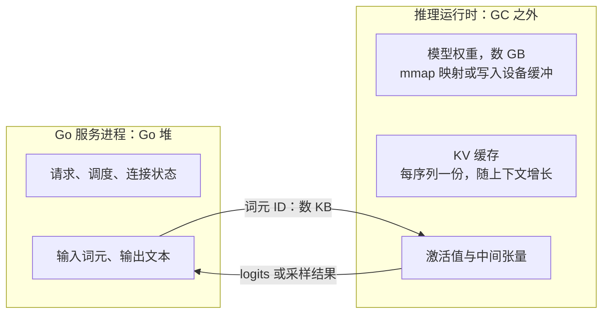

# 20.1 推理运行时与 FFI

第 18、19 章讨论的 FFI 边界，在大模型推理中再次出现。训练大模型主要依赖 Python 与 CUDA；模型训练完成、
需要服务大量请求时，问题的性质随之改变，Go 在这一层有了用武之地。但 Go 本身并不做矩阵乘法，
它需要接入一个原生的推理运行时，而这次接入又回到了第 18 章的那道边界。本节讨论三个问题：Go
如何接入推理运行时，张量的内存归谁所有，以及运行时应当与 Go 服务同处一个进程，还是另起一个进程。

## 20.1.1 训练与服务的分工

**训练**是一项研究性的工作：尝试不同的网络结构、调整超参数、观察损失曲线，
需要的是表达上的灵活与生态的丰富。Python、PyTorch 与 CUDA 是这一侧的主流组合，Go 在这里没有位置，
也不需要有。

**推理与服务**则是另一类工作。模型的权重已经冻结，剩下的几乎全是系统问题：如何以高吞吐、
低延迟服务大量并发请求；如何把数 GB 的权重稳定地装入内存并交给设备；如何把这一切做成易于部署、
能承受生产流量、便于监控与运维的服务。这些问题与 Go 擅长的领域高度重合：静态链接的单一二进制、goroutine
与通道、可预期的内存管理、成熟的标准库网络栈。本地大模型服务 Ollama 的服务进程就是用 Go 编写的，其
v0.40.13 版的 `go.mod` 声明 `go 1.26.10` [[Ollama, n.d.](#ref-ollama-nd)]。

## 20.1.2 接入原生推理运行时

矩阵乘法、注意力、反量化这些消耗算力的计算，Go 并不亲自完成，而是交给一个**推理运行时**：
llama.cpp 及其张量库 ggml（C/C++）[[Gerganov et al., n.d.](#ref-gerganov-nd)]、
以 C API 对外提供接口的 ONNX Runtime [[Microsoft, n.d.](#ref-microsoft-nd)]，或 Apple 的 MLX。
这些运行时针对 CPU 的 SIMD 指令与各类 GPU 后端做了深度优化。Go 接入它们，最直接的方式仍然是 cgo。

于是第 18 章的机制原样回来。以 Ollama 为例，原生部分用 CMake 构建，GPU 后端需要显式选择，例如
`-DOLLAMA_LLAMA_BACKENDS="cuda_v13;vulkan"`；所用的 llama.cpp 由仓库根目录的 `LLAMA_CPP_VERSION`
固定到一个标签（v0.40.13 中为 `b11963`），再叠加 `llama/compat/` 下的补丁
[[Ollama, 2026a](#ref-ollama-2026a)]。[15.6](../../part5toolchain/ch15compile/cgo.md)
末尾讨论的代价也一并继承：构建需要 C/C++ 工具链，纯 Go 的交叉编译不再可用，
运行时每次跨越边界都要付出状态切换的开销。Ollama 的开发文档对此有一条提示：

```text
Ollama includes native code compiled with CGO.  From time to time these data structures can change and
CGO can get out of sync resulting in unexpected crashes. You can force a full build of the native code
by running `go clean -cache` first.
```

即：Ollama 含有经 CGO 编译的原生代码，这些数据结构偶尔会变化，CGO 可能因此失去同步，导致意外崩溃；先执行
`go clean -cache` 即可强制完整重建原生代码。这是一个构建层面的问题，根源在 Go 构建缓存的设计。
`go help cache` 写明，构建缓存能正确跟踪 Go 源文件、编译器与编译选项的变化，但不检测经 cgo 引入的 C
库的变化；C 库变化之后，需要显式清理缓存或使用 `-a` 强制重建。在 `cmd/go` 的实现中，参与计算动作 ID
的只有包目录内的文件（Go、C、头文件等），包目录之外被 `#include` 的头文件不在其中（以 Go 1.26 为准）。cgo
把两种语言的类型定义绑在一起，而 Go 工具链只看得见其中一半。

设计上的纪律与 [18.1](../ch18gpu/boundary.md) 相同：**粗粒度**。没有人会为每个算子跨一次边界，
而是一次调用让运行时完成「对这一批词元（token）做一次完整的前向计算」，
把成百上千个算子的调度留在边界的另一侧。18.1 指出 GPU 负载天然是细粒度命令的洪流，推理运行时的价值之一，
正是把这股洪流挡在边界的另一侧，只给 Go 留下一个粗粒度的接口。

## 20.1.3 张量放在哪里

接入之后，最重要的工程问题是内存。大模型的内存以 GB 计，一次跨界复制的代价不可忽视。把
[18.3](../ch18gpu/memory.md) 的内存划分套用到推理上，归属关系如下（推理运行时可能与 Go 同处一个进程，
也可能是独立的子进程，内存的归属不因此改变）：



**其一，权重不在 Go 堆中。** 常见的做法有两种。llama.cpp 的加载模式默认为 `auto`，即「除非某个设备不支持，
否则使用 mmap」[[ggml-org, 2026a](#ref-ggml-org-2026a)]。GGUF 格式在设计时就把 mmap 兼容列为目标之一，
文件中每个张量的数据都按 `general.alignment` 对齐（未指定时为 32 字节），映射之后即可直接使用
[[ggml-org, 2026b](#ref-ggml-org-2026b)]。映射得到的页属于内核的页缓存，按需换入换出，Go
的垃圾回收器既不扫描它，也不把它计入堆的大小。另一种做法见于纯 Go 的 Forma：它不使用 mmap，而是逐个张量用
`ReadAt` 读入一块临时的 `[]byte`，完成精度与布局转换后写入 accel 向 Metal 申请的设备缓冲；
在统一内存的设备上，转换结果直接写入设备内存，主机侧不再保留转换后的副本 [[Ou, 2026a](#ref-ou-2026a)]。
两条路线的结局相同：常驻的数 GB 权重都不在 Go 堆中。

为什么要如此在意这一点？`[]byte` 不含指针，回收器不必扫描其内容，但它会计入存活堆。按 `GOGC=100`
的默认设置，下一轮回收的堆目标大约是存活堆的两倍（见 [13.3](../../part4memory/ch13gc/pacing.md)），8 GB
的权重若放在 Go 堆中，进程的内存上限就要按 16 GB 规划，而这块内存仍然不能直接交给设备使用。

**其二，KV 缓存是每个序列的大块状态。** 自回归生成时，模型在每一步都要读回此前所有位置的键与值，
运行时因此为每个序列维护一份 KV 缓存。每个位置的开销为 $2 \times \text{层数} \times \text{KV 头数} \times
\text{头维度} \times \text{每元素字节数}$。以 Qwen3-4B 为例（36 层、8 个 KV 头、头维度 128），按 f16
存储时每个位置约 144 KiB，4096 个位置约 576 MiB [[Ou, 2026a](#ref-ou-2026a)]。这块内存同样由运行时管理，
Go 一侧只持有一个句柄或序列编号。

**其三，跨越边界的只有小数据。** 输入的词元 ID、每一步的 logits 或采样结果、最终的文本，
与权重相比都是小量，复制过边界并无大碍。采样放在哪一侧会影响跨界的数据量：采样在运行时内部完成时，
每步只需返回一个词元；Forma 目前在 Go 中采样（在设备上采样的设计尚处于草案阶段），于是每一步都要把 logits
读回主机 [[Ou, 2026a](#ref-ou-2026a)]。推理中的「零拷贝」指的就是这条纪律：GB 级的数据留在原地，Go
只传递句柄与小数据。

**其四，原生内存的释放不能交给 GC。** 回收器只按 Go 堆的增长来安排回收，看不见原生一侧占用了多少内存，
用终结器或 `runtime.AddCleanup` 释放 GB 级的原生缓冲，释放的时机便无从保证（见
[13.10](../../part4memory/ch13gc/finalizer.md)）。Ollama 的 `mlx` 包选择确定性的释放：
每个数组句柄都隶属于一个作用域，作用域结束时其中的数组一并释放；数组只能通过返回值、`Attach` 或 `Detach`
在作用域之间移动 [[Ollama, 2026d](#ref-ollama-2026d)]。同一个包还要处理线程局部状态。MLX 的部分状态绑定在
操作系统线程上，`mlxthread` 因此启动一个长期运行的 工作 goroutine，调用 `runtime.LockOSThread`
后有意不再解锁，注释写明这是为了让 MLX 的线程局部状态不会泄漏给其他 goroutine。Go 的文档规定，goroutine
在锁定线程的状态下退出时，该线程会被终止（`runtime/proc.go`，以 Go 1.26 为准），这一规则恰好为它兜底。
这与 [18.2](../ch18gpu/sched.md) 讨论的 GPU 上下文是同一类问题。

## 20.1.4 进程边界放在哪里

最后是 [18.1](../ch18gpu/boundary.md) 讨论过的选择：推理运行时应当与 Go 服务同处一个进程，
还是另起一个进程？在推理部署中，这个选择直接决定系统的拓扑。现有的 Go 项目分布在一条光谱上。

**同一进程，经 cgo 调用。** 没有进程间通信与序列化，输入输出在同一地址空间中以句柄传递，延迟最低。
代价是全盘继承 cgo，而且原生代码的崩溃会带走整个进程：C 代码中发生段错误时，Go 运行时打印
`signal arrived during cgo execution` 后终止进程（`runtime/signal_unix.go`，以 Go 1.26 为准），
运行时无法从中恢复。上文的 `mlx` 包属于这一类：数组运算经 cgo 在调用者所在的进程中执行，只不过在 Ollama
中，执行这些运算的是下面所说的子进程。

**同一台机器，独立子进程。** Ollama 实际采用的是这种结构。v0.40.13 中，所有 GGUF 模型都由上游的
`llama-server` 子进程服务：Go 服务进程用 `exec.Command` 启动它，令其监听 `127.0.0.1` 上的一个端口，再通过
HTTP 与之通信 [[Ollama, 2026b](#ref-ollama-2026b)]；MLX 模型则由服务进程以 `runner` 参数重新执行自身、
在子进程中运行。这并不是新近的转向。v0.20.0 的服务进程就以 `runner` 参数重新执行自身的可执行文件，
子进程经 cgo 链接 ggml，父子之间同样通过本机 HTTP 的 `/load`、`/health`、`/completion` 等接口通信
[[Ollama, 2026c](#ref-ollama-2026c)]。换言之，至少从 v0.20.0 起，Ollama 就把执行模型的 cgo
代码关在子进程里，原生代码的崩溃只会让一个子进程退出，而不会带走负责调度与 API 的 Go 进程。v0.40.13
的服务进程自身仍会经 cgo 调用原生代码，但只用于探测与加载：macOS 上经 Objective-C 查询 Metal 设备，Linux
上用 `dlopen` 加载 ggml 的后端库以探测设备，并为 `!cgo` 构建提供了替代实现；`mlx`
包在初始化时也会尝试加载 MLX 的动态库，服务进程据此判断能否运行 MLX 模型。

Fornax 是同一结构的另一个例子。它在一个 Go 二进制中完成权重的冻结与校验，随后启动 vLLM 或 SGLang
作为推理引擎，并在其前面提供兼容 OpenAI 与 Anthropic 接口的转换层；权重校验通过之前，`/readyz`
不会报告就绪 [[Ou, 2026c](#ref-ou-2026c)]。监管引擎进程的代码如下：

```go
cmd := exec.CommandContext(ctx, args[0], args[1:]...)
cmd.Stdout, cmd.Stderr = opts.Log, opts.Log
if err := cmd.Start(); err != nil {
	return fmt.Errorf("start engine: %w", err)
}

engineErr := make(chan error, 1)
go func() { engineErr <- cmd.Wait() }()
select {
case <-ctx.Done():
	<-engineErr // CommandContext kills the engine; reap it
	return nil
case err := <-engineErr:
	return fmt.Errorf("engine exited: %w", err)
case err := <-serveErr:
	return fmt.Errorf("shim server: %w", err)
}
```

`exec.CommandContext` 的文档规定，上下文在命令自行结束之前被取消时，会调用 `cmd.Cancel`（默认是
`os.Process.Kill`）中断进程；`cmd.Wait` 放进一个 goroutine，把阻塞的等待转换成通道上的一个事件，于是取消、
引擎退出与转换层出错三件事可以在同一个 `select` 中处理（关于 `select` 见
[第 10 章](../../part3concurrency/ch10chan/readme.md)）。引擎崩溃在这里只是一个返回值。
代价是多了一层本机通信与序列化，部署时也多了一个组件。

**同一进程，不用 C 工具链。** Forma 以 `CGO_ENABLED=0` 构建，不依赖 C++ 运行时、Python 或厂商 SDK
[[Ou, 2026a](#ref-ou-2026a)]。模型被描述为一张计算图，由 accel 编译并在 CPU 后端或 Metal 上执行
[[Ou, 2026b](#ref-ou-2026b)]；accel 借助 purego 在运行时调用 `objc_msgSend` 驱动 Metal。需要说清的是，
purego 通过 `go:linkname` 使用运行时的 `runtime.cgocall` 完成调用
[[Ebitengine, n.d.](#ref-ebitengine-nd)]，因此它消除的是构建期的成本，运行期的状态切换依然存在，这一点
18.1 已有讨论。Forma 目前处于早期阶段，没有发布标签：在一台 8 核的 Apple 芯片机器上，Qwen3-0.6B 以 f16
运行单个会话，解码约每秒 18 个词元，首词元时间约 170 ms；CPU 后端结果正确，但速度远不足以提供服务；尚未与
vLLM 做过对比 [[Ou, 2026a](#ref-ou-2026a)]。它代表光谱上的一端：交叉编译与单文件部署完整保留，
代价是只能使用 accel 已经支持的后端与算子。

**远程服务。** 把推理运行时部署为独立的服务，例如 vLLM [[vLLM, n.d.](#ref-vllm-nd)]或 llama.cpp
自带的服务器，Go 进程通过 gRPC 或 HTTP 访问。Go 一侧完全不含 cgo，推理服务可以独立伸缩与重启，
代价是网络往返与跨服务的运维。

没有普遍适用的答案。追求最低延迟且愿意承担 cgo，选同一进程；需要故障隔离而又在同一台机器上部署，选子进程；
需要单文件部署与交叉编译，而目标后端恰好受支持，可以考虑纯 Go 的路线；需要独立伸缩，选远程服务。
正如 18.1 所说，FFI 边界不是一条固定的界线，而是一个可以移动的设计选择。

## 小结

模型训练完成之后，服务它是一个系统问题，这是 Go 进入 AI 推理与服务层的原因。但 Go 并不亲自计算张量，它经
cgo、子进程或 purego 接入原生运行时，第 18 章的边界连同它的代价随之回归：粗粒度调用的纪律、构建期的 C
工具链、Go 构建缓存看不见的 C 依赖，以及运行期的跨界开销。内存上，数 GB 的权重经 mmap 映射或写入设备缓冲，
KV 缓存与激活值也都留在原生一侧，Go 只传递句柄、词元与 logits，原生内存则以确定的作用域释放。
进程边界放在哪里决定了系统拓扑：Ollama 与 Fornax 把原生引擎放进子进程，Forma 则选择不用 C 工具链。

权重与张量安顿好之后，[20.2](./tokenize.md) 讨论数据本身：一段文本如何切分为词元、又如何还原为文本，
以及 [5.2](../../part2lang/ch05data/string.md) 关于字符串与字节的机制为何在这里关系到结果是否正确。

## 延伸阅读

- <a id="ref-ebitengine-nd"></a>[Ebitengine, n.d.] Ebitengine. *purego: A library for calling C functions
  from Go without Cgo.* https://github.com/ebitengine/purego
  以 v0.10.1 为准；`go_runtime.go` 以 `go:linkname` 引用 `runtime.cgocall`。
- <a id="ref-gerganov-nd"></a>[Gerganov et al., n.d.] Georgi Gerganov 等. *llama.cpp 与 ggml.*
  https://github.com/ggml-org/llama.cpp ，https://github.com/ggml-org/ggml
  C/C++ 张量运行时、GGUF 权重格式与 `mmap` 加载、KV 缓存。
- <a id="ref-ggml-org-2026a"></a>[ggml-org, 2026a] ggml-org. *llama.cpp b11963*（提交 39febd2adb）：
  `include/llama.h` 中的 `llama_load_mode` 与 `tools/server/README.md`. 2026.
  https://github.com/ggml-org/llama.cpp/blob/b11963/tools/server/README.md
- <a id="ref-ggml-org-2026b"></a>[ggml-org, 2026b] ggml-org. *GGUF.* ggml v0.28.0（提交 facdc44a67），
  2026. https://github.com/ggml-org/ggml/blob/v0.28.0/docs/gguf.md
  GGUF 的设计目标（单文件部署、mmap 兼容）与对齐规则。
- <a id="ref-microsoft-nd"></a>[Microsoft, n.d.] Microsoft. *ONNX Runtime C API.*
  https://onnxruntime.ai/docs/api/c/
  以 C API 暴露的推理运行时，可经 cgo 接入 Go。
- <a id="ref-ollama-nd"></a>[Ollama, n.d.] Ollama. *Ollama.* https://github.com/ollama/ollama
  用 Go 编写的本地大模型服务；原生推理引擎以 CMake 构建多种后端。
- <a id="ref-ollama-2026a"></a>[Ollama, 2026a] Ollama. *Development.* v0.40.13（提交 04088e7c9d），2026.
  https://github.com/ollama/ollama/blob/v0.40.13/docs/development.md
  CMake 构建、后端选择与 CGO 失去同步的提示；另见同版本的 `LLAMA_CPP_VERSION` 与 `llama/README.md`。
- <a id="ref-ollama-2026b"></a>[Ollama, 2026b] Ollama. *llm/llama_server.go.* v0.40.13（提交
  04088e7c9d），2026. https://github.com/ollama/ollama/blob/v0.40.13/llm/llama_server.go
  以子进程包装上游 `llama-server`，经本机 HTTP 通信；另见同版本的 `mlxrunner/client.go`。
- <a id="ref-ollama-2026c"></a>[Ollama, 2026c] Ollama. *llm/server.go.* v0.20.0（提交 de9673ac3f），2026.
  https://github.com/ollama/ollama/blob/v0.20.0/llm/server.go
  以 `runner` 参数重新执行自身，子进程经 cgo 链接 ggml。
- <a id="ref-ollama-2026d"></a>[Ollama, 2026d] Ollama. *mlx/scope.go* 与 *mlx/mlxthread/thread.go.*
  v0.40.13（提交 04088e7c9d），2026. https://github.com/ollama/ollama/tree/v0.40.13/mlx
  数组句柄的作用域式释放、锁定 OS 线程的 worker，以及 `dynamic.go` 中的动态库加载。
- <a id="ref-ou-2026a"></a>[Ou, 2026a] Changkun Ou. *Forma: Run open-weight LLMs from Go.*
  https://github.com/latere-ai/forma, 2026.
  以提交 5af707fbe6 为准；见 `docs/orientation.md`、`safetensors/`、`weights/`。
- <a id="ref-ou-2026b"></a>[Ou, 2026b] Changkun Ou. *accel: Run compute on the GPU from Go.*
  https://github.com/golang-design/accel, 2026.
  以提交 9aa37847fd 为准；Metal 绑定见 `internal/mtl/`。
- <a id="ref-ou-2026c"></a>[Ou, 2026c] Changkun Ou. *Fornax: Run open-weight models on GPUs you control.*
  https://github.com/latere-ai/fornax, 2026.
  以提交 b2b035cc7b 为准；引擎监管见 `internal/runtime/serve.go`。
- <a id="ref-vllm-nd"></a>[vLLM, n.d.] vLLM. *vLLM: Easy, Fast, and Cheap LLM Serving.*
  https://docs.vllm.ai/
  进程外推理服务的代表，Go 经 RPC 接入的对端。
- 本书 [15.6 cgo](../../part5toolchain/ch15compile/cgo.md)、
  [18.1 跨越 FFI 边界](../ch18gpu/boundary.md)、[18.2 调度器与阻塞的外部调用](../ch18gpu/sched.md)、
  [18.3 显存与垃圾回收的分界](../ch18gpu/memory.md)、[20.2 分词与张量](./tokenize.md)、
  [20.3 服务、批处理与流式](./serving.md)。
