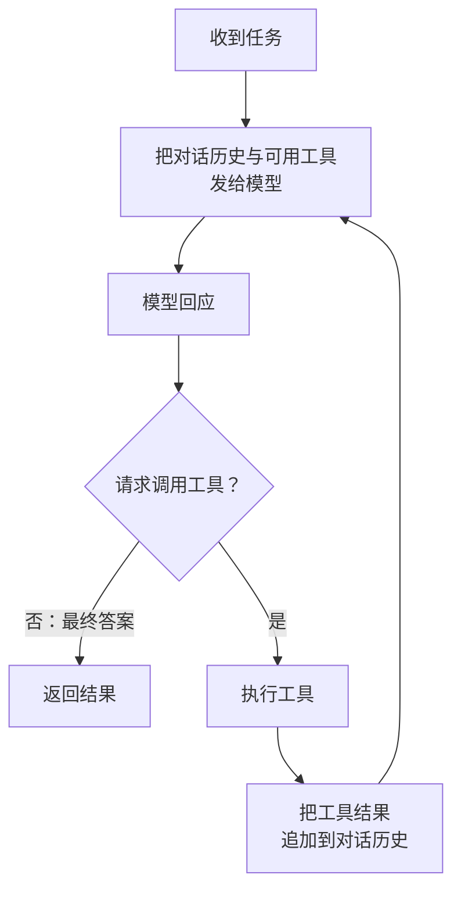

# 21.1 Agent 控制循环

第 20 章讨论的是如何服务一个模型：请求进入，词元（token）流出。Agent 在此之上多了一层：模型不只生成回答，
还可以请求调用工具；运行时执行工具，把结果交还模型，再由模型决定下一步，如此多步推进，直到任务完成。
模型怎样作出决定不在本书范围之内，本章只讨论承载这一过程的运行时。从运行时的角度看，Agent
是一个控制循环，它所面对的并发问题，第三部分都已讨论过。

## 21.1.1 控制循环

Anthropic 在总结与客户共同构建 Agent 的经验时，区分了两类系统：**工作流**（workflow）
按预先写定的代码路径编排模型与工具；**Agent** 则由模型动态地决定自己的步骤和工具的使用
[[Anthropic, 2024](#ref-anthropic-2024)]。对后者的实现，这篇文章的描述相当朴素：

```text
Agents can handle sophisticated tasks, but their implementation is often
straightforward. They are typically just LLMs using tools based on
environmental feedback in a loop.
```

即 Agent 能处理复杂的任务，实现却往往很直接：通常只是一个在循环中依据环境反馈使用工具的语言模型。

这一形式有其学术来源。ReAct 让语言模型交替生成推理轨迹与面向任务的动作：推理帮助模型制定、
跟踪和修正行动计划，动作则让模型与知识库或环境等外部来源交互、取得新的信息；
论文在问答与事实核查任务中让模型调用一个简单的 Wikipedia API，以此缓解纯推理中的幻觉与错误传播
[[Yao et al., 2023](#ref-yao-et-al-2023)]。Toolformer 则训练模型自行决定调用哪个 API、何时调用、
传入什么参数，以及如何把结果纳入后续的生成 [[Schick et al., 2023](#ref-schick-et-al-2023)]。Weng
的综述把基于语言模型的 Agent 拆成规划、记忆与工具使用三个组成部分 [[Weng, 2023](#ref-weng-2023)]。以
Anthropic 的 API 为例，模型打算调用工具时，响应中会带有一个工具调用块，其中写明工具名与参数
[[Anthropic, 2024](#ref-anthropic-2024)]。运行时要做的，就是识别这个块、执行工具、把结果追加回上下文。



下面的程序用一个确定性的桩模型代替真实模型，把这个循环写成可运行的 Go 代码。桩模型按顺序给出预先写好的
回应，不读历史内容，这样输出是固定的；循环本身与接入真实模型时没有区别。

```go {run=true}
package main

import (
	"context"
	"errors"
	"fmt"
)

type Message struct{ Role, Text string }

// Reply 是模型的一次回应：Call 非空表示请求调用工具，否则 Final 就是最终答案。
type Reply struct {
	Call  *Call
	Final string
}

type Call struct{ Tool, Arg string }

type Model func(ctx context.Context, history []Message) (Reply, error)

type Tool func(ctx context.Context, arg string) (string, error)

var errStepLimit = errors.New("agent: step limit reached")

func run(ctx context.Context, model Model, tools map[string]Tool, task string, maxSteps int) (string, error) {
	history := []Message{{"user", task}}
	for step := 1; step <= maxSteps; step++ {
		if err := ctx.Err(); err != nil {
			return "", err
		}
		r, err := model(ctx, history)
		if err != nil {
			return "", err
		}
		if r.Call == nil {
			return r.Final, nil
		}
		out, err := invoke(ctx, tools, *r.Call)
		if err != nil {
			out = "error: " + err.Error() // 工具出错也作为观察结果交给模型
		}
		fmt.Printf("  step %d: %s(%s) -> %s\n", step, r.Call.Tool, r.Call.Arg, out)
		history = append(history,
			Message{"assistant", r.Call.Tool + "(" + r.Call.Arg + ")"},
			Message{"tool", out})
	}
	return "", errStepLimit
}

func invoke(ctx context.Context, tools map[string]Tool, c Call) (string, error) {
	t, ok := tools[c.Tool]
	if !ok {
		return "", fmt.Errorf("unknown tool %q", c.Tool)
	}
	return t(ctx, c.Arg)
}

// scripted 是一个确定性的桩模型：依次给出预先写好的回应，不看历史内容。
func scripted(replies ...Reply) Model {
	return func(ctx context.Context, history []Message) (Reply, error) {
		n := len(history) / 2 // 已完成的工具调用次数
		if n >= len(replies) {
			return replies[len(replies)-1], nil
		}
		return replies[n], nil
	}
}

func main() {
	versions := map[string]string{"loopvar": "Go 1.22", "iter": "Go 1.23"}
	ctx, cancel := context.WithCancel(context.Background())
	defer cancel()
	tools := map[string]Tool{
		"lookup": func(ctx context.Context, arg string) (string, error) {
			if v, ok := versions[arg]; ok {
				return v, nil
			}
			return "", fmt.Errorf("no entry for %q", arg)
		},
		"stop": func(ctx context.Context, arg string) (string, error) {
			cancel() // 模拟用户在工具执行期间按下「停止」
			return "stopped", nil
		},
	}

	fmt.Println("任务 1")
	m1 := scripted(
		Reply{Call: &Call{"lookup", "rangefunc"}},
		Reply{Call: &Call{"lookup", "iter"}},
		Reply{Final: "iter 包随 Go 1.23 发布"})
	report(run(ctx, m1, tools, "iter 包何时发布？", 8))

	fmt.Println("任务 2")
	m2 := scripted(Reply{Call: &Call{"lookup", "loopvar"}}) // 永远只请求工具
	report(run(ctx, m2, tools, "反复查询", 3))

	fmt.Println("任务 3")
	m3 := scripted(Reply{Call: &Call{"stop", ""}}, Reply{Final: "不会到达"})
	report(run(ctx, m3, tools, "中途取消", 8))
}

func report(answer string, err error) {
	if err != nil {
		fmt.Println("  错误:", err)
		return
	}
	fmt.Println("  答案:", answer)
}
```

```text
任务 1
  step 1: lookup(rangefunc) -> error: no entry for "rangefunc"
  step 2: lookup(iter) -> Go 1.23
  答案: iter 包随 Go 1.23 发布
任务 2
  step 1: lookup(loopvar) -> Go 1.22
  step 2: lookup(loopvar) -> Go 1.22
  step 3: lookup(loopvar) -> Go 1.22
  错误: agent: step limit reached
任务 3
  step 1: stop() -> stopped
  错误: context canceled
```

三个任务分别对应循环的三种出口。任务 1 中，第一次工具调用失败，错误没有终止循环，而是作为观察结果交还
模型，模型据此改换参数再试；21.2 会看到，MCP 在协议层面也把这类工具执行错误与协议错误区分开来。
任务 2 中，模型始终不给出最终答案，循环由步数上限终止。Anthropic 的文章同样建议为 Agent 设置停止条件，
例如最大迭代次数，以保持对运行的控制 [[Anthropic, 2024](#ref-anthropic-2024)]。任务 3 中，工具执行期间
context 被取消，循环在下一步开始前检查到取消并返回。`ctx` 同时传给了模型与每个工具，取消信号
如何穿过这些层次，是 21.3 的主题。

桩模型让输出可以复现，适合检验运行时本身：循环的出口、错误的处理与取消。Agent 的行为则要用另一种方式检验：
真实模型每次运行的输出都可能不同，一次运行的结果说明不了多少问题。examen 是一个对 Agent
和基于模型的程序做实验的服务，它对任务、被测系统、模型与环境的每种组合重复运行多次，
度量运行之间的离散程度，报告的每个数字都附带区间，落在噪声范围之内的差异就作为噪声报告
[[Ou, 2026a](#ref-ou-2026a)]。

这个循环中没有任何机器学习的成分。它所需要的是把上下文、工具集合与停止条件组织正确，
并让它在并发、失败与取消之下仍然可靠。

## 21.1.2 显式的状态

上面的 `run` 把状态隐含在控制流里：此刻是在等模型还是在等工具，只能从程序计数器推断。
一次长时间运行的任务可能持续数分钟、调用几十次工具，此时更好的做法是把状态显式化。Ou 在讨论 Agent
的**运行框架**（harness）时，把一次运行的职责分给几方：模型提出下一步的建议，
运行框架负责排序并持久记录每一步，工具与外部系统承载实际的影响；运行状态也应当显式地区分「等待模型」
「等待工具」「等待审批」「取消中」等，客户端不应从输出流中不再出现新的词元去猜测发生了什么
[[Ou, 2026b](#ref-ou-2026b)]。

显式的状态在工程上带来三点好处：**可观测**，任一时刻都能报告运行停在哪一步；**可持久化与可恢复**，
状态写入存储后，进程崩溃或迁移时可以从断点继续，而不必从头再来；**可控**，超时、重试、预算与人工介入
都可以挂在明确的状态转移上。

managed-agents 是一个为不同厂商的托管 Agent 会话提供统一 Go 接口的库 [[Ou, 2026c](#ref-ou-2026c)]。
它把对外可见的生命周期定义为一个有序的枚举，并把「状态只能前进」写成可执行的检查：

```go
// State is the externally visible lifecycle of a managed session.
type State uint8

// ……
const (
	StateUnknown State = iota
	StatePending
	StateRunning
	StateDone
	StateFailed
)
```

```go
	if previous.State.Valid() {
		if previous.State.Terminal() && current.State != previous.State {
			return fmt.Errorf("%w: terminal state changed", ErrContract)
		}
		if stateRank(current.State) < stateRank(previous.State) {
			return fmt.Errorf("%w: state regressed from %s to %s", ErrContract, previous.State, current.State)
		}
		// ……
```

后一段摘自 `ValidateObservation`，它比较同一会话的前后两次观察：终态不得再改变，状态不得倒退，
累计用量不得减少。类型签名表达不了这类关于观察序列的约束，于是这个库把它们写成函数，
并另附一套黑盒测试，要求每个适配器都通过。

状态显式化之后，持久化与恢复才有落脚点。topos 是一个 Agent 会话运行时，它把一次会话保存为只追加的
类型化事件日志：用户消息、每次工具调用及其结果、每次模型请求，以及会话状态 [[Ou, 2026d](#ref-ou-2026d)]。
模型看到的对话记录由日志计算得出：

```go
// Fold renders the transcript of one thread from a session's events
// (spec 004). thread is "" for the session's own thread. The fold is
// pure: the same events give byte-identical output.
func Fold(events []Event, thread string) (Transcript, error) {
```

折叠是纯函数，同样的事件序列总是得到逐字节相同的对话记录，因此任何一个执行器都可以接手日志，继续这次会话。
它的运行框架在一轮对话中反复执行单步：先折叠日志，检查预算，构造请求，发给模型，再执行模型请求的工具调用，
直到某个停止原因成立。`session` 包列出的停止原因包括正常结束（`end_turn`）、预算耗尽（`budget`）、
轮次超时（`turn_limit`）、输出上限（`output_limit`）、被中断（`interrupted`）与出错（`error`）等。
停止条件也不一定是预算：agon 让多个评审方反复质询一份代码改动，除了轮次上限与共享的词元预算之外，
连续两轮没有新的质疑时也会终止，这是一种以收敛为依据的停止条件 [[Ou, 2026e](#ref-ou-2026e)]。

持久化并不能让工具的副作用变得可以重放。进程若在工具执行期间崩溃，日志中只有调用、没有结果，
而这次调用对外部系统的影响是未知的：写入可能已经提交，也可能没有。topos 恢复会话时，对无法确认能否
安全重复的调用不再重新执行，而是给它补上一个结果，告诉模型：

```text
The runner stopped while this call ran. Its effects are unknown; inspect
the machine before repeating it.
```

即执行器在这次调用运行期间停止了，其影响未知，重复调用之前应先检查机器的状态。
运行框架的讨论给出了同样的规则：状态转移必须在命令发出之前提交，恢复时要先查明外部影响的结果，
再决定是否重放 [[Ou, 2026b](#ref-ou-2026b)]。这与数据库和分布式系统中的幂等与补偿问题是同一类问题，Agent
并没有使它更简单。

## 21.1.3 每个 Agent 一个 goroutine，还是集中编排

单个 Agent 是一个循环；多个 Agent 同时运行时，就回到了并发设计。常见的取向有两种。

**每个 Agent 一个 goroutine。** 这是最自然的形态：每个 Agent 的循环是一个 goroutine，彼此隔离。goroutine
的创建与切换开销很低（[第 9 章](../../part3concurrency/ch09sched/readme.md)），而 Agent
的循环大部分时间在等待模型或工具的 I/O，正是 goroutine 擅长的负载。一个主 Agent 派生若干子 Agent
并行处理子任务，就是扇出与扇入（[10.7](../../part3concurrency/ch10chan/pattern.md)）：主 goroutine 启动子
goroutine，经由通道或 errgroup 收集结果。Anthropic 所说的「编排者-工作者」（orchestrator-workers）工作流，
即由一个中心模型动态拆分任务、分派给工作者并汇总结果 [[Anthropic, 2024](#ref-anthropic-2024)]，
在运行时层面也是这一结构。

**集中编排。** 当大量 Agent 争用同一份稀缺资源时，各自独立运行就不够了。最典型的稀缺资源是模型后端：
无论是第 20 章那样的进程内推理服务，还是有速率限制的远端 API，吞吐都是有限的。成千上万个 Agent goroutine
同时发起推理请求，会压垮后端。这时需要一个集中的调度层，把所有 Agent 的模型调用收拢到一处，
统一排队、限流和安排优先级。其形态与 [18.2](../ch18gpu/sched.md) 和 [20.3](../ch20inference/serving.md)
反复出现的结构相同：一份共享资源由单一的拥有者管理，众多使用者通过通道与之通信。Agent 越多，
这个汇合点上的背压与公平性就越重要，这是 21.3 的话题。

## 21.1.4 Agent 站在第 20 章之上

Agent 的每一次「思考」都是一次第 20 章意义上的推理请求，即那条流式输出、需要背压与取消的词元流。因此
Agent 是第 20 章推理服务的客户端，它的控制循环反复消费 [20.3](../ch20inference/serving.md) 中的那条流。

边界也随之改变。第 18 至 20 章的核心边界是进程内的 FFI，即经由 cgo 通往设备和推理运行时；
到了 Agent 这一层，模型后端往往在另一个进程甚至另一台机器上，边界变成了网络 RPC。[18.1](../ch18gpu/boundary.md)
已经指出，进程内的 FFI 边界与进程间的边界，是同一个设计选择的不同位置。
边界的形式变了，要求没有变：依然需要流式、背压与取消。

循环在哪里运行，也会改变失败的语义。managed-agents 面对的厂商形态各不相同：有的在远端托管会话，
返回一个可以从任何进程轮询的标识；有的在调用方进程内驱动模型循环，只把沙箱放在远端；
有的完全是内存中的库，进程结束，会话也随之结束。它的 README 指出，把一个阻塞的进程内执行器包装成
可轮询的会话很容易，也能通过所有测试，但进程第一次重启时，这次运行就会无声地丢失，而不是报告一个错误
[[Ou, 2026c](#ref-ou-2026c)]。它的做法是让接口保持很小，同时把这些差异显式地声明出来：

```go
type Runtime interface {
	// ……
	// Capabilities reports what this runtime can do. It creates nothing and
	// mutates nothing, so a caller may ask before deciding to start at all.
	Capabilities(context.Context) (Capabilities, error)
	// ……
	// Start creates the session and returns as soon as it exists, without
	// waiting for it to finish.
	Start(context.Context, SessionSpec) (SessionRef, error)

	// Poll reports the current state of a session without blocking. Successive
	// observations must satisfy ValidateObservation.
	Poll(context.Context, SessionRef) (Status, error)
	// ……
	// Cancel stops a live session. Cancelling a session that has already
	// finished is success, and the evidence stays readable afterwards.
	Cancel(context.Context, SessionRef) error
	// ……
}
```

接口的文档要求，每个可能阻塞的方法都接受一个 context 并遵守它的取消，以便从外部放弃一次会话。`Capabilities`
则声明这个运行时能否在进程重启后接续会话、能否取消、能否评分等；
调用方请求的能力超出声明时，`ValidateCapabilities` 会在创建任何远端资源之前拒绝。这与 `io.Reader`
一类小接口的设计取向一致：接口只规定最少的行为，接口之外的差异不靠调用方猜测，而是被明确地报告出来。

## 小结

把模型的决策能力放在一边，Agent 在运行时看来是一个控制循环：把上下文发给模型，模型要么给出答案，
要么请求调用工具；运行时执行工具，把结果追加回上下文，如此反复，直到答案出现、停止条件成立或被取消。
把循环的状态显式化，换来可观测、可恢复与可控；持久化的事件日志让任何执行器都能接手一次会话，
但工具的外部影响不会因此变得可以重放，恢复时须先核对。多个 Agent 的并发，在「每个 Agent 一个 goroutine」
与「集中编排稀缺的模型后端」之间权衡，后者仍是「单一拥有者加通道」的形态。Agent
是第 20 章推理服务的客户端，它把流式、背压与取消的要求带到了一个跨越网络的循环中。

循环中最关键的动作是调用工具。下一节 [21.2](./mcp.md) 讨论工具本身：工具如何描述、如何分发，
以及 Model Context Protocol 如何把工具的接入标准化。

## 延伸阅读

- <a id="ref-anthropic-2024"></a>[Anthropic, 2024] Anthropic. *Building Effective Agents.* December 19,
  2024. https://www.anthropic.com/research/building-effective-agents
  （署名 Erik S. 与 Barry Zhang；区分工作流与 Agent，把 Agent 描述为
  在循环中依据环境反馈使用工具的语言模型，并讨论停止条件与编排者-工作者等模式）
- <a id="ref-ou-2026a"></a>[Ou, 2026a] Changkun Ou. examen. https://github.com/latere-ai/examen, 2026.（对
  Agent 与基于模型的程序做实验与评测的服务；每种组合重复运行，比较结果附带区间；尚处于早期版本）
- <a id="ref-ou-2026b"></a>[Ou, 2026b] Changkun Ou. *运行框架.* AI as an Infrastructure, 2026.
  https://aaai.latere.ai/zh/orchestration/the-harness
  （运行框架的职责划分、显式状态机，以及恢复时先核对外部影响再重放的规则）
- <a id="ref-ou-2026c"></a>[Ou, 2026c] Changkun Ou. managed-agents.
  https://github.com/latere-ai/managed-agents, 2026.（托
  管 Agent 会话的统一 Go 接口；`Runtime`、`Capabilities` 与 `ValidateObservation`）
- <a id="ref-ou-2026d"></a>[Ou, 2026d] Changkun Ou. topos. https://github.com/latere-ai/topos, 2026.（Agent
  会话运行时；只追加的事件日志、纯函数 `session.Fold` 与 `harness` 包中的单步循环）
- <a id="ref-ou-2026e"></a>[Ou, 2026e] Changkun Ou. agon. https://github.com/latere-ai/agon, 2026.（对
  Agent 代码改动的对抗式评审；以稳定状态、轮次上限与共享预算为终止条件）
- <a id="ref-schick-et-al-2023"></a>[Schick et al., 2023] Timo Schick 等. *Toolformer: Language Models Can
  Teach Themselves to Use Tools.* NeurIPS, 2023. https://arxiv.org/abs/2302.04761
  （以自监督方式训练模型决定调用哪个 API、何时调用、传什么参数；arXiv 首版 2023 年 2 月 9 日）
- <a id="ref-weng-2023"></a>[Weng, 2023] Lilian Weng. *LLM Powered Autonomous Agents.* June 23, 2023.
  https://lilianweng.github.io/posts/2023-06-23-agent/
  （Agent 的规划、记忆、工具使用等组成部分综述）
- <a id="ref-yao-et-al-2023"></a>[Yao et al., 2023] Shunyu Yao 等. *ReAct: Synergizing Reasoning and
  Acting in Language Models.* ICLR, 2023. https://arxiv.org/abs/2210.03629
  （推理与行动交替的循环，Agent 控制循环的代表性形式化；arXiv 首版 2022 年 10 月 6 日）
- 本书 [第 9 章 goroutine 调度器](../../part3concurrency/ch09sched/readme.md)、[第
  10 章 通道与 select](../../part3concurrency/ch10chan/readme.md)、[10.7
  工程实践与跨语言对照](../../part3concurrency/ch10chan/pattern.md)、[18.1
  跨越 FFI 边界](../ch18gpu/boundary.md)、[18.2
  调度器与阻塞的外部调用](../ch18gpu/sched.md)、[20.3
  服务、批处理与流式](../ch20inference/serving.md)、[21.2
  工具调用与 MCP](./mcp.md)。
