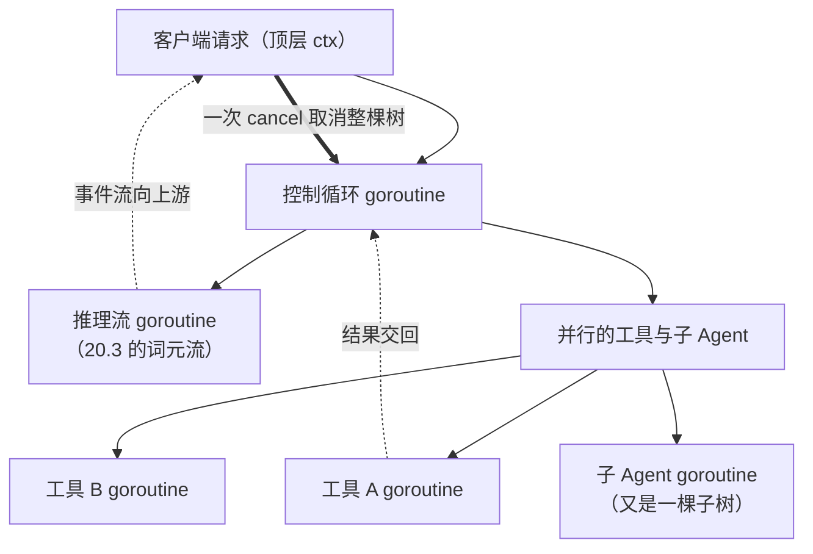

# 21.3 流式、背压与取消

[21.1](./loop.md) 给出了 Agent 的控制循环，[21.2](./mcp.md) 讨论了循环中的工具调用。一个能投入生产的
Agent，难处并不在循环的骨架，而在贯穿整条链路的三件事：流式、背压与取消。三者相互牵连，把它们统一起来的，
是 Go 程序员熟悉的结构：一棵由 context 绑定的 goroutine 树。本节用到的 context 与通道，分别见
[11.8](../../part3concurrency/ch11sync/context.md) 与
[第 10 章](../../part3concurrency/ch10chan/readme.md)。

## 21.3.1 整条链路都是流式的

先看数据在 Agent 中如何流动。请求从客户端进入 Agent 的控制循环；循环的每一步向模型发起一次推理，
这次推理是 [20.3](../ch20inference/serving.md) 讨论的流式词元（token）流；循环还会调用工具，
工具本身也可能很慢，或者以流的形式返回结果。流式因此不是某一层的特性，而是整条链路的常态。

用户不应在 Agent 执行几十步的过程中面对一个没有任何反馈的界面。模型正在输出什么、正在调用哪个工具、
工具返回了什么，都应在发生时呈现出来。这意味着 Agent 不只是消费下层的流，
还要生成一条自己的事件流交给上游：模型输出的词元、开始调用某个工具、工具返回结果。在 HTTP 上，
处理函数每写出一个事件，就用 `http.ResponseController` 的 `Flush`（Go 1.20 加入）把缓冲的数据推给客户端。
MCP 的 Streamable HTTP 采用同样的形状：服务器可以用只属于这次请求的 SSE 流作答，
流中先是进度等与请求相关的通知，最后是响应
[[Model Context Protocol, 2026](#ref-model-context-protocol-2026)]。

在 Go 中表示一条流，有两种常见的写法。一种是 goroutine 加通道：生产者在自己的 goroutine 中运行，
把元素发送到通道，消费者从通道接收；有缓冲的通道让生产与消费可以在时间上重叠。另一种是 Go 1.23
加入的迭代器 `iter.Seq`：生产者是一个函数，在消费者的调用栈上运行，每产出一个元素就调用一次 `yield`。
`iter` 包的文档写道：

```text
The function stops either when the sequence is finished or
when yield returns false, indicating to stop the iteration early.
```

即迭代器函数在序列结束时停止，或在 `yield` 返回 false、表示提前结束时停止。迭代器不需要额外的 goroutine，
消费者不取下一个元素，生产者就不会继续，背压是自然得到的；消费者提前退出 `for range` 时，
生产者也随之返回。代价是生产与消费不能重叠。生产者需要与网络 I/O 并行推进时，例如一边接收推理服务的输出、
一边向客户端转发，仍然要用 goroutine 与通道。

## 21.3.2 取消必须穿透每一层

除了流式，最硬的要求是取消。用户随时可能点击「停止」或关闭连接；一个子任务失败后，
并行运行的其他子任务也应当停止。一次取消必须能穿过 Agent 的每一层调用，这正是 context 的用途：
取消与截止时间沿着调用链传到每一个为这次请求工作的 goroutine [[Go Authors, 2026a](#ref-go-authors-2026a)]
[[Ajmani, 2014](#ref-ajmani-2014)]。

把一个 ctx 从最顶层的客户端请求一路传下去：进入控制循环，传给每一次推理，传给每一次工具调用，
再传给工具内部的每一次 HTTP 请求与数据库查询。

```go
// 同一个 ctx 贯穿循环、推理、工具，以及工具内部的 I/O
func (a *Agent) step(ctx context.Context) error {
	stream, err := a.model.InferStream(ctx, a.history) // 取消时停止生成
	if err != nil {
		return err
	}
	for ev, err := range stream { // stream 的类型是 iter.Seq2[Event, error]
		if err != nil {
			return err
		}
		if err := a.emit(ctx, ev); err != nil { // 把事件转发给上游客户端
			return err
		}
		if ev.ToolCall != nil {
			res, err := a.callTool(ctx, *ev.ToolCall) // 见 21.2，ctx 随调用传入
			if err != nil {
				return err
			}
			a.history = append(a.history, toolMsg(res))
		}
	}
	return ctx.Err()
}
```

取消的起点常常是 HTTP 连接。`net/http` 为服务端请求提供的 context，在客户端断开时就会被取消：

```go
// For incoming server requests, the context is canceled when the
// client's connection closes, the request is canceled (with HTTP/2),
// or when the ServeHTTP method returns.
func (r *Request) Context() context.Context {
```

MCP 的取消也与传输方式有关 [[Model Context Protocol, 2026](#ref-model-context-protocol-2026)]。在
Streamable HTTP 上，关闭这次请求的 SSE 响应流本身就是取消信号，服务器必须把客户端断开视为对该请求的取消，
这与上面 `Request.Context` 的行为相对应；在 stdio 上没有每个请求独立的流可以关闭，客户端必须发送
`notifications/cancelled` 通知，写明要取消的请求 `id`。收到取消通知的服务器应当停止处理、释放相关资源、
不再发送响应；但取消通知可能在处理完成之后才到达，双方都必须正确处理这种竞争。

官方 Go SDK 在 stdio 这类连接上把两端的 context 接了起来
[[modelcontextprotocol, 2026](#ref-modelcontextprotocol-2026)]。客户端一侧，发出请求的 ctx 被取消时，SDK
立即放弃等待响应，并在另一个 goroutine 中发出取消通知：

```go
	case ctx.Err() != nil:
		// ……
		conn.Retire(call, ctx.Err())
		go func() {
			notifyCtx, stop := context.WithTimeout(context.WithoutCancel(ctx), notifyCancellationTimeout)
			defer stop()
			_ = conn.Notify(notifyCtx, notificationCancelled, &CancelledParams{
				Reason:    ctx.Err().Error(),
				RequestID: call.ID().Raw(),
			})
		}()
```

发送通知用的 context 由 `context.WithoutCancel` 派生，否则这条通知会因为调用方的 ctx
已被取消而发不出去（`WithoutCancel` 的设计见 [11.8](../../part3concurrency/ch11sync/context.md)）。
服务器一侧，收到取消通知后取消对应请求的处理函数的 context：

```go
// A canceller is a jsonrpc2.Preempter that cancels in-flight requests on MCP
// cancelled notifications.
type canceller struct {
	conn *jsonrpc2.Connection
}

// Preempt implements [jsonrpc2.Preempter].
func (c *canceller) Preempt(ctx context.Context, req *jsonrpc.Request) (result any, err error) {
	if req.Method == notificationCancelled {
		// ……
		go c.conn.Cancel(id)
	}
	return nil, jsonrpc2.ErrNotHandled
}
```

于是 Agent 进程中的一次 `cancel()`，经过一条 JSON-RPC 通知，变成了工具服务器进程中处理函数的
`ctx.Done()`。

取消能走多远，取决于每一层是否配合。context 的取消是协作式的
（[11.8](../../part3concurrency/ch11sync/context.md)）：它只关闭 `Done` 通道，指望每一层主动检查并退出；
任何一层不理会 ctx，取消就在那里中断。推理服务也是如此：只有当它在请求的 context 被取消时停止生成，20.1
中每个请求占用的 KV 缓存 才会随之释放。最难处理的一类，是 [18.2](../ch18gpu/sched.md) 讨论过的阻塞在 cgo
调用中的工具：运行时无法抢占一个正在执行 C 代码的线程（[15.6](../../part5toolchain/ch15compile/cgo.md)），
协作式的 context 更无能为力，上层的取消只能等这次调用自己返回。协作式取消的边界，止于不可抢占的 FFI 边界。
设计工具时应尽量使用可取消的 I/O；不可取消的阻塞调用，可以放到单独的进程中，取消时直接结束那个进程。

取消也不等于回滚。工具的外部影响在取消的那一刻可能已经发生，21.1 中 topos 对执行期间中断的调用标记为
「影响未知」，就是这个原因。topos 的运行框架为每一步派生一个可取消的 context，并启动一个监视 goroutine，
在收到中断信号时取消它 [[Ou, 2026a](#ref-ou-2026a)]：

```go
// interruptible is the context one step's request and calls run under:
// ……
func (t *turn) interruptible(ctx context.Context) (context.Context, func()) {
	sctx, cancel := context.WithCancel(ctx)
	// ……
	// The watcher ends before the step's stop returns, so a cut it makes
	// is the step's own and never the next one's.
	done, exited := make(chan struct{}), make(chan struct{})
	go func() {
		defer close(exited)
		// ……
	}()
	return sctx, func() {
		close(done)
		<-exited
		cancel()
	}
}
```

返回的停止函数先通知监视 goroutine 结束，再等待它真正退出，然后才取消 context，
这保证一次中断只作用于它所属的那一步，不会误伤下一步。一轮对话因取消而结束时，运行框架仍要把「已中断」
的状态写入日志，此时用的同样是 `WithoutCancel`：

```go
	// Every other way out of a turn still closes it, so the header never
	// stays running: a cancel as interrupted, a failure of the harness as
	// error with its session.error.
	closing := context.WithoutCancel(ctx)
	if ctx.Err() != nil {
		err = t.finish(closing, session.StopInterrupted, "canceled")
```

## 21.3.3 背压与扇出

第三件事是背压，它与流式、取消是同一个系统的三个侧面。

沿 21.3.1 的流来看：客户端读得慢，Agent 向上游发送事件的通道就会填满；通道满了，Agent 消费模型词元
流的速度就被迫放慢；这又会使模型的生成阻塞（[20.3](../ch20inference/serving.md)），同时一直占用 KV 缓存。
慢消费者的压力沿着整条流一路传回最底层的设备。这是有界通道作为背压阀的作用：整条链路按最慢的一环推进，
而不是让快的一端把内存堆满。关键在于每一跳的通道都必须有界，背压才能传导，
而不是在某处积压成无界增长的内存。

下面的程序把这条链路缩到最小：一个模拟流式推理的生产者，经由容量为 2 的通道把词元交给客户端；
客户端读到第 3 个词元 后断开，生产者应当随之退出。

```go {run=true}
package main

import (
	"context"
	"fmt"
)

// generate 模拟一次流式推理：逐个产出 token，直到产完或 ctx 被取消。
// 发送与 ctx.Done() 放在同一个 select 里，下游不读时它阻塞，取消时它退出。
func generate(ctx context.Context, out chan<- string, produced *int) error {
	defer close(out)
	for i := 0; ; i++ {
		select {
		case out <- fmt.Sprintf("tok%d", i):
			*produced++
		case <-ctx.Done():
			return context.Cause(ctx)
		}
	}
}

func main() {
	const capacity = 2 // 有界缓冲：生产者最多领先消费者 2 个 token
	ctx, cancel := context.WithCancelCause(context.Background())
	tokens := make(chan string, capacity)
	produced := 0
	done := make(chan error)
	go func() { done <- generate(ctx, tokens, &produced) }()

	received := 0
	for tok := range tokens {
		received++
		fmt.Println("client got", tok)
		if received == 3 {
			cancel(fmt.Errorf("client closed the stream"))
			break
		}
	}
	err := <-done // 等生产者真正退出，确认没有泄漏的 goroutine
	fmt.Println("producer exited:", err)
	fmt.Println("produced - received <= capacity:", produced-received <= capacity)
}
```

```text
client got tok0
client got tok1
client got tok2
producer exited: client closed the stream
produced - received <= capacity: true
```

生产者实际产出了多少个词元 取决于调度，可能是 3、4 或 5 个，但不会超过已读数量加上通道容量，
这就是有界通道给出的保证。`select` 同时等待发送与 `ctx.Done()`：消费者不读时生产者阻塞在发送上，
消费者断开后，生产者经由取消退出，取消的原因由 `context.Cause` 取回
（[11.8](../../part3concurrency/ch11sync/context.md)）。主 goroutine 最后等待 `done`，确认生产者已经返回，
而不是把它遗留在一个无人接收的通道上。

Agent 派生并行的子任务时，例如同时调用多个工具或派生多个子 Agent，背压与取消还要与扇出、扇入结合。
`golang.org/x/sync/errgroup` 把这三者封装在一起 [[Go Authors, 2026b](#ref-go-authors-2026b)]，其实现见
[10.7](../../part3concurrency/ch10chan/pattern.md)：

```go
// 并行调用多个工具：共享一个可取消的 ctx，任一失败则其余一并取消
g, ctx := errgroup.WithContext(ctx)
g.SetLimit(4) // 至多 4 个工具同时执行
results := make([]Result, len(calls))
for i, call := range calls { // Go 1.22 起，每轮迭代都有各自的 i 与 call
	g.Go(func() error {
		r, err := a.callTool(ctx, call)
		results[i] = r
		return err
	})
}
err := g.Wait() // 等待全部结束，返回第一个错误
```

自 Go 1.22 起，循环变量在每轮迭代中都是新的实例（[6.1](../../part2lang/ch06func/func.md)），过去为闭包写的
`i, call := i, call` 已经不再需要。`SetLimit` 与 `TryGo` 是 2022 年加入的 [[Ou, 2022](#ref-ou-2022)]，
`SetLimit` 设置上限后，`Go` 在启动 goroutine 之前先向一个容量等于上限的通道发送一个令牌：

```go
func (g *Group) Go(f func() error) {
	if g.sem != nil {
		g.sem <- token{}
	}

	g.wg.Add(1)
	go func() {
		defer g.done()

		// It is tempting to propagate panics from f()
		// up to the goroutine that calls Wait, but
		// it creates more problems than it solves:
		// ……
		// See #53757, #74275, #74304, #74306.

		if err := f(); err != nil {
			// ……
		}
	}()
}
```

名额用尽时，`Go` 阻塞在这次发送上，调用方随之放慢，这是阻塞式的背压。代码中的注释还记录了一次反复：x/sync
的 v0.14.0 曾让 `Wait` 把子 goroutine 的 panic 传回调用方，v0.16.0 又撤销了这一改动，理由是这会任意推迟
panic、使 bug 更难发现，把 panic 的调用栈变成一个普通的值、使崩溃监控工具看不到它，还可能因死锁而把 panic
完全掩盖 [[Donovan, 2025](#ref-donovan-2025)]。对 Agent 而言，这意味着进程内运行的工具一旦 panic，
errgroup 不会替调用方兜底，未恢复的 panic 会终止整个进程；不受信任或不够稳定的工具代码，要么在调用处自行
`recover`，要么放到进程之外，经由 MCP 调用。

背压还有另一种策略：不等待，直接拒绝。`TryGo` 在名额已满时立即返回 false。跨越网络时，
拒绝往往比阻塞更合适：阻塞会一直占用连接与 goroutine，拒绝则把决定权交还调用方，由它选择稍后重试或放弃。
pons 在转发工具调用时，为整个进程、每个调用者和每个连接分别限制同时在途的请求数，超出时以「请求过多」
的错误立即拒绝 [[Ou, 2026b](#ref-ou-2026b)]：

```go
// PerConnection is how many requests one connection has in flight in one
// process.
const PerConnection = 16
```

```go
// connectionPlace takes one of a connection's places in flight.
func (p *places) connectionPlace(connection string) (func(), error) {
	p.mu.Lock()
	defer p.mu.Unlock()
	if p.connections[connection] >= p.connection {
		return nil, apierr.Fail(apierr.CodeRateLimited, "connection_inflight="+strconv.Itoa(p.connection))
	}
	p.connections[connection]++
	return func() {
		p.mu.Lock()
		defer p.mu.Unlock()
		if p.connections[connection]--; p.connections[connection] <= 0 {
			delete(p.connections, connection)
		}
	}, nil
}
```

取得名额时返回一个释放函数，调用方在请求结束时调用它，这与 errgroup 中 `g.done`
从信号量通道接收令牌的作用相同；区别只在于名额不足时，一个阻塞等待，一个立即拒绝。

## 21.3.4 一棵由 context 绑定的 goroutine 树

把本节的内容合在一起，一个 Agent 在运行时看来是一棵由 context 绑定的 goroutine 树：



树的每个节点是一个 goroutine：控制循环、推理流、并行的工具，以及递归派生的子 Agent。在树的每条边上，
流式让事件向上游流动，背压让慢的节点抑制上游的生产，取消让根节点的一个信号到达整棵子树。
要让这棵树在取消后真正收拢，还需要等待每个子节点退出，这是结构化并发关心的问题
（[11.8](../../part3concurrency/ch11sync/context.md)、
[10.7](../../part3concurrency/ch10chan/pattern.md)）。树中的每个部件，goroutine、通道、`select`、context
与 errgroup，本书前面都已讨论过。Agent 是一类新的负载，在运行时层面却没有要求新的机制。

## 小结

生产级 Agent 的难处不在循环骨架，而在贯穿全链的流式、背压与取消。流式是常态：Agent 消费下层的词元流，
又生成自己的事件流交给上游；通道与迭代器是两种表示流的方式，前者允许生产与消费重叠，后者自然地带有背压。
取消必须穿透每一层：从 HTTP 连接的断开，到 MCP 的取消通知，再到工具处理函数的 `ctx.Done()`，官方 Go SDK
把这几段接了起来；但取消是协作式的，止于不可抢占的 cgo 调用，也不能撤销已经发生的外部影响。
背压依靠每一跳的有界通道传导，名额不足时可以阻塞等待，也可以立即拒绝；并行的扇出用 errgroup 把共享的 ctx、
并发上限与扇入合在一起。三者合起来，Agent 是一棵由 context 绑定的 goroutine 树。

## 本部分小结

第 21 章把 Agent 归结为控制循环、工具调用与一棵取消树，没有用到机器学习，用到的是第 9 至 11 章的调度、
通道与 context。这也是第六部分各章的共同结论：GPU、图形、推理与 Agent 这些新的负载，在运行时层面要求的
不是新的机制，而是已有原理在新场景中的应用，包括 FFI 边界的成本核算、单一拥有者加通道的资源管理，
以及协作式的取消与背压。全书最后的[结束语](../../finalwords.md)讨论 Go 未来的方向。

## 延伸阅读

- <a id="ref-ajmani-2014"></a>[Ajmani, 2014] Sameer Ajmani. *Go Concurrency Patterns: Context.* The Go
  Blog, 2014. https://go.dev/blog/context
  （context 的设计意图：把取消与截止时间贯穿一棵 goroutine 树）
- <a id="ref-donovan-2025"></a>[Donovan, 2025] Alan Donovan. errgroup: revert propagation of panics.
  x/sync commit 7fad2c9213, 2025. https://go.dev/cl/682935
  随 x/sync v0.16.0 发布。
  （撤销 v0.14.0 中让 `Wait` 传回 panic 的改动，并在 `Go` 中留下解释原因的注释）
- <a id="ref-go-authors-2026a"></a>[Go Authors, 2026a] The Go Authors. *Package context.*
  https://pkg.go.dev/context
  （协作式取消沿调用树传播，Agent 取消树的机制基础）
- <a id="ref-go-authors-2026b"></a>[Go Authors, 2026b] The Go Authors.
  *Package golang.org/x/sync/errgroup.* https://pkg.go.dev/golang.org/x/sync/errgroup
  （扇出、扇入与共享的可取消 ctx，一个失败则其余一并取消；本节摘录依据 x/sync v0.24.0）
- <a id="ref-model-context-protocol-2026"></a>[Model Context Protocol, 2026] Model Context Protocol.
  *Specification,* revision 2026-07-28. https://modelcontextprotocol.io/specification/2026-07-28
  （Streamable HTTP 中请求范围的 SSE 流；按传输区分的取消：
  断开 SSE 流即取消，stdio 上发送 `notifications/cancelled`）
- <a id="ref-modelcontextprotocol-2026"></a>[modelcontextprotocol, 2026] modelcontextprotocol.
  *Official Go SDK.* v1.8.0, 2026. https://github.com/modelcontextprotocol/go-sdk
  （客户端在 ctx 取消时发出 `notifications/cancelled`，服务器据此取消处理函数的 context）
- <a id="ref-ou-2022"></a>[Ou, 2022] Changkun Ou. x/sync/errgroup: add TryGo and SetLimit to control
  concurrency. x/sync commit 0976fa681c, 2022. https://go.dev/cl/405174
  随 x/sync v0.1.0 发布。
  （以容量等于上限的通道作为信号量，限制同时运行的 goroutine 数）
- <a id="ref-ou-2026a"></a>[Ou, 2026a] Changkun Ou. topos. https://github.com/latere-ai/topos, 2026.
  （Agent 会话运行时；每一步可中断的 context，以及取消后用 `context.WithoutCancel` 记录终止状态）
- <a id="ref-ou-2026b"></a>[Ou, 2026b] Changkun Ou. pons. https://github.com/latere-ai/pons, 2026.
  （转发工具调用的服务；按进程、调用者与连接限制在途请求，超出时立即拒绝）
- 本书 [6.1 函数调用](../../part2lang/ch06func/func.md)、
  [第 10 章 通道与 select](../../part3concurrency/ch10chan/readme.md)、
  [10.7 工程实践与跨语言对照](../../part3concurrency/ch10chan/pattern.md)、
  [第 11 章 同步原语与模式](../../part3concurrency/ch11sync/readme.md)、
  [11.8 上下文](../../part3concurrency/ch11sync/context.md)、
  [15.6 cgo](../../part5toolchain/ch15compile/cgo.md)、
  [18.2 调度器与阻塞的外部调用](../ch18gpu/sched.md)、
  [20.3 服务、批处理与流式](../ch20inference/serving.md)、
  [21.1 Agent 控制循环](./loop.md)、[21.2 工具调用与 MCP](./mcp.md)。
